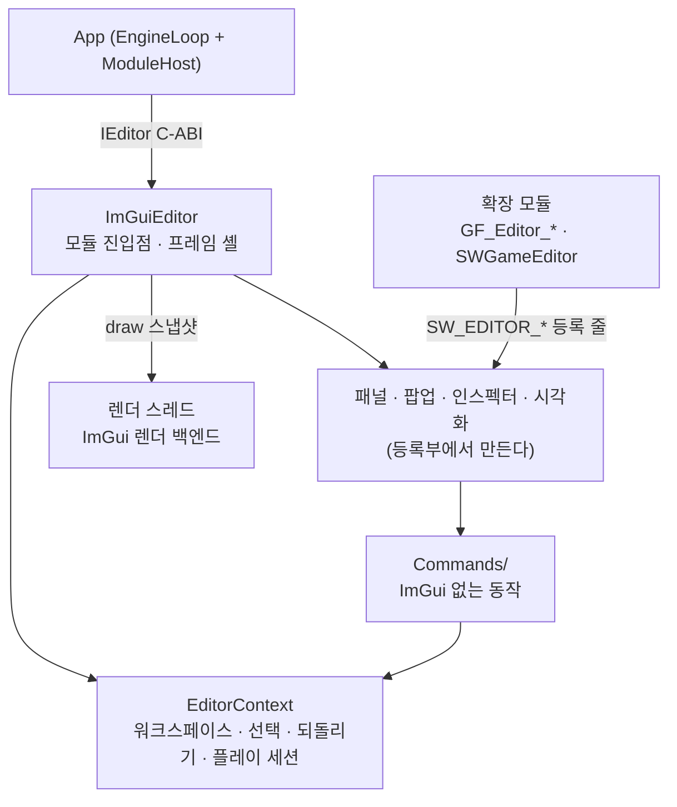

# Editor — 개발용 에디터 모듈

## 1. 이것은 무엇이고 왜 있나

에디터는 씬을 만들고 고치고, 게임을 그 자리에서 돌려 보며 디버깅하는 도구입니다. 언리얼 에디터나 유니티 에디터가 하는 일을 작게 한 것입니다.
화면은 Dear ImGui 로 그립니다. 계층 창(Hierarchy), 인스펙터, 씬 뷰와 게임 뷰, 콘텐츠 브라우저, 출력 로그, 프로파일러, 그리고 애니메이션 그래프나 시퀀서 같은 도구 창이 있습니다.

에디터는 개발(Dev) 빌드에서만 있습니다. `EditorModule` 이라는 SHARED DLL 로 빌드되고, App 이 `-EnableEditor` 인자를 받으면 불러 씁니다.
배포(Shipping) 빌드에서는 이 폴더의 코드가 통째로 빠집니다. 그래서 게임 코드는 에디터에 기대면 안 됩니다. 게임 코드가 `Editor/` 를 include 하면 Shipping 빌드가 깨집니다.

에디터가 없으면 씬 파일을 손으로 고치고, 값을 바꿀 때마다 다시 빌드해야 합니다. 에디터는 그 일을 화면 위에서 하게 하고, 원본 이미지와 모델을 엔진 형식으로 바꾸는 임포트도 맡습니다.
키트와 게임은 자기 에디터 확장 모듈로 패널, 시각화, 인스펙터, 커맨드를 더할 수 있습니다.

## 2. 머릿속 그림



**셸과 상태.** `ImGuiEditor` 는 App 이 부르는 진입점이고 프레임마다 ImGui 프레임을 열고 닫습니다. 편집 상태(선택, 되돌리기 기록, 플레이 세션, 서비스 조회)는 `EditorContext` 가 들고 있습니다.
상태를 든 코드는 ImGui 를 모르므로 `Test/EditorTest` 가 화면 없이 시험합니다.

**레지스트리.** 패널, 팝업, 인스펙터, 뷰포트 시각화, 커맨드, 환경설정 섹션은 모두 자기 .cpp 의 등록 한 줄(`SW_EDITOR_*`)로 생깁니다. 중앙 목록 파일은 없습니다.
에디터 확장 모듈의 등록 줄도 같은 목록에 오르고, 모듈을 내리면 그 줄로 만든 것이 먼저 지워집니다.

**UI 스레드와 렌더 스레드.** ImGui 는 UI 스레드에서 그리고, 실제 GPU 그리기는 렌더 스레드가 합니다. UI 스레드는 그린 결과를 draw 스냅샷으로 넘기고, 렌더 스레드는 다음 스냅샷이 올 때까지 같은 스냅샷을 다시 그립니다.

**두 뷰.** 씬 뷰는 에디터 카메라로 그린 편집 화면이고, 게임 뷰는 게임 카메라의 출력입니다(유니티의 Scene 과 Game). 보이는 뷰만 그립니다.

## 3. 따라 해 보기 — 확장 모듈에 패널과 커맨드 하나

가장 흔한 일은 도구 창을 하나 더하는 것입니다. 본보기는 ThemePark 키트의 에디터 확장 `GF_Editor_ThemePark` 입니다.
이 확장은 놀이기구 배치 파일을 표로 보이는 Park Layout 창과, 그 창을 여는 커맨드를 더합니다. EditorModule 안의 패널도 같은 모양입니다.

1. 패널 클래스를 둡니다(`ParkLayoutPanel.h`). `IEditorPanel` 을 상속하고 제목과 그리기를 구현합니다.

<!-- doc-snippet: Source/GameFramework/Kits/Genre/Simulation/ThemePark/Editor/ParkLayoutPanel.h#panel-class -->
```cpp
    class ParkLayoutPanel final : public IEditorPanel
    {
    public:
        ParkLayoutPanel();

        const utf8* getPanelTitle() const override { return "Park Layout"; }
        bool        isToolPanel() const override { return true; }
        void        drawContent() override;
    };
```

   `isToolPanel()` 이 true 면 필요할 때 여는 도구 창으로 분류됩니다.

2. 생성자와 그리기를 씁니다(`ParkLayoutPanel.cpp`). `IEditorPanel( false )` 는 창을 닫힌 채 시작하게 합니다. 열린 채 시작하는 도구 창은 떠 있는 창으로 화면 가운데를 덮습니다.
   단추를 그린 직후의 `EditorSelfTestMarks::note` 는 시나리오가 누를 레이블를 남깁니다.

<!-- doc-snippet: Source/GameFramework/Kits/Genre/Simulation/ThemePark/Editor/ParkLayoutPanel.cpp#panel-draw -->
```cpp
    ParkLayoutPanel::ParkLayoutPanel()
        : IEditorPanel( false )
    {
    }

    void ParkLayoutPanel::drawContent()
    {
        ParkLayoutPreview& preview = ParkLayoutPreview::get();
        bool               bForce  = false;
        if ( ImGui::Button( EditorThemeUtil::makeIconLabel( editoricon::kRefresh, "Reload" ) ) )
            bForce = true;
        EditorSelfTestMarks::note( "themepark.layout.reload" );
```

3. 같은 파일 끝에 등록 한 줄을 둡니다. 이 줄이 있으면 Panel 메뉴에 창이 생깁니다. 순서 키 9000 은 메뉴 안의 자리입니다.

<!-- doc-snippet: Source/GameFramework/Kits/Genre/Simulation/ThemePark/Editor/ParkLayoutPanel.cpp#panel-register -->
```cpp
    SW_EDITOR_PANEL( ParkLayoutPanel, "themepark.layout", EditorPanelCategory::Custom, 9000 );
```

4. 창을 여는 커맨드를 둡니다(`ParkLayoutCommands.cpp`). 동작은 함수 하나이고, 등록 한 줄이 그 함수를 커맨드 팔레트(Ctrl+Shift+P)와 메뉴와 단축키에 함께 겁니다.

<!-- doc-snippet: Source/GameFramework/Kits/Genre/Simulation/ThemePark/Editor/ParkLayoutCommands.cpp#command-open -->
```cpp
            static void openPanel()
            {
                EditorContext* pContext = EditorContext::get();
                if ( pContext != nullptr && pContext->getPanelManager().setPanelOpen( "themepark.layout", true ) )
                    SW_LOG_INFO( "Park Layout panel opened" );
            }
```

<!-- doc-snippet: Source/GameFramework/Kits/Genre/Simulation/ThemePark/Editor/ParkLayoutCommands.cpp#command-register -->
```cpp
    SW_EDITOR_COMMAND( ParkLayoutOpen, "themepark.openLayoutPanel", 9100, "Park Layout", editoricon::kMap, "ThemePark", "놀이기구 배치 패널을 엽니다",
                       "Open the park layout panel", {}, &ParkLayoutCommandsInternal::openPanel, nullptr, nullptr );
```

   메뉴에 보이게 하려면 마지막 칸에 메뉴 경로(`"MainMenu/Edit"` 같은)를 적습니다. 이 커맨드는 팔레트에만 둡니다.

5. 확인은 에디터 시나리오로 합니다. `Resource/engine/automation/editor/extensionpanel.scenario.xml` 이 이 창을 열고(`panel.focus themepark.layout`), 레이블 `themepark.layout.reload` 를 누릅니다.
   실행은 `App.exe -EnableEditor -gv_editorStateDir=<빈 폴더> -scenario=engine/automation/editor/extensionpanel.scenario.xml -dx12` 입니다.
   시나리오는 `<Pass/>` 나 `timeoutFrames` 로 끝나므로 창이 남지 않습니다.

## 4. 작동 원리

### 프레임 한 번

App 은 프레임마다 `IEditor` 를 거쳐 에디터를 부릅니다. 순서는 이렇습니다.

1. `beginFrame` 이 플랫폼 백엔드와 렌더 백엔드의 새 프레임을 열고, 시험 입력(`EditorSelfTestInput`)을 넣습니다.
2. `updateUI` 가 레지스트리와 매니저를 맞추고(`syncWithRegistry`), 메뉴 막대와 상단 재생 툴바, 도킹 공간, 패널, 팝업을 그립니다.
3. 그린 결과를 draw 스냅샷(`EditorDrawDataSnapshot`)으로 떠서 렌더 스레드에 넘깁니다. 스냅샷의 그리기 목록은 풀로 두고 버퍼만 옮겨 담습니다.
4. `onHostFrameEnd` 가 미뤄 둔 플레이 시작과 Step 을 처리하고, 플레이 옵션(Maximize On Play)의 상태 전이를 봅니다(`EditorPlayCommands::tick`).

UI 스레드가 놓은 GPU 자원(ImGui 텍스처, 게임 뷰 렌더 타깃)은 바로 지우지 않습니다. 렌더 스레드가 같은 스냅샷을 여러 프레임 다시 그리므로 `EditorDrawReleaseQueue` 에 맡깁니다.
큐는 해제마다 "다음에 낼 스냅샷 번호" 를 찍어 두고, 렌더 스레드가 그 번호 이상의 스냅샷을 기록하는 프레임에서 `IRHIDevice::enqueueGPURelease` 로 넘깁니다. 그 프레임의 GPU 완료 뒤에 실제로 풀립니다.

ImGui 의 할당은 sw 할당자로 보냅니다. `ImGuiEditor::initialize` 가 컨텍스트를 만들기 전에 `ImGui::SetAllocatorFunctions` 를 부르므로, ImGui 메모리도 `Editor` 메모리 태그와 누수 검사에 잡힙니다.

### 폴더의 역할

| 폴더 | 담는 것 |
|---|---|
| `Common/` 루트 · `Common/Config/` | 경로, 내보내기 매크로, 외부 도구 잡 · 백그라운드 작업, 설정 표(테마 값 포함) |
| `Common/Workspace/` | ImGui 없는 상태 — 컨텍스트, 선택, 되돌리기, 플레이 세션, 알림 큐, 에디터 카메라, 뷰 RT 판정, 레지스트리의 공통 모양, 파일 감시, 아래 층이 위 층을 부르는 창구(`IEditorPanelHost`), 에셋 종류 동작 등록부 |
| `Common/Commands/` | ImGui 없는 동작 — 씬과 에셋 변이, 파일 IO, 커맨드 레지스트리 |
| `Common/GUI/` · `Common/Widgets/` · `Popups/` | ImGui 를 그리는 셸 — 패널 · 팝업 틀과 매니저, 도킹, 메뉴, 상태 막대, 알림 그리기, 테마, 공용 위젯, 셸 팝업(커맨드 팔레트 · 빠른 열기) |
| `Common/Backend/` | ImGui 플랫폼 · 렌더 백엔드, draw 스냅샷, 해제 큐 |
| `Common/Asset/` | 원본 임포트(텍스처, 모델, 높이장)와 저장 직후 검증 |
| `Viewport/` | 뷰포트 클라이언트, 기즈모, 오버레이, 시각화 |
| `Panels/` | 구체 창(씬 뷰 · 게임 뷰 · 계층 · 인스펙터 · 도구 창)과 씬 뷰 초점 도우미 |
| `AssetActions/` | 에셋 종류마다의 썸네일, 열기, 뷰포트 드롭 |
| `SelfTest/` | 에디터 안 시험, 시나리오 단계와 탐침, 시험 실행 창(Test Runner) |

폴더는 층입니다. 아래 층은 위 층을 include 하지 않고, `Scripts/lint/gate/CheckEditorLayers.py` 가 이를 검사합니다(위반은 실패).
아래부터 `Common` 루트 · `Backend` · `Config` → `Asset` · `Localization` · `SourceControl` → `Workspace` → `Commands` → `GUI` · `Widgets` · `Popups` → `Viewport` → `Panels` · `AssetActions` → `SelfTest` → 셸(`ImGuiEditor`) 입니다.
티어 표와 예외(어디서나 include 해도 되는 잎 헤더, 조립 파일)는 `Scripts/lint/rules/CheckEditorLayers.toml` 에 있습니다.
아래 층이 위 층을 불러야 하면 세 가지 중 하나를 씁니다. 틀(인터페이스 · 매니저 · 등록부)을 아래로 내리거나, 아래 층에 창구 인터페이스를 두고 위 층이 구현하거나(`IEditorPanelHost` — 커맨드가 패널을 열고 도구 문서를 저장한다),
UI 를 만지는 명령의 등록 줄을 그 UI 의 .cpp 에 둡니다(레이아웃 · 패널 · 테마 개발 명령은 `Common/GUI/EditorUIDevCommands.cpp`, 씬 뷰 오버레이는 `Panels/Scene/SceneViewDevCommands.cpp`).

판단을 ImGui 밖으로 빼 두는 이유는 시험입니다. `Test/EditorTest` 는 ImGui 없이 도는 코드만 시험하므로, 판단이 그리기 코드 안에 있으면 시험이 닿지 않습니다.
그래서 도구 창마다 ImGui 없는 짝(`ProfilerScopeHistory`, `InputMapConflicts`, `EditorViewportOverlayLayout` 같은)을 두고 패널은 그리기만 합니다.

### 레지스트리

`Common/Workspace/EditorRegistry.h` 의 `EditorRegistry<T>` 와 `EditorRegistrar<T>` 가 등록 줄을 모읍니다. 등록 줄은 정적 객체라 DLL 이 올라올 때 목록에 오릅니다.
목록은 순서 키, 같으면 id 사전순으로 정렬됩니다. 번역 단위 사이의 정적 초기화 순서는 정해지지 않으므로 등록 순서에 기대지 않습니다.
같은 종류의 같은 id 는 둘째 등록이 오류와 함께 거절됩니다. 매니저(패널, 팝업, 인스펙터)는 등록 세대가 바뀌면 다시 맞춥니다.

### 문서와 미저장 편집

편집을 들고 있는 패널은 `IEditorPanel` 의 문서 계약을 씁니다. 패널은 편집이 생기면 `markDocumentDirty()` 를 부르고, `saveDocument()` 와 필요하면 `revertDocument()` 를 구현합니다.
dirty 비트는 기반 클래스가 듭니다. 그래서 제목의 미저장 표시, Ctrl+S, 종료와 씬 전환의 확인 모달이 그 패널의 편집을 봅니다.
문서 하나가 에셋 경로와 묶인 도구 창은 `EditorDocumentPanel` 을 상속합니다. 포커스 추적, 되돌리기 기준선, 문서 전환 확인, 열기 단추와 최근 목록이 따라옵니다.

### 되돌리기

오브젝트 편집은 엔진의 데이터 명령(`ObjectUndoUtil`)으로 기록합니다. 명령은 오브젝트 id, 이름, 상태 스냅샷만 들고 있어 에디터 모듈을 다시 불러도 남습니다.
문서 편집처럼 모듈 코드를 쥔 명령은 모듈이 내려갈 때 `CommandStack::releaseCodeWithin` 이 뗍니다. 여러 오브젝트를 한 번에 바꾸면 한 트랜잭션으로 묶습니다.

### 플레이 세션

Play 는 활성 씬을 스냅샷으로 찍고 월드를 시작합니다. Stop 은 월드를 멈추고 스냅샷으로 되돌립니다. Simulate 는 씬만 틱하고 게임 모듈 업데이트와 게임 입력을 끕니다(언리얼 Simulate).
플레이 중에는 편집 내역을 맡겨 두므로(`CommandStack::parkHistory`) 플레이 중 인스펙터 편집은 기록하지 않고 바로 적용합니다. Stop 이 그 편집을 되돌립니다.
남기고 싶은 오브젝트는 Keep Simulation Changes 로 적어 두면, Stop 이 되돌린 뒤 그 상태를 입히고 되돌리기 하나로 기록합니다.

### 멀티 프로세스 재생

툴바 Play 앞의 Net Mode 를 Dedicated Server 나 Listen Host 로 바꾸고 플레이어 수를 고르면, Play 가 에디터 안이 아니라 서버와 클라이언트를 자식 프로세스로 띄웁니다
(언리얼 PIE 의 Net Mode + "Run Under One Process" 끔). 서버는 `Server`(전용) 또는 첫 `App`(리슨 호스트)이고 `-gv_netListenPort`, 클라이언트는 `App` 이고 `-gv_netConnectAddress` 를 받습니다 — 포트는 비어 있는 것을 고릅니다.

- 로그: 프로세스마다 읽기 스레드가 줄을 모으고 툴바가 프레임마다 `[Server]` · `[Client1]` 꼬리표를 붙여 Output Log 에 다시 씁니다(자식의 오류 줄은 경고로). 전용 서버의 줄에는 서버가 붙인 `[tick=N]` 이 그대로 있어 클라이언트 줄과 틱으로 맞춰 봅니다. 하나가 먼저 끝나면 종료 코드 · 마지막 줄과 함께 경고합니다.
- Window > Multiplayer 의 Session 탭: 구성(트레이스 기록 · 클라이언트 인자), 프로세스 목록(pid · 상태 · 접속 · 마지막 줄), 서버 Pause · Step N · Resume(서버 표준 입력의 Dev 명령), 출처별 로그 거르기.
- Stop: 모든 자식의 표준 입력에 `quit` 를 보내 정상 종료시키고(15 초를 넘으면 강제 종료), Record traces 가 켜져 있으면 프로세스마다 `-gv_traceSaveOnExit` 로 쓴 파일을
  이름표를 달아 `Saved/Traces/netplay_<시각>/merged.trace.json` 으로 합칩니다 — Profiler 창 Load Trace · Perfetto 로 엽니다. 같은 PC 라 단조 시계로 정확히 맞습니다.
- 개발 명령 `netplay.start [dedicated|listen] [<플레이어 수>]` · `netplay.stop` · `netplay.wait <클라이언트 수> [<초>]` · `netplay.server <명령>`, 탐침 `Editor.NetPlayProcessCount` · `Editor.NetPlayConnectedClients` —
  에디터 시나리오 `engine/automation/editor/netplay.scenario.xml` 이 이것으로 확인합니다. 세션 본체(`Common/Commands/EditorNetPlaySession`)는 ImGui 가 없어 `EditorTest` 가 `Server` 를 헤드리스 클라이언트로 띄워 시험합니다.

### 씬 뷰와 게임 뷰

씬 뷰(`SceneViewPanel`)는 에디터 카메라(`EditorCamera::ensure`)로 그린 씬 위에 격자, 기즈모, 피킹, 눈금자, 시각화, 디버그 선, HUD 상자, 방향 큐브를 ImGui 로 얹습니다.
씬 뷰 툴바는 뷰포트 위에 떠 있는 오버레이 바 넷입니다(유니티 씬 뷰 Overlays). 바는 끌어 옮기고 가장자리에 붙이고 접고 숨길 수 있습니다.
게임 뷰(`GameViewPanel`)는 게임 카메라의 출력만 보입니다. 화면 UI 와 화면 사각형 뷰(분할 화면)까지 든 게임 화면이고 편집 보조선은 없습니다. 디버그 HUD 는 런타임 UI 라 게임 뷰에 그대로 그려집니다.

보이는 패널만 그립니다. 패널이 `drawContent` 에서 `EditorContext::markViewDrawn` 을 부른 뷰만 셸이 호스트에 알립니다. 게임 뷰가 보이면 그것이 엔진의 주 출력이고 씬 뷰는 추가 뷰입니다.

상단 재생 툴바(`EditorPlayToolbar`)는 어느 뷰를 열어 두든 같은 자리에 있습니다. Play, Simulate, Pause, Step, Step N, Stop, 카메라 위치에서 시작(Cam), 시간 배율, 자동 플레이(Auto), RenderDoc 단추가 있습니다.
메뉴 Play 에는 Eject(F8), Keep Simulation Changes, Play in New Window 가 있습니다. Play in New Window 는 저장된 활성 씬을 `-gv_firstScene` 으로 엔진을 따로 띄웁니다(언리얼 Standalone).

### 임포트

런타임은 엔진 형식만 읽습니다. 원본은 `textures_raw/`, `models_raw/`, `heightfields_raw/` 에 두고, 같은 상대 경로의 `textures/*.dds`, `models/*.mesh`, `heightfields/*.heightfield` 로 임포트합니다.
에디터가 떠 있으면 핫 리로드가 원본 변경을 받아 임포트하고, 헤드리스로는 `App --import-textures`, `--import-models`, `--import-heightfields` 가 에디터 모듈을 인스턴스 없이 올려 같은 코드를 부릅니다(`AssetImportEntry.cpp`).
원본과 결과의 대조는 원본 폴더마다의 `import.stamp` 입니다. 한 줄에 원본 해시와 결과 해시와 상대 경로가 있습니다. 판정은 파일 시간이 아니라 내용으로 합니다. git 이 파일 시간의 순서를 뒤집기 때문입니다.
원본 해시에는 원본 바이트와 적용한 규칙과 임포터 버전이 섞이므로, 규칙만 바꿔도 어긋남이 됩니다.

모델 임포트는 glTF(오른손, +Y 위)를 엔진 좌표(왼손, +Y 위)로 옮기려고 X 를 뒤집고 삼각형마다 감김을 뒤집습니다. 스킨이 있으면 옆 폴더 `models/<이름>/` 에 스켈레톤, 부착 메시, 클립을 씁니다.
VRM 은 같은 길로 임포트하고, MToon 머티리얼이 있으면 머티리얼마다 구간 메시와 툰 머티리얼을 씁니다(`VrmMaterialImporter`). 대응 표는 `VrmMaterialImporter.cpp` 의 머리 주석과 `VrmMaterialImporterTest` 가 정본입니다.
임포트 규칙은 `Config/Editor/TextureImportConfig.json` 과 `Config/Editor/ModelImportConfig.json` 의 `rules` 이고, 모르는 키는 설정 전체를 거부합니다. 철자가 틀린 키가 조용히 기본값이 되지 않게 하려는 것입니다.

글 수집과 PO 교환(`App --gather-text`, `--export-po`)도 같은 길로 에디터 모듈을 올려 부르는 개발 도구입니다(`Common/Localization/`).

### 저장 직후 에셋 검증

에셋이 저장되거나 임포트되면 `EditorAssetValidation` 이 경로를 모았다가 `Scripts/qa/ValidateAssets.py --files …` 를 한 번에 띄웁니다(언리얼 Data Validation 의 "저장할 때 검증").
규칙은 `Config/Editor/AssetValidationRules.json` 이고 검사는 파이썬 한 곳(`Scripts/common/AssetValidation.py`)에 있습니다. 커밋 훅 게이트 `CheckAssetRules` 도 같은 코드를 씁니다.
결과는 로그로만 알리고 저장을 막지 않습니다.

### 버전 관리 잠금

콘텐츠 브라우저의 Check Out (Lock) 과 Release Lock 은 git LFS 잠금을 씁니다(언리얼 Source Control 을 작게 한 것). 공급자(`ISourceControlProvider`)는 명령을 만들고 출력을 읽기만 하고, 띄우고 기다리는 일은 `EditorSourceControl` 이 전용 스레드에서 합니다.
저장이나 열기가 스스로 잠그지는 않습니다. 잠금 서버가 없는 저장소에서 저장마다 실패가 쌓이는 것을 피하려는 것입니다.

### 시험 — 자체 시험과 시나리오

패널과 위젯처럼 에디터 컨텍스트와 ImGui 프레임이 모두 서야 재현되는 동작은 두 가지로 시험합니다.

- **에디터 자체 시험**은 자기 .cpp 의 `SW_EDITOR_SELF_TEST( 이름, "id", 순서, &본문 )` 한 줄로 등록합니다. 본문은 패널을 그린 뒤 프레임마다 불리고 `Continue` 를 돌려주면 다음 프레임에 다시 불립니다.
  `App.exe -dx12 -EnableEditor "-gv_editorSelfTest=*" -gv_profileFrames=1200` 로 돌리고, 결과는 `EditorSelfTest|PASS|<id>` 줄입니다. `AppSmokeTest.EditorSelfTestsPassInsideTheEditor` 가 기대 목록과 대조합니다.
- **에디터 시나리오**는 `Resource/engine/automation/editor/*.scenario.xml` 입니다. 레이블(`EditorSelfTestMarks::note`)를 누르고 탐침(`SW_AUTOMATION_PROBE` — `Editor.*`)으로 결과를 봅니다.
  단계와 탐침의 목록은 [Automation README](../Engine/Automation/README.md) "에디터 시나리오" 절에 있고, `AppScenarioTest.EditorScenariosPassOn<Backend>` 가 네 백엔드에서 모두 돌립니다.

같은 실행기를 Test Runner 창(`test_runner`)이 그 자리에서 돌립니다. 화면을 볼 수 없을 때는 `-gv_editorPanelDump=N` 이 N 번째 프레임에 창마다 정점 수를 로그에 남깁니다. 보이는데 정점이 0 인 창이 빈 창입니다.

## 5. 확장하는 법

### 패널, 팝업, 인스펙터, 시각화, 프로퍼티 그리기

중앙 파일을 고치지 않습니다. 자기 .cpp 에 등록 한 줄을 둡니다.

| 종류 | 등록 한 줄 | 순서가 정하는 것 |
|---|---|---|
| 패널 | `SW_EDITOR_PANEL( MyPanel, "my_panel", EditorPanelCategory::Tool, 1900 );` | Panel 메뉴와 그리기 순서 |
| 팝업 | `SW_EDITOR_POPUP( MyPopup, 400 );` (클래스에 `kPopupID`) | 그리기 순서 |
| 컴포넌트 인스펙터 | `SW_EDITOR_INSPECTOR( MyComponent, MyComponentInspector );` | 타입 계층이 정함 |
| 뷰포트 시각화 | `SW_EDITOR_VISUALIZER( Name, "id", 300, editoricon::kBug, "Lbl", "툴팁", true, &draw );` | 툴바 토글 순서 |
| 프로퍼티 타입 그리기 | `SW_EDITOR_PROPERTY_DRAWER( Name, "TypeName", Drawer );` | 타입 이름이 정함 |
| 상태 막대 항목 | `SW_EDITOR_STATUS_BAR_ITEM( Name, "id", 100, &draw );` (`Common/GUI/EditorStatusBar.h`) | 메뉴 막대 오른쪽 상태 영역의 순서 |

1. 순서 키는 지금 100 간격입니다. 사이에 끼우려면 그 사이 값을 씁니다.
2. 패널 id 는 `windows.ini` 의 가시성 키이고 `-gv_editorOpenPanel` 의 값입니다. 바꾸면 저장된 배치가 그 창을 잊습니다.
3. 확인은 `App.exe -EnableEditor -gv_editorRegistryDump=1 -gv_profileFrames=30` 입니다. 레지스트리를 `EditorRegistry|<종류>|<id>|…` 한 줄씩 남기고, `AppSmokeTest.EditorRegistriesKeepTheirOrder` 가 기대 목록과 대조합니다.
4. 프로퍼티 타입 그리기는 `draw( 인스턴스, 프로퍼티, 그리드 )` 를 받습니다. 팝업 편집기처럼 여러 프레임에 걸친 편집은 작업 사본을 고치고 마칠 때 `grid.applyPropertyTextAsEdit` 로 한 번 입힙니다. 본보기는 `FloatCurve` 의 커브 편집기입니다.

### 커맨드

메뉴 항목, 전역 단축키, 커맨드 팔레트 항목은 한 정의에서 나옵니다.

1. 에디터 기본 커맨드는 `Common/GUI/EditorCommandGUI.cpp` 의 `_s_arrCommandRow` 표에 한 줄을 더합니다. 그 밖의 파일과 확장 모듈은 `SW_EDITOR_COMMAND` 한 줄을 둡니다.
2. 메뉴에 보이게 하려면 메뉴 경로(`"MainMenu/File"`)와 순서를 채웁니다. 순서의 백의 자리가 바뀌는 자리에 구분선이 들어가고, 메인 메뉴끼리도 가장 작은 순서로 줄 섭니다(File 1xxx, Edit 2xxx, Build 3xxx, Play 4xxx).
3. 단축키 라벨은 손으로 적지 않습니다. 툴팁의 `(Ctrl+S)` 도 표의 조합에서 만들어 붙으므로, 조합을 바꾸면 라벨도 따라 바뀝니다.
4. `EditorCommandRegistry::validate` 가 시작할 때 중복 id, 중복 조합, 같은 메뉴의 같은 순서, 그려지지 않는 메뉴 경로를 오류로 남깁니다.

### 에셋 종류

종류별 분기를 쓰지 않습니다. 종류는 세 곳에서만 정의됩니다.

1. `Common/Workspace/EditorAssetType.h` 의 `EditorAssetType` 에 값을 하나 더합니다.
2. `Common/Workspace/EditorAssetType.cpp` 의 두 표에 줄을 더합니다. `kArrAssetMatch` 는 어떤 경로가 그 종류인지와 핫 리로드 칸을 정하고, `kArrKindInfo` 는 이름, 라벨, 패널 제목, 아이콘, 색, 임포트를 정합니다. 줄이나 칸이 빠지면 `static_assert` 가 컴파일을 멈춥니다.
3. 썸네일, 열기, 뷰포트 드롭이 따로 필요하면 `AssetActions/<Kind>AssetTypeActions.cpp` 에 `IEditorAssetTypeActions` 를 구현하고 같은 파일에 등록 객체를 둡니다.

### 확장 모듈 — 키트와 게임의 에디터 코드

키트나 게임은 자기 폴더의 `Editor/` 하위 폴더에 에디터 확장 모듈을 둡니다(키트는 `GF_Editor_<키트>`, 게임은 `SWGameEditor`). 확장 모듈은 Dev 전용 SHARED DLL 이고 EditorModule 을 링크합니다.
만드는 절차는 [Kits README](../GameFramework/Kits/README.md) "키트에 에디터 도구를 붙일 때" 절이고, 본보기는 `GF_Editor_ThemePark` 입니다.

1. 등록은 EditorModule 과 같은 `SW_EDITOR_*` 한 줄입니다.
2. 확장이 쓰는 에디터 API 는 `SW_EDITOR_API` 로 내보낸 것뿐입니다. 링크 오류가 나면 그 클래스에 `SW_EDITOR_API` 를 붙입니다.
3. 노드 그래프 문서 창은 템플릿 `EditorGraphDocumentPanel` 을 상속하고 캔버스를 `beginGraphCanvas` 와 `endGraphCanvas` 로 엽니다.
4. 씬 뷰 카메라를 옮기려면 `EditorSceneViewUtil::focusOn` 을 부릅니다.

### 환경설정 섹션

1. 리플렉션 구조체 하나(`REFLECT()` 와 `PROPERTY()`)를 만들고 .cpp 에 `SW_EDITOR_SETTINGS( 구조체, "id", "Editor/라벨", 순서, 바뀐뒤함수 );` 를 둡니다. 기본 생성자의 값이 기본값입니다.
2. 값은 `getPreferences<구조체>()` 로 읽습니다. 저장은 `Saved/Editor/EditorPreferences.json` 에 기본과 다른 값만 합니다.
3. 값의 주인이 따로 있으면(엔진 사용자 설정 같은) 그리기 함수 쪽 `SW_EDITOR_SETTINGS_PAGE( 이름, "id", "Editor/라벨", 순서, &그리기 );` 를 씁니다. 이 쪽은 환경설정 파일에 적지 않습니다. 디버그 HUD 쪽이 본보기입니다.

### 테마 프리셋

`Common/GUI/EditorThemeUtil.cpp` 의 프리셋 표(`getPresetRows`)에 한 줄을 넣고 열거형에 값을 하나 더합니다. 저장 이름, 콤보 라벨, 팔레트가 그 한 줄에 있고, 표와 열거형의 개수는 `static_assert` 가 맞춥니다.

### 뷰포트에서 집기와 그리기

1. 피킹은 `Common/Commands/EditorViewportPick` 이 합니다. 고유한 경계가 있는 종류는 제공자 표에 한 줄을 넣습니다. 그렇지 않은 컴포넌트도 오브젝트의 `SceneComponent` 를 기본 반지름으로 훑으므로 집힙니다.
2. 디버그 시각화는 `Viewport/Visualizers/` 에 파일 하나와 `SW_EDITOR_VISUALIZER` 한 줄입니다. 툴바 토글도 그 레지스트리에서 만들어집니다.
3. 월드에서 화면으로는 `Viewport/EditorViewportProjection` 을 씁니다. 선분은 `projectSegment` 로 투영합니다. 점마다 투영하면 카메라를 가로지르는 선이 통째로 사라집니다.
4. 화면에서 월드로는 `EditorViewportPick::makeRay` 와 `rayHitsAxisPlane` 입니다. 뷰포트 도구를 더할 때 NDC 계산을 다시 쓰지 않습니다.

## 6. 함정과 주의

### 등록과 모듈

- **등록 순서에 기대지 않습니다.** 순서는 순서 키로 정합니다. 번역 단위 사이의 정적 초기화 순서는 빌드마다 달라질 수 있습니다.
- **EditorModule 을 정적 라이브러리로 묶지 않습니다.** 지금은 DLL 이라 아무도 참조하지 않는 등록 객체도 링크에 남습니다. 정적으로 묶으면 링커가 등록 줄을 버릴 수 있으므로, 그런 구성을 만들면 `AppSmokeTest.EditorRegistriesKeepTheirOrder` 부터 확인합니다.
- **EditorTest 는 Shipping 프리셋에서도 지어집니다.** `Test/EditorTest/CMakeLists.txt` 가 고른 Editor 파일은 Shipping 정의로 컴파일되므로, 에디터 메타데이터(`_displayName` · 카테고리 · 숨김 — `#if !defined( SW_SHIPPING )`)를 읽는 코드는 같은 가드 안에 둡니다. 에디터를 고친 묶음은 Shipping 빌드까지 돌려야 이 깨짐이 보입니다.
- **확장 모듈의 ImGui 호출은 CMake 가 만든 결속기가 에디터 컨텍스트에 겁니다.** vcpkg imgui 는 정적 라이브러리라 DLL 마다 `GImGui` 와 할당자 사본이 있습니다(`EditorUIContext::publish`, `cmake/Engine/EditorExtensionUIBinder.cpp.in`).
  ImGuizmo 를 쓰는 확장은 그리기 전에 `ImGuizmo::SetImGuiContext( ImGui::GetCurrentContext() )` 를 부릅니다.
- **확장 모듈은 ImDrawList 콜백(`AddCallback`)을 쓰지 않습니다.** 렌더 스레드가 늦게 부르므로 그때는 확장이 이미 언로드되었을 수 있습니다.
- **확장 모듈이 내려가면 그 이미지의 등록 줄로 만든 인스턴스가 먼저 지워집니다**(`EditorModuleUnloadListener`). 열려 있던 패널은 id 로 기억해 다시 올라오면 엽니다.
- **노드 그래프 캔버스는 `beginGraphCanvas` 로 엽니다.** 확장 모듈은 imgui-node-editor 를 자기 사본으로 링크하므로, 템플릿이 그 사본에도 지금 편집기를 겁니다. `_nodeGraph.beginCanvas` 를 바로 부르면 확장의 `ax::NodeEditor` 호출이 편집기 없음으로 멈춥니다.
- **시각화의 켬과 끔은 id 로 보관합니다**(`EditorVisualizerToggles`). 등록 순서의 비트 위치로 보관하면 줄이 끼어들 때 다른 시각화가 켜집니다.
- **메뉴와 매니저에 손 목록을 다시 만들지 않습니다.** 등록 목록은 EditorModule 에 하나(`getEditorRegistrationList`)이고 확장 모듈의 등록도 같은 목록에 오릅니다.

### 커맨드와 입력

- **패널에서 단축키를 따로 처리하지 않습니다.** ImGui 의 `IsKeyPressed` 는 소비되지 않으므로, 전역 처리기와 패널이 같은 조합을 보면 같은 프레임에 두 번 실행됩니다. Ctrl+Z 가 두 번 되돌린 적이 있습니다.
- **사용자 단축키는 `Saved/Editor/Shortcuts.json` 이 표 위에 입힙니다**(`EditorShortcutOverrides`). 기본과 다른 커맨드만 적고, 원래 조합은 `EditorCommandDesc::_defaultShortcut` 에 남습니다. 키를 더하려면 `EditorCommandKey` 와 이름 표와 `EditorCommandGUI.cpp` 의 `kArrExtraKey` 를 함께 고칩니다.
- **모달이 떠 있으면 키가 `InputManager` 까지 오지 않습니다.**
- **씬 뷰 단축키는 씬 뷰 위에서, 비행 중이 아닐 때만 듣습니다.** W, E, R 은 기즈모, Q 와 Space 는 순환, 키패드 7, 1, 3 은 직교 보기, 5 는 원근, Shift+Space 는 최대화, 오른쪽 단추와 휠은 비행 속도입니다.
  시나리오는 가운데 단추를 씬 뷰 빈 곳에 누른 채(`state="down"`) 키를 보냅니다.

### 문서, 되돌리기, 플레이

- **자기 dirty 플래그를 만들지 않습니다.** 계약 밖의 플래그는 Ctrl+S 가 포커스된 문서 대신 씬을 저장하게 하고, 종료 확인이 그 편집을 세지 않아 편집이 조용히 사라집니다.
  저장이 실패하면 dirty 를 지우지 않습니다. 로드 실패는 `markDocumentLoadFailed` 로 저장을 막습니다.
- **한 패널이 문서를 둘 이상 들면 기반 비트는 "무언가 바뀌었다" 만 말합니다**(`DataTablePanel`). 어느 쪽인지는 패널이 반쪽 비트로 알고 한곳에서 맞춥니다(`syncDocumentDirty`).
- **도구 문서 패널의 문서 바꾸기는 다음 그리기의 `updateFocusedDocument` 가 합니다.** 패널이 직접 읽으면 미저장 확인을 건너뜁니다. Quick Open 은 콘텐츠 브라우저 더블클릭과 같은 `EditorAssetCommands::openPath` 로 엽니다.
- **되돌리기 기록은 편집 통지 뒤에 남깁니다**(`InspectorPropertyUndo::commitFinishedEdits`). 위젯이 풀린 순간에 "뒤" 스냅샷을 뜨면 다중 선택의 나머지에 입힌 값이 빠져, Ctrl+Z 가 주 선택만 되돌립니다.
- **자식 있는 오브젝트를 지울 때는 서브트리를 후위 순서로 한 트랜잭션에 기록합니다**(`recordDestruction`). 같은 프레임에 지우고 되살린 오브젝트는 지연 파괴 때문에 새 id 를 받으므로 이름으로 다시 찾습니다.
- **플레이 스냅샷은 활성 씬의 세대, 이름, 소스 경로를 함께 적습니다.** Stop 때 세대가 다르면 플레이 중에 씬이 바뀐 것이므로, 로드를 거두고 편집하던 씬을 다시 세운 뒤 되돌립니다. 그대로 되돌리면 두 씬이 섞이고, 저장하면 플레이 중에 연 씬 파일을 덮어씁니다.
- **씬을 여는 중의 Play 는 미룹니다.** 로드가 끝난 프레임에 시작합니다. 지금 시작하면 스냅샷이 곧 내려갈 씬을 찍습니다.
- **Maximize On Play 와 Shift+Space 는 같은 임시 레이아웃 `maximize-restore` 를 씁니다.** 상태 전이는 `EditorPlayCommands::tick` 이 프레임 끝에 한 번 보므로, 시작과 정지가 어디서 오든 같게 처리됩니다.

### 뷰와 도킹

- **탭 뒤의 패널은 그리지 않고 레이블도 남기지 않습니다.** 자체 시험과 시나리오는 먼저 그 탭을 앞으로 가져옵니다(`ImGui::SetWindowFocus`, `panel.focus <id>`). 씬 뷰가 보이는지는 `Editor.SceneViewDrawn` 으로 봅니다. `Editor.SceneViewRequested` 는 두 뷰가 다 가려져도 1 입니다.
- **기본 배치의 앞 탭은 붙인 순서로 정해지지 않습니다.** ImGui 는 새로 붙은 탭 가운데 마지막 것을 고르므로, 열린 채 시작하는 도구 창이 가운데 영역에 붙으면 씬 뷰가 그려지지 않습니다.
  그래서 `EditorDockLayout::updateDefaultTabSelection` 이 Scene 탭이 골라질 때까지 두 프레임 이상 포커스를 줍니다. 이름 붙인 레이아웃을 읽은 뒤에도 같습니다.
- **기본 배치의 창 이름을 바꾸면 도크스페이스 id 의 버전 번호(`EditorMainDockSpace_v7`)를 올립니다.** 저장된 `imgui.ini` 의 옛 도크 트리가 새 창을 모르면 새 창이 떠 있는 창으로 뜹니다.
- **도크 칸은 창 크기를 비율로 따릅니다**(`EditorDockLayout::scaleDockSizeToViewport`). ImGui 는 옆 칸에 마지막 픽셀 크기를 그대로 주므로, 맞추지 않으면 창을 줄일 때 게임 뷰가 32 px 로 눌립니다.
- **이름 붙인 레이아웃은 다음 프레임 `NewFrame` 앞에서 읽습니다**(`EditorDockLayout::applyPendingNamedLayout`). 프레임 안에서 ImGui 설정을 읽으면 이미 있는 창과 도킹 노드에 적용되지 않습니다.
- **두 뷰가 함께 보일 때 그림자 볼륨은 주 출력(게임 카메라)의 것입니다.** 그림자 행렬이 프레임 공통이라, 씬 뷰가 게임 카메라에서 먼 곳을 보면 그림자가 빠집니다. 보기 모드는 뷰마다입니다.
- **뷰 렌더 타깃은 1 픽셀 떨림을 무시합니다**(`EditorViewTargetUtil::needsResize`). 두 뷰 스크린샷을 비교하는 시나리오는 먼저 창 크기를 크게 바꿔 두 렌더 타깃을 새로 짓게 합니다.
- **에디터 실행의 `<Screenshot>` 과 `-gv_screenshot` 은 게임 뷰 그림입니다.** 에디터 UI 와 격자와 기즈모는 ImGui 오버레이라 들지 않습니다. 에디터 화면은 시나리오 단계 `CaptureWindow` 로 찍습니다. 이 단계는 창이 맨 앞이 아니면 찍지 않습니다(다른 창이 찍히지 않게).
- **씬 뷰 카메라 비행은 엔진 프레임의 실제 경과(`GameTimeScale::getUnscaledDeltaTime`)로 움직입니다.** ImGui `DeltaTime` 은 벽시계라 고정 프레임 시나리오에서 이동 거리가 실행마다 달라집니다.
- **격자 선의 모양은 월드 인덱스로만 정합니다**(`EditorGridUtil`). 카메라 기준 인덱스로 고르면 카메라가 움직일 때 굵은 선이 다른 월드 선으로 미끄러집니다.
- **씬 뷰 오버레이 바는 자식 창입니다.** 그래서 바 위의 마우스는 피킹과 호버로 새지 않습니다. 같은 가장자리에 붙은 바끼리 겹치면 먼 쪽으로 밀어 냅니다. 상태는 `Saved/Editor/ViewportOverlays.ini` 의 `scene.` 칸입니다.
- **씬 뷰의 HUD 상자와 방향 큐브는 붙은 오버레이 바 아래에 둡니다**(`EditorViewportOverlays::computeTopRightInset`, 지난 프레임 자리). 바와 같은 자리에 그리면 바가 글자를 덮습니다.
- **씬 뷰 호버 강조는 클릭과 같은 피킹을 마우스가 움직인 프레임에만 부릅니다.** 메시 8000 개(Debug)에서 피킹 한 번에 20.5 ms 가 걸리므로, 2 ms 를 넘으면 움직이는 동안 0.1 초에 한 번만 찾습니다. 캔버스의 호버와 클릭은 이미지 바로 뒤에 읽습니다. 시각화가 항목을 더하면 "마지막 항목" 이 바뀝니다.
- **뷰포트 빌보드는 레지스트리만 훑습니다**(카메라, 빛, 바람). 모든 오브젝트의 컴포넌트를 훑으면 8000 개 벤치에서 프레임마다 10.7 ms 가 들고, 레지스트리만 훑으면 37 us 입니다. 클릭은 레이 피킹보다 빌보드를 먼저 찾습니다.

### 디버그 HUD 와 통계

- **에디터의 통계 표시는 디버그 HUD 하나입니다.** 게임 뷰는 런타임 HUD 를 그대로 보이고, 씬 뷰는 같은 섹션 본문을 4 Hz 로 불러 ImGui 로 그립니다(`EditorDebugHUDView`). 같은 수치를 따로 그리는 경로를 다시 만들지 않습니다.
- **HUD 상태는 엔진 사용자 설정(`debug.*`)입니다.** 에디터 환경설정 파일에 다시 적지 않습니다. HUD 를 바꾸는 시나리오는 처음과 끝에 `hud off` 로 기본값을 둡니다. 사용자 파일에 값이 남기 때문입니다.
- **씬 뷰 HUD 는 프로파일러를 켜지 않습니다.** 프로파일러가 필요한 섹션은 꺼져 있으면 건너뛰고 한 줄로 알립니다.

### 그리기와 GPU

- **UI 스레드에서 읽은 펜스 값으로 GPU 자원을 해제하지 않습니다.** 뒤에 줄 선 프레임이 놓인 자원을 씁니다. `EditorDrawReleaseQueue` 에 맡깁니다.
- **새 렌더 타깃은 만들 때 클리어 색으로 채웁니다.** 그리기 전 패킷이 샘플링할 수 있고, Vulkan 의 UNDEFINED 레이아웃은 쓰레기를 보입니다.
- **draw 스냅샷은 ImGui 내부에 기댑니다.** 그리기 목록은 풀로 두고 버퍼만 옮겨 담은 뒤 쓰기 커서를 "다 썼음" 으로 맞춥니다. `OwnerViewport` 는 원본 것을 두고 `Textures` 는 비웁니다. 매 프레임 `CloneOutput` 으로 새로 만들면 프레임당 약 260 KB 를 잡고 놓습니다(6 분에 20 GB). ImGui 버전을 올리면 이 셋을 먼저 다시 확인합니다.
- **떠 있는 뷰포트는 UI 스레드가 그립니다.** GL 처럼 컨텍스트가 스레드에 묶인 백엔드는 `requiresRenderThreadContext()` 가 참이라 그 GPU 호출을 렌더 스레드의 present 훅에서 합니다.
- **렌더 백엔드는 네이티브 객체를 `RHINativeHandles` 로만 받습니다.** `IRHIDevice` 가 버전 번호를 대조해 내줍니다. 백엔드 디바이스 클래스로 캐스팅하지 않습니다.
- **draw 스냅샷은 획득한 뒤 present 하거나 포기(`abandonPendingDraw`)해서 끝냅니다.**

### ImGui 위젯

- **에디터 ImGui 의 픽셀 리터럴은 UI 단위이며 `EditorThemeUtil::getDpiScale()` 을 곱합니다.** ImGui 스타일 값은 테마 적용이 이미 곱하므로 거듭 곱하지 않습니다.
- **위젯 크기에 픽셀 상수를 쓰지 않습니다.** `GetFrameHeight` 와 글자 폭에서 잽니다. 24 px 고정 단추가 150 % 배율에서 잘렸습니다. 레이블 줄 바꿈은 `EditorWidgets::drawClampedLabel` 을 씁니다.
- **테마 적용은 스타일 크기를 ImGui 기본(96 DPI)에서 다시 시작합니다**(`EditorThemeInternal::resetSizesToDefault`). 그러지 않으면 적용마다 배율이 거듭 곱해져 도킹 구분선의 호버 여백이 옆 패널의 클릭을 가로챕니다.
- **검색 칸 뒤에 단추를 같은 줄로 두지 않습니다.** `drawSearchField` 는 폭 0 이면 남은 폭을 다 쓰므로 뒤의 단추가 창 밖으로 밀립니다.
- **회색 단추의 툴팁은 `ImGuiHoveredFlags_AllowWhenDisabled` 로 띄웁니다.** `EditorWidgets::drawTooltip` 은 회색 위젯 위에서 뜨지 않습니다.
- **팝업에 `p_open=&_bOpen` 을 넘기지 않습니다.** X 버튼이 `onClose` 를 건너뜁니다. 입력 위젯은 `drawTextField` 하나를 씁니다.
- **`ed::EndCreate()` 는 `ed::BeginCreate()` 의 반환값과 상관없이 늘 부릅니다.** `BeginCreate` 는 false 를 돌려줘도 내부 활성 상태를 세워 두므로, if 안에서만 닫으면 다음 프레임에 단언으로 멈춥니다.
- **노드 편집기 캔버스가 창의 첫 그리기가 되지 않게 합니다.** 캔버스는 마지막 그리기 명령이 비어 있으면 자기 클립 사각형을 그 명령에 덮어씁니다. 확대가 1 이 아니면 배경과 노드가 잘립니다. `EditorNodeGraph::beginCanvas` 가 배경을 먼저 그려 마지막 명령을 채웁니다.
- **노드 그래프 캔버스 안의 위젯 좌표는 캔버스 좌표입니다.** 시험 레이블는 `ed::CanvasToScreen` 으로 바꿔 `EditorSelfTestMarks::noteRect` 로 적습니다.
- **에디터 아이콘은 `Scripts/common/EditorIconFont.py` 의 `kListIcon` 이 원본입니다.** 아이콘을 더하면 `GenerateEditorIcons.py` 로 폰트와 헤더를 다시 만들고 함께 커밋합니다(`CheckEditorIcons`). 코드에서는 `editoricon::k…` 상수만 씁니다.
  vcpkg 가 함께 설치하는 `IconsFontAwesome6.h` 의 `ICON_FA_*` 는 쓰지 않습니다. 그 글리프는 합친 폰트에 없어 `?` 상자로 나옵니다. 아이콘 세트도 CC0 급만 넣습니다.
- **떠 있는 도구 창의 첫 크기는 `IEditorPanel::getInitialPanelSize` 입니다.** `EditorChrome::setNextPanelSize` 가 UI 배율로 곱하고 주 뷰포트 작업 영역의 90 % 로 자릅니다. `-gv_editorOpenPanel=all` 은 모든 창에 900×620 을 주므로 첫 크기 결함을 가립니다.

### 인스펙터와 패널

- **리플렉션 객체 그리기는 `EditorPropertyGrid` 하나입니다**(인스펙터, 환경설정, 다중 선택). 값 칸마다 레이블 `inspector.property.<타입>.<프로퍼티>` 를 남깁니다. 드래그 칸은 Ctrl+클릭이 글 입력입니다.
- **기본값과 다른 프로퍼티의 기준은 컴포넌트 타입마다의 기본 인스턴스입니다**(`EditorDefaultObjects`, 언리얼 CDO). 모듈이 언로드되면 모두 지웁니다.
- **인스펙터 위젯과 CallInEditor 인자는 `ReflectBuiltins.xxx` 를 펼친 표 하나입니다**(`InspectorBuiltinValue.h`). 내장 타입을 더하면 `InspectorWidgetFor<T>` 특수화가 없을 때 컴파일이 멈춥니다.
- **각도는 라디안으로 저장하고 에디터만 도로 보입니다**(`Units=rad`). 0..1 비율은 `Units=ratio` 입니다. `PropertyUnitsTest.UnitsMatchHowValuesAreStored` 가 봅니다.
- **에셋 경로 칸의 고르기, 지우기, 드롭은 `grid.applyPropertyTextAsEdit` 로 입힙니다.** 값에 바로 쓰면 ImGui 편집 플래그가 서지 않아 통지와 되돌리기가 빠집니다.
- **Add Component 목록은 `EditorComponentMenu` 하나입니다.** 컴포넌트 이동(`GameObject::moveComponent`)은 이웃과 바꾸고, 주 씬 컴포넌트(뿌리 트랜스폼)는 옮기지도 그 자리로 끼워 넣지도 않습니다.
- **컴포넌트 아이콘은 `EditorComponentIcon` 표 하나입니다.** 에디터는 GameFramework 를 링크하지 않아 짧은 타입 이름으로 맞추므로, 타입 이름을 바꾸면 그 줄이 조용히 죽습니다. `EditorComponentIconTest` 가 표의 이름이 레지스트리에 있는지 봅니다.
- **Hierarchy 의 눈은 에디터에서만 숨깁니다**(`GameObject::setHiddenInEditor`). 저장, 되돌리기, 씬 dirty 에 남지 않습니다. 숨기는 쪽이 메시 렌더 상태를 더럽혀야 다음 프레임에 빠집니다. 자물쇠는 뷰포트 집기만 막습니다.
- **Hierarchy 의 줄 순서는 지난 프레임에 그린 순서입니다.** Shift 범위 선택, Ctrl+A, 화살표 키가 그것을 봅니다. 접힌 자식은 빠집니다.
- **Animation Graph 의 편집 대상은 캔버스 선택이 바뀐 프레임에만 따라갑니다.** 매 프레임 따르면 전이 목록으로 고른 것을 노드 선택이 덮습니다. Link Selected 는 고른 순서로 잇습니다.
- **Input Map Editor 의 충돌은 `InputMapConflicts` 가 모읍니다.** Chord 와 Shortcut 은 조합 전체가 같아야 겹칩니다. 엔진의 `InputMap::hasBindingConflict` 는 아직 슬롯 하나만 보아 조합 키끼리 겹친다고 답하므로, Rebind 경고에만 씁니다.
- **Output Log 의 그리기 사본은 새 줄만 덧붙입니다.** 통째로 다시 담으면 로그가 올 때마다 최대 2048 줄을 복사합니다. 따라가기는 스크롤이 맨 아래에 붙어 있을 때만 합니다. 늘 내리면 위로 올려 읽는 중에 끌려 내려갑니다.
- **Tile Map Tool 의 도구는 같은 `paintCell` 을 칸마다 부릅니다.** 레이어 규칙이 한 곳에 있으므로 새 도구도 칸 목록만 만들고 `paintCell` 로 칠합니다.
- **아틀라스와 텍스처 썸네일은 `EditorThumbnailCache` 로 엔진 텍스처를 빌립니다.** 패널의 `shutdown` 에서 `clear` 해야 디바이스가 내려가기 전에 ImGui 등록과 텍스처 참조를 놓습니다. DDS 읽기가 UI 스레드에서 돌므로 프레임마다 하나만 읽습니다.
- **머티리얼 패널의 구 미리보기는 CPU 셈입니다**(`MaterialPreviewShading`). 관례 이름의 값만 읽고 셰이더 코드는 보지 않습니다.
- **Sequencer 미리보기는 편집 씬의 오브젝트를 그대로 옮깁니다.** 키를 찍은 오브젝트를 저장하면 미리보기 자리가 씬에 남습니다(언리얼 Restore State 없음).
- **렌더 타깃 창의 채널, 깊이, 픽셀 값은 CPU 스냅샷입니다**(`RenderTargetViewUtil`). 창이 `RenderTargetRegistry::requestReadback` 으로 요청하면 렌더 스레드가 endFrame 뒤에 `readbackTexture2D` 로 읽어 둡니다.
  깊이는 네 백엔드 모두 `kRHIDepthReadbackFormat`(0..1 float32)으로 읽습니다. 읽기는 GPU 를 기다리므로 고를 때와 Refresh 와 Auto(30 UI 프레임)에만 합니다.
  미리보기 RGBA8 텍스처는 스냅샷마다 새로 만들고 옛 것은 draw 해제 큐로 놓습니다. 쓰던 텍스처에 다시 올리면 아직 그것을 그리는 프레임과 겹칩니다.
  자동 범위는 지운 깊이(1)를 빼고 잡습니다. 선형화는 원근 투영을 가정하므로 직교 그림자 맵은 Linearize 를 끄고 봅니다. 시나리오 `editor/rendertargetview`.
- **프로파일러 캡처 파일은 패널 표의 창 하나입니다**(`Saved/Profiler/ProfilerCapture.txt`). 긴 분석은 Tracy 캡처가 맡습니다. 호출 트리는 Timeline 녹화를 접어 만듭니다.

### 콘텐츠 브라우저와 에셋

- **`.meta`(GUID)는 그 에셋을 쓰는 시스템이 만듭니다.** 목록을 보기만 하는 화면이 `.meta` 를 쓰면 폴더를 한 번 연 것만으로 추적되지 않는 파일이 수십 개 생깁니다.
- **콘텐츠 브라우저의 게임 루트는 활성 팩 하나가 기본입니다.** All packs 를 켜면 팩마다 루트가 붙습니다.
- **참조 찾기는 `EditorReferenceIndex` 입니다.** 텍스트 에셋의 글 가운데 실제로 있는 파일의 리소스 id 만 셉니다. 자동화 시나리오 파일은 참조자로 세지 않습니다. 세면 이름 바꾸기가 돌고 있는 시나리오 파일까지 고쳐 씁니다.
- **에셋 이름 바꾸기와 옮기기는 참조하는 글을 그 자리에서 고칩니다**(`EditorAssetFileCommands`). 리다이렉터를 남기지 않습니다. 지우기는 OS 휴지통입니다.
- **콘텐츠 브라우저는 `AssetHotReload::getContentChangeSerial` 이 바뀌면 다시 읽습니다.** 에디터 안의 삭제처럼 결과를 바로 아는 경로는 그 자리에서 다시 읽습니다. 감시는 한두 프레임 늦습니다.
- **에셋 핫 리로드에 종류별 코드를 넣지 않습니다.** 새 종류는 엔진에 `IAssetCache` 를 등록하고 `EditorAssetTypeRegistry` 줄의 `_pCacheKindName` 을 채웁니다. 컴포넌트는 `onPropertyChanged` 로 알림을 받으며, 값이 같아도 에셋에서 계산한 상태를 다시 맞춰야 합니다.
- **에셋 종류별 if 체인을 다시 만들지 않습니다.** 도구 문서 IO 는 `loadToolDocument` 와 `saveToolDocument<TAsset>` 하나입니다. 복합 접미사 `.prefab.xml` 은 접미사 비교로 봅니다. `hasExtension` 은 마지막 점 뒤만 봅니다.

### 임포트

- **임포트 동작을 바꾸면 임포터 버전을 올립니다**(`TextureImporterInternal::kImporterVersion`, `ModelImportUtil::kImporterVersion`, `HeightfieldImporterInternal::kImporterVersion`). 올려야 모든 스탬프가 어긋남이 되어 다시 임포트됩니다.
- **모델 임포트의 옆 폴더(`models/<모델>/`)는 임포트마다 통째로 지워집니다.** 손으로 쓴 캐릭터 데이터는 `game/<게임>/characters/<캐릭터>/` 처럼 임포트 산출물 밖에 둡니다. 클립 알림은 원본 옆 `<모델>.clips.json` 에 적습니다.
- **임포터는 결과 옆 폴더의 머티리얼에 경로에서 정해지는 GUID 의 `.meta` 를 미리 씁니다**(`ModelImportUtil::makeImportedGuid`). 머티리얼 캐시가 첫 실행에 실행마다 다른 GUID 를 지으면 스탬프가 "손으로 바꿨다" 가 됩니다.
- **원본 glb 는 내려받은 그대로 둡니다.** 비표준 씬 뿌리는 임포터가 받고, 배치 오프셋은 `ModelImportConfig.json` 규칙의 `translation` 으로 지웁니다. 스킨드 모델에 `translation` 과 `recenter` 는 오류입니다. 바인드 행렬이 어긋나기 때문입니다.
- **Debug App 의 `--import-textures` 는 BC7 큰 원본에 매우 느립니다**(1024² 한 장에 20 분 넘게). 큰 BC7 은 Release App 으로 굽습니다.
- **BC 압축은 높이 64 줄의 가로 띠로 나눠 작업 시스템이 병렬로 합니다.** `TEX_COMPRESS_DEFAULT` 일 때만 결과가 통째 압축과 같은 바이트입니다. 디더링이나 오차 확산을 켜면 블록 사이가 이어져 깨집니다.
- **`.mesh` 는 지금 형식만 읽습니다.** `RHIVertex` 를 바꾸면 `MeshAssetFormat::kVersion` 을 올리고 다시 임포트합니다.
- **글 수집 시험(`LocalizationGatherTest.RepositoryProjectsAreUpToDate`)은 엔진 타입만 봅니다.** 게임이나 키트 타입에 `Localizable` 메타를 더하고 저장소 데이터가 쓰면 `App --check-text` 와 결과가 갈라집니다.

### 설정, 상태, 서비스

- **앱이 다시 쓰는 상태는 `Saved/Editor/`, 사람이 쓰는 설정은 `Config/Editor/` 입니다.** 에디터 자기 파일과 폴더 이름은 코드 상수(`EditorUtil::k…FileName`)이고 설정 파일이 제 위치를 정하지 않습니다.
- **에디터 환경설정은 섹션 하나가 리플렉션 구조체 하나입니다.** 저장은 기본과 다른 값만 하고, 창에서 바꾼 0.5 초 뒤에 합니다. `-gv_editorUiScale` 과 `-gv_editorStartupScene` 은 주어지면 환경설정을 이깁니다.
- **섹션의 바뀐 뒤 동작은 ImGui 컨텍스트보다 먼저 불릴 수 있습니다.** 기동 때 파일을 읽기 때문입니다. 상태를 소유자에게 옮길 때는 그 소유자가 언제 서는지부터 봅니다. 테마가 `EditorContext::initialize()` 전에 읽혀 조용히 버려진 적이 있습니다.
- **DPI 는 96 DPI 기준값에 배율을 곱합니다.** 테마에서 곱하고 되읽을 때 나눕니다. 짝이 깨지면 배율이 두 번 걸립니다. 모니터를 옮기면 `beginFrame` 이 ImGui 의 FontScaleDpi 를 따라 `setDpiScale` 로 여백까지 맞춥니다.
- **nullable 조회는 받아서 확인하고 씁니다**(`editor::getService<T>()`, `EditorContext::get()`). 나중에 불리는 람다 안에서는 다시 받습니다. `getService<…>()->` 꼴은 `CheckNullableServiceUse` 가 막습니다.
- **저장소 파이썬 스크립트는 `EditorUtil::kPythonCommand` 로 띄웁니다**(Windows `py -3`).
- **창 제목(`<게임> — <씬>[*] — SW Editor`)은 셸이 프레임마다 다시 겁니다.** `setTitle` 은 빈 제목을 받지 않습니다.

### 시험과 검증

- **에디터 동작을 바꾸면 에디터 시나리오로 확인합니다.** 창을 띄우는 실행은 반드시 저절로 끝나게 합니다(시나리오의 `<Pass/>`, `-gv_profileFrames`). `-gv_editorPanelDump` 는 스스로 끝나지 않습니다.
- **에디터는 `-EnableEditor` 로 켜야 뜹니다.** 그 인자 없이 돌린 검증은 에디터를 끈 검증입니다.
- **시험은 시험이 만든 것을 되돌립니다.** 설정 파일을 다시 쓰는 경로를 지나는 시험은 파일 바이트를 떠 두었다 되돌립니다. 입력 시험이 한 PC 에서만 지면 모니터 배율부터 봅니다.
- **시험 입력은 플랫폼 newFrame 뒤, NewFrame 앞에 넣습니다**(`EditorSelfTestInput`). 클릭은 누르기와 떼기를 단계 둘로 나눕니다. ImGui 는 한 프레임의 누름과 뗌을 흘려 처리하고, 플랫폼이 실제 커서를 다시 넣습니다.
- **배타 시나리오(`input="exclusive"`)는 사람의 마우스 · 키보드를 ImGui 에 넣지 않습니다.** 셸이 창 메시지를 버리고(`InputManager::shouldDropNativeEvent`), 플랫폼 백엔드 호출은 `ScopedImGuiOsInputFilter` 가 감쌉니다. 플랫폼은 메시지 없이도 실제 커서를 묻기 때문입니다(Win32 `GetCursorPos`, X11 `XQueryPointer`).
  막지 않으면 단추를 떼는 프레임에 실제 커서가 마지막 위치가 됩니다. 그러면 ImGui 가 뗌을 다음 프레임으로 미뤄, 뷰포트 비행이 그 차이만큼 시점을 돌립니다(`sceneviewgameview`, 커서를 창 밖에 두면 매번 졌습니다). 혼합 시나리오와 입력 리플레이는 막지 않습니다.
- **떠 있는 창은 플랫폼이 "커서 아래 뷰포트" 를 실제 커서로 넣습니다.** 레이블가 든 뷰포트를 마우스 위치와 함께 넣어야 호버가 맞습니다(`moveMouseToMark`).
- **창 수가 모자라면 코드보다 `Saved/Editor/` 의 `windows.ini` 와 `imgui.ini` 를 먼저 봅니다.** 추적하지 않는 파일이라 세션 사이의 픽셀 비교도 이것 때문에 맞지 않습니다. 시나리오는 늘 빈 상태 폴더(`-gv_editorStateDir`)로 시작합니다.
- **기계 훑기는 델리게이트로 묶인 `&Class::method` 를 "죽은 함수" 로 잡습니다.** 쓰이는지는 `= delete` 로 바꾸고 빌드해 셉니다.
- **피킹 클릭과 기즈모 우선순위는 사람이 눌러야 보입니다.** 그리기 회귀는 씬 뷰 정점 수로 전후를 비교합니다.

## 7. 더 볼 곳

- [Automation README](../Engine/Automation/README.md) — 에디터 시나리오의 단계와 탐침
- [Kits README](../GameFramework/Kits/README.md) — 키트에 에디터 도구를 붙이는 절차
- [검증과 측정](../../docs/08_Verification.md) — 패널 덤프 기준선, 임포트 측정
- [결정 기록](../../docs/09_Decisions.md) — 에디터 보강의 결정(5-11 절)
- [설정 문서](../../docs/Config/README.md) — 에디터가 쓰는 파일
- [Localization README](../Engine/Localization/README.md) — 글 수집과 PO 형식

| 자주 여는 파일 | 하는 일 |
|---|---|
| `ImGuiEditor.cpp` | 모듈 진입점과 프레임 셸 |
| `Common/GUI/EditorCommandGUI.cpp` | 커맨드 표, 전역 단축키, 메뉴 |
| `Common/Workspace/EditorPlaySession.cpp` | Play, Stop, 스냅샷 |
| `Viewport/EditorViewportClient.cpp` | 씬 뷰 입력과 그리기 |
| `SelfTest/EditorScenarioSteps.cpp` | 시나리오 단계와 `Editor.*` 탐침 |
