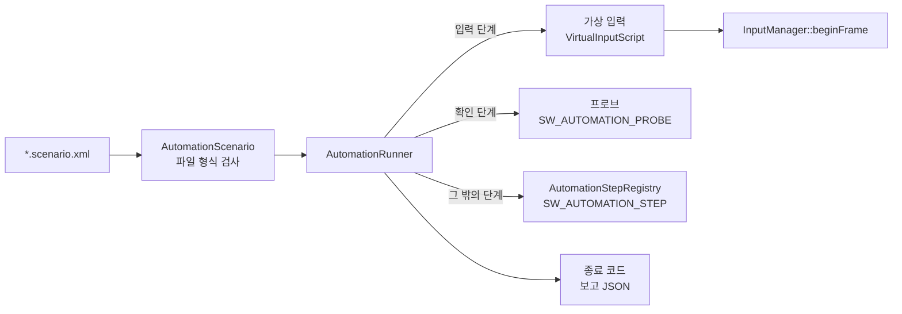

# Automation — 자동화 시나리오

## 이것은 무엇이고 왜 있나

"무기 교체 키를 한 번 누르면 무기가 정확히 다음 무기로 한 번만 바뀌는가", "창을 닫으면 10초 안에 프로세스가 끝나는가" 같은 확인은 실제 App을 띄워야만 할 수 있습니다.
이런 확인을 사람이 손으로 하거나 OS 입력을 흉내 내는 외부 스크립트로 하면, 실행할 때마다 결과가 달라지고 다시 돌리기도 어렵습니다.

이 모듈은 그런 확인을 **시나리오 파일 하나**로 적게 합니다. 시나리오는 "몇 번째 프레임에 무슨 입력을 넣고 무엇을 확인한다"를 XML로 적은 것입니다.
App을 `-scenario=` 인자로 실행하면 시나리오대로 입력을 넣고 확인한 뒤, 결과를 **종료 코드**로 돌려줍니다.

언리얼의 Functional Test(레벨 안에서 단계와 단언을 실행)와 Gauntlet(프로세스를 띄워 결과 코드와 로그를 수집)을 합친 것에 해당합니다.
유니티 Test Framework의 `InputTestFixture.Press/Release` 와 프레임 단위 `yield` 도 같은 일을 합니다. 다른 점은 시나리오가 코드가 아니라 데이터라서, 새 시나리오를 쓰는 데 빌드가 필요 없다는 것입니다.

엔진 계층으로는 8층입니다.

## 머릿속 그림



**프레임과 고정 시간.** 시나리오의 프레임 번호는 시작 조건이 처음 참이 된 프레임이 0입니다. 시나리오가 도는 동안 App은 벽시계 대신 고정 프레임 시간(`fixedDelta`)을 씁니다.
그래서 같은 시나리오는 어느 기계에서나 같은 프레임에 같은 일이 일어납니다.

**단계.** 시나리오의 각 동작을 단계라고 부릅니다. 단계는 입력(`Tap`, `MouseDelta`), 환경(`Variable`, `CloseWindow`), 결과 확인(`Expect`, `ExpectImage`), 끝(`Pass`, `Fail`)으로 나뉩니다.
엔진이 모르는 단계는 다른 모듈이 레지스트리에 등록합니다.

**프로브.** 프로브(probe)는 시나리오가 읽을 수 있게 게임이 이름을 붙여 내놓은 값입니다. `Shooter3D.WeaponIndex` 처럼 씁니다. `<Expect>` 단계가 프로브 값을 확인합니다.

**종료 코드.** 결과는 프로세스 종료 코드로 나옵니다(`AutomationResult`).

| 코드 | 뜻 |
|---|---|
| 0 | 통과 |
| 10 | 실패. 단언이 하나라도 틀렸습니다 |
| 11 | 읽기 오류. 파일 형식, 모르는 단계나 속성, 모르는 프로브, 모르는 전역 변수 |
| 12 | 시간 초과. 시작 조건이나 `<Pass/>` 가 제한 프레임 안에 오지 않았습니다 |
| 13 | 건너뜀. 이 기계에서 돌 수 없습니다(전경 창을 얻지 못한 경우 등) |

## 따라 해 보기 — 무기 교체 시나리오

Shooter3D의 `weaponswitch` 시나리오입니다. E 키를 짧게, 길게, 같은 프레임에 눌렀다 떼도 무기가 정확히 한 단계씩 바뀌는지 확인합니다.

**1단계 — 시나리오 파일을 씁니다.** 게임 팩의 `automation/` 폴더에 `<이름>.scenario.xml` 을 만듭니다.

<!-- snippet: Resource/game/shooter3d/automation/weaponswitch.scenario.xml 의 앞부분과 끝 — 5b U7 에서 대조 -->
```xml
<Scenario name="shooter3d.weaponswitch" fixedDelta="0.0166667" timeoutFrames="600" startAfter="ScenePlaying" startTimeoutFrames="900" input="exclusive">
	<At frame="0">
		<Variable name="gv_shooterAutoPlay" value="0"/>
		<Expect probe="Shooter3D.WeaponIndex" equals="0"/>
	</At>
	<!-- E 를 한 프레임 -->
	<At frame="20"><Tap slot="Key.E" hold="1"/></At>
	<At frame="30"><Expect probe="Shooter3D.WeaponIndex" equals="1"/></At>
	<!-- ... -->
	<At frame="280">
		<Expect probe="Shooter3D.PlayerAlive" equals="1"/>
		<ExpectLog contains="[Shooter] " atLeast="7" since="1"/>
		<Pass/>
	</At>
</Scenario>
```

0 프레임에서 자동 플레이를 끄고, 20 프레임에 E를 한 프레임 누르고, 30 프레임에 무기 번호가 1인지 확인합니다. 마지막에 `<Pass/>` 로 끝냅니다.
같은 프레임의 단계는 적은 순서대로 실행됩니다.

**2단계 — 실행합니다.**

```powershell
cd build/Ninja-Debug-Shooter3D/Bin
./App.exe -dx12 -scenario=game/shooter3d/automation/weaponswitch.scenario.xml -scenario-report=Saved/Automation/ws.json
echo $LASTEXITCODE
```

로그에 `[Scenario] PASS shooter3d.weaponswitch (280 frame(s))` 가 찍히고 종료 코드가 0이면 통과입니다. 실패하면 `[Scenario] FAIL` 줄 뒤에 실패한 단언이 한 줄씩 나옵니다.
`-scenario-report` 를 주면 같은 결과를 JSON으로도 씁니다. 스크린샷 같은 산출물은 `Saved/Automation/<시나리오 이름>/` 에 생깁니다.

**3단계 — CTest에 넣습니다.** 할 일이 없습니다. 파일을 `automation/` 폴더에 두기만 하면 `AppScenarioTest` 가 찾아서 돌립니다(아래 "작동 원리").

## 작동 원리

### 루트 속성

| 속성 | 기본값 | 뜻 |
|---|---|---|
| `name` | 필수 | 보고와 산출물 폴더 이름 |
| `fixedDelta` | `1/60` | 프레임마다 흐르는 시간(초) |
| `timeoutFrames` | 3600 | 이 프레임 수 안에 `<Pass/>` 가 없으면 12 |
| `startAfter` | `ScenePlaying` | 시작 조건. `ScenePlaying` 또는 `Immediately` |
| `startTimeoutFrames` | 1200 | 시작 조건을 이만큼 기다려도 오지 않으면 12 |
| `isolated` | `false` | `true` 면 새 프로세스에서만 돕니다. 시작 상태를 전제하거나 환경(창 크기 · 테마 · 네트워크 세션)을 크게 바꿔 체인(`-scenario=a,b,c`)에 넣을 수 없는 시나리오에 적습니다. 실행기는 이 값을 읽지 않고, 묶어 돌리는 쪽(`AppScenarioTest`)이 고릅니다 |
| `input` | `exclusive` | `exclusive` 는 무인 실행입니다. 사람의 마우스 · 키보드를 창 메시지 단계에서 버려 게임 입력과 에디터 UI 어디에도 닿지 않습니다(창 닫기 · 크기 · 포커스는 지나감, 탐침 `Input.OsDeviceInputBlocked`). `mixed` 는 OS 입력도 받습니다 |

`ScenePlaying` 은 활성 씬이 플레이를 시작했고 로딩 화면이 사라진 첫 프레임입니다. 로딩 화면이 게임 입력을 막기 때문에 그 뒤에 시작합니다.
`mixed` 는 진짜 OS 창 상태를 확인하는 시나리오에 씁니다. 이때 실행 중에 사람이 키보드나 마우스를 만지면 그 입력도 섞입니다.

### 엔진 단계

엔진이 제공하는 단계입니다. 다른 모듈의 단계와 같이 `AutomationStepRegistry` 에 등록되므로(`AutomationRunner.cpp` 의 `SW_AUTOMATION_STEP` · `SW_AUTOMATION_STEP_WITH_HOOKS`) 같은 이름의 등록은 중복으로 거절됩니다.
실행기는 단계 이름으로 분기하지 않고 등록의 함수만 부릅니다. 검사(속성의 허용 값과 오류 메시지)는 `AutomationRunnerInternal::validate*`, 시작할 때의 준비(입력 단계를 가상 입력으로 옮기기)와 실행 · 차례(조건 · 스크린샷 기다리기)는 `AutomationRunnerEngineSteps` 에 있습니다.

| 단계 | 속성 | 하는 일 |
|---|---|---|
| `Press`, `Release` | `slot` | 가상 입력 사건을 넣습니다 |
| `Tap` | `slot`, `hold`(프레임, 기본 1) | 누르고 `hold` 프레임 뒤에 뗍니다. 0이면 같은 프레임에 뗍니다 |
| `MouseDelta` | `x`, `y`(픽셀) | 마우스 이동량(`MouseRawDelta`) |
| `MousePosition` | `x`, `y`(창 클라이언트 영역의 0..1 비율) | 커서를 옮깁니다(`MouseMove`) |
| `GamepadAxis` | `axis`, `value`, `pad` | 게임패드 축 값 |
| `Text` | `value` | 글자 입력 |
| `Variable` | `name`, `value` | 전역 변수(gv) 값을 바꿉니다 |
| `Expect` | `probe` 와 비교 하나 | 프로브 값을 확인합니다 |
| `WaitUntil` | `probe` 와 비교 하나, `timeoutFrames`(기본 1200) | 프로브가 그 비교를 만족할 때까지 시나리오 시계를 붙잡습니다. 그동안 프레임 번호가 오르지 않고, 뒤의 단계와 입력 사건이 그만큼 밀립니다. 시한을 넘기면 실패로 적고 진행합니다. 그 프레임에 혼자 둡니다 |
| `ExpectLog` | `contains`, `count` 또는 `atLeast`, `since` | 시나리오 동안 그 글을 담은 로그 줄 수를 확인합니다 |
| `Screenshot` | `file` | 그 프레임의 화면을 PPM으로 저장합니다 |
| `ExpectImage` | `file`, `metric`, `region`, `ratio`, `reference` 와 비교 하나 | 스크린샷 영역의 지표를 확인합니다 |
| `CloseWindow` | `withinSeconds`(기본 10) | 창 닫기를 요청하고, 그 시간 안에 루프가 끝나야 통과입니다 |
| `ExpectExitWithin` | `seconds`(기본 10) | 앞 단계가 창을 닫게 했을 때, 그 시간 안에 끝나야 통과입니다 |
| `Pass`, `Fail`, `Skip` | `reason`(`Fail`, `Skip`) | 시나리오를 끝냅니다 |

- `slot` 은 `InputSlotUtil` 의 문자열입니다(`Key.E`, `Mouse.Left`, `Gamepad.A`, 두 번째 패드는 `Gamepad1.A`).
- `MousePosition` 의 비율은 시작할 때의 창 크기로 픽셀로 바뀝니다. 그 뒤의 마우스 버튼은 이 위치에서 눌립니다. RTS 선택이나 건물 배치처럼 커서 아래를 고르는 조작에 씁니다.
- 비교 속성은 `equals`, `near`(`tolerance` 와 함께), `atLeast`, `atMost` 중 정확히 하나입니다. `Expect` 는 틀려도 실패를 기록하고 계속 진행합니다.
- `ExpectLog` 는 실행기 자신의 `[Scenario]` 줄을 세지 않습니다.
- `Pass` 는 앞에서 실패가 기록되었으면 10으로 끝납니다.

### 등록 단계

엔진 밖 모듈이 `SW_AUTOMATION_STEP` 으로 등록하는 단계입니다. 실행기는 엔진 단계와 똑같이 레지스트리(`AutomationStepRegistry`)에서 이름으로 찾습니다.

| 단계 | 속성 | 등록하는 곳 | 하는 일 |
|---|---|---|---|
| `Intent` | `pawn`, `move`, `up`, `yaw`, `pitch`, `buttons`, `frames` | GameFramework `ControlAutomationSteps` | 폰에 이동 의도를 직접 넣습니다 |
| `Possess` | `controller`, `pawn` | GameFramework `ControlAutomationSteps` | 컨트롤러가 빙의할 폰을 바꿉니다 |
| `ExpectUI` | `focus`, `screen`, `screens` 중 하나 이상 | `Engine/UI/Automation/UIAutomationSteps` | 런타임 UI의 포커스 위젯, 활성 화면, 화면 수를 확인합니다 |
| `UILayoutDump` | `file` | `Engine/UI/Automation/UIAutomationSteps` | UI 화면마다 위젯 이름과 픽셀 사각형을 파일로 씁니다 |
| `DevCommand` | `line` | `AutomationEnvironmentSteps` | 개발 명령(`SW_DEV_COMMAND`) 한 줄을 부릅니다(`play`, `stop`, `editor <커맨드 id>`, `scene.saveAs <경로>`, `scene.open <리소스 id 또는 경로>`, `content.open <리소스 폴더>`). 모르는 명령은 읽기 오류, 명령이 false 면 실패입니다. Shipping 에는 없습니다 — 이 단계가 든 시나리오는 Shipping 에서 읽기 오류가 아니라 13(건너뜀)입니다 |
| `ResizeWindow` | `width`, `height`(픽셀) | `AutomationEnvironmentSteps` | 창을 창 모드의 그 클라이언트 크기로 바꿉니다. 창의 최소 크기보다 작으면 거기서 멈춥니다 |
| `PostWindowMessage` | `message` | `AutomationWindowSteps` | 자기 창에 OS 메시지를 보냅니다 |
| `ExpectCursorClip` | `state`(`locked`, `free`) | `AutomationWindowSteps` | 커서 가두기 상태를 확인합니다(`GetClipCursor`) |
| `RequireForeground` | 없음 | `AutomationWindowSteps` | 전경 창을 얻지 못하면 13으로 끝냅니다 |
| `CaptureWindow` | `file`(.png) | `AutomationWindowSteps` | 화면에 합성된 클라이언트 영역을 PNG 로 씁니다. 에디터 UI 까지 찍힙니다. 창이 전경이 아니면 찍지 않고 경고만 남깁니다(가린 다른 창이 찍히지 않게) |

- `Intent` 와 `Possess` 는 그 프레임의 입력 재생 **전**에 돕니다(등록 시 `_bBeforeInput` 이 참). 빙의와 의도는 [GameFramework README](../../GameFramework/README.md)의 Control 절에 있습니다.
- `ExpectUI` 와 같은 판정을 nogpu 테스트 `UINavigationScriptTest` 도 씁니다. `UILayoutDump` 결과는 `AppUITest` 가 스크린샷 안의 위젯을 이름으로 찾는 데 씁니다.
- 에디터 단계(`EditorClick` · `EditorDrag` · `EditorHover` · `EditorText` · `EditorKey` · `EditorExpectObject` · `EditorExpectDockLayout`)는 에디터 모듈이 등록합니다. 목록은 [Editor README](../../Editor/README.md#에디터-시나리오-단계와-탐침) 에 있습니다.
- 창 단계는 Windows에서만 동작하고, 다른 플랫폼에서는 같은 이름으로 13(건너뜀)을 냅니다.
  `PostWindowMessage` 의 `message` 는 `WM_ACTIVATE_INACTIVE`, `WM_ACTIVATE_ACTIVE`, `WM_KILLFOCUS`, `WM_SETFOCUS`, `WM_LBUTTONDOWN_CLIENT`, `WM_LBUTTONUP_CLIENT`, `WM_CLOSE` 중 하나입니다.
  `WM_CLOSE` 만 `PostMessage` 로 보내고, 나머지는 처리기가 끝난 뒤 돌아오는 `SendMessage` 로 보냅니다. 버튼 메시지는 클라이언트 영역 가운데를 누릅니다.
  커서 가두기는 전경 창에서만 걸리므로 `ExpectCursorClip` 앞에 `RequireForeground` 를 둡니다.

### 실행 순서

- 단계 종류와 프로브 이름은 시작 조건이 참이 되는 프레임에 검사합니다. 게임과 에디터 모듈이 등록하는 이름이 그때 모두 채워져 있기 때문입니다.
- 입력 단계는 시작할 때 가상 입력 소스로 옮겨지고, 각 프레임의 `InputManager::beginFrame` 에서 OS 사건과 같은 위치로 들어갑니다([Input README](../Input/README.md)).
- 확인 단계와 환경 단계는 그 프레임의 씬 틱 뒤, `EngineLoop::endFrame` 이 입력 프레임을 닫기 전에 돕니다.
- `AutomationSession` 은 프레임 관찰자(`IEngineFrameObserver`, `Engine/Utility/EngineFrameObserver.h`)입니다. App 이 `-scenario` 를 읽어 세션을 만들고 렌더 스레드의 시나리오 캡처를 켠 뒤
  `EngineLoop::addFrameObserver` 로 붙입니다. 루프는 관찰자 목록만 알고 프레임 앞(`onFrameBegin`) · 씬 틱 뒤(`onAfterSceneTick`, UI 앞 — 기본은 빈 함수) · 뒤(`onFrameEnd`) ·
  렌더 패킷 채우기(`onBuildRenderPacket`) · 창 닫힘(`onWindowClosed`)에서 부릅니다. 전용 서버는 시나리오를 쓰지 않습니다.
- 같은 목록에 텔레메트리(`TelemetryService`, 기동 단계 `Telemetry` 가 붙인다 — 씬 틱 뒤 장면별 프레임 시간)와 App 의 `RHIBackendSwitcher`
  (`-gv_rhiSwapAtFrame` 진단 — 프레임 앞)도 붙습니다.
- 세션이 시나리오 순서(`AutomationScenarioChain`)와 지금 단계의 실행기를 들고, 단계가 시작할 때마다 App의 `gv_fixedFrameDelta` 를 그 시나리오의 `fixedDelta` 로 바꾸고
  작업 폴더 · 스크린샷 기준선을 맞춥니다. 루프는 세션 · 실행기 · 체인 · 단계 전환을 모릅니다.
- 체인이 끝나면 `onFrameEnd` 가 종료 코드를 돌려주고 루프가 `requestQuit( 종료 코드 )` 를 부르며, App은 그 코드로 종료합니다. App 은 엔진을 내리기 전에 세션을 떼고(`removeFrameObserver`) 없앱니다.

### 스크린샷과 이미지 지표

`-gv_screenshot` 은 렌더 스레드의 자기 프레임 번호로 찍어서 시나리오 프레임과 맞지 않습니다.
그래서 `<Screenshot>` 은 저장 경로를 **렌더 패킷에 실어** 보내고, 렌더 스레드가 그 패킷을 그린 뒤 화면에 나간 이미지(Present 결과)를 씁니다.
`<ExpectImage>` 는 스크린샷이 다 써질 때까지 최대 30 프레임 기다린 뒤 PPM을 읽어 지표를 계산합니다.

| 지표 | 정의 |
|---|---|
| `meanLuma` | 영역 평균 휘도(0..1, Rec.709) |
| `darkFraction` | 휘도가 영역 중앙값 × `ratio`(기본 0.7)보다 어두운 픽셀 비율. 그림자나 실루엣을 봅니다 |
| `meanRedMinusBlue` | 평균 (R − B). 배경 대비 색을 봅니다 |
| `differentFrom` | `reference` 이미지와의 평균 절대 차(0..1). 백엔드 일치나 움직임을 봅니다 |

`region` 은 `x0,y0,x1,y1` 형식의 0..1 비율입니다. `darkFraction` 은 영역 전체가 한 밝기면 0이 나오므로, 밝기가 섞인 영역을 골라야 합니다.
지표 값은 언제나 로그(`[Scenario] metric darkFraction(0,0,1,0.12) park.ppm = 0.034`)와 보고 JSON에 적힙니다. 임계값은 이렇게 측정한 값을 보고 정합니다.

### 시나리오 이어 돌리기 — 한 프로세스에서 여럿

`-scenario=` 에 쉼표로 여러 경로를 주면 한 프로세스에서 차례로 돕니다(`AutomationScenarioChain`). 앞 단계가 통과해야 다음으로 가고, 앞 단계가 만든 상태(씬, 올라온 모듈, 백엔드)를 이어받습니다.

```powershell
./App.exe -dx12 -scenario=engine/automation/hotreload.scenario.xml,engine/automation/runner.scenario.xml,engine/automation/hotreload.scenario.xml -scenario-report=Saved/Automation/chain.json
```

- 단계마다 시나리오 프레임은 0 부터 다시 셉니다(시작 조건이 그 단계에서 다시 참이 되는 프레임이 0). 고정 프레임 시간도 단계의 `fixedDelta` 로 다시 맞춥니다.
- 첫 실패에서 멈추고 나머지는 돌리지 않습니다. `-scenario-keep-going` 이면 실패해도 이어 돌려 실패를 한꺼번에 모읍니다(단계가 서로 독립일 때). 건너뜀(13)은 기본에서는 이 기계가 못 도는 것이라 멈추지만, `-scenario-keep-going` 에서는 그 단계만의 일(전경 창을 못 얻음 등)로 보고 실패로 세지 않고 이어 갑니다(전부 건너뛰면 13).
- 종료 코드는 처음 통과하지 못한 단계의 코드이고, 로그에 `[Scenario] chain stage 2/3 FAIL (이름) - 1 later stage(s) skipped` 와 `[Scenario] chain PASS (3 stage(s), 0 failed, 0 skipped, 0 not run)` 가 남습니다.
- 보고 JSON 은 단계마다 `<이름>.<단계 번호>.json` 입니다(단계가 하나면 그대로).
- `CloseWindow` 로 끝나는 시나리오는 마지막 단계에만 둡니다(창이 닫히면 루프가 끝나 남은 단계를 돌 수 없고, 그때는 실패로 끝납니다).
- 상태를 이어받으므로 단계는 앞 단계가 남긴 것에 기대지 않게 씁니다. 리로드 횟수처럼 프로세스 전체로 세는 값은 상대값 탐침(`Module.ReloadPending`)으로 봅니다.
  에디터 시나리오를 묶으려면 단계 사이에 에디터 상태를 되돌려야 합니다(되돌리기 스택 · 선택 · 씬 내용이 남는다 — 백로그).

### 핫 리로드 시나리오

`Resource/engine/automation/hotreload.scenario.xml` 이 게임 모듈을 리로드합니다. 개발 명령 `module.reload <모듈>`(`App/AppAutomation.cpp`)로 예약하고, 탐침으로 끝을 기다린 뒤 결과를 봅니다.

| 이름 | 종류 | 뜻 |
|---|---|---|
| `module.reload <모듈>` | `DevCommand` | 그 모듈과 그것에 의존하는 모듈의 리로드를 예약합니다(개발 콘솔에서도 쓴다). Shipping 에는 없어 그 시나리오는 13 으로 끝납니다 |
| `Module.ReloadPending` | 탐침 | 예약한 리로드가 끝나기 전 1, 끝나면(또는 그래프가 막히면) 0. 앞선 리로드 횟수와 무관해 체인에서도 `WaitUntil … equals="0"` 으로 기다립니다 |
| `Module.ReloadCount` | 탐침 | 프로세스가 시작한 뒤 끝까지 성공한 연쇄 리로드 수 |
| `Module.GraphBroken` | 탐침 | 실패한 리로드가 그래프를 막았으면 1(프로세스를 다시 시작해야 한다) |
| `Module.BindingsOk` | 탐침 | 모든 모듈이 지금 보관한 의존 이미지에 묶였으면 1(`LiveReloadManager::verifyModuleBindings`) |
| `Scene.ObjectCount` | 탐침 | 활성 씬의 오브젝트 수(리로드 앞뒤로 씬이 사라지지 않았는지) |

리로드는 벽시계 디바운스(300 ms)와 DLL 복사를 거치므로 `WaitUntil` 의 `timeoutFrames` 를 넉넉히 둡니다(빠른 백엔드는 프레임이 훨씬 빨리 돈다). 키트나 에디터 확장을 리로드하려면 게임 팩의 시나리오에서 그 모듈 이름을 줍니다.

### 에디터 시나리오를 한 프로세스로 묶기

`AppScenarioTest` 의 에디터 케이스(백엔드마다 하나)는 `engine/automation/editor/*.scenario.xml` 을 **한 프로세스**에서 이어 돌립니다(`-scenario-keep-going`). 시나리오마다 App 을 새로 띄우면
기동 · 모듈 로드 · 셰이더 준비가 시나리오 수만큼 반복됩니다. DX12 에서 62 개를 프로세스 하나씩 돌리면 272 초, 묶으면 189 초입니다(같은 PC · 리로드 4 종 포함).

체인은 시나리오마다 앞에 **초기화**(`editor/chain/reset.scenario.xml`)를 끼워 새 에디터 세션과 같은 출발점으로 되돌립니다. 플레이 중지, 시작 씬 다시 열기(되돌리기 스택 · 선택 · 변경 표시가
씬 교체와 함께 비워진다), 창을 엔진 기본 크기(1280x720)로, UI 배율 1, 도구 · 확장 패널 닫기(`panel.closeOptional`), 도크 기본 배치입니다.
6 개마다 **모듈 리로드**가 끼고 게임 모듈(`reloadgame`) → 키트와 서버 전용 키트 연쇄(`reloadkit`, `GF_Chat`) → 키트와 에디터 확장(`reloadkitext`, `GF_ThemePark`) → 에디터 모듈(`reloadeditor`) 순서로 돕니다.
리로드 뒤에도 초기화가 먼저 도므로 다음 시나리오는 새 이미지 위에서 시작합니다 — 실제 개발에서 편집 중에 모듈을 다시 올리는 것과 같은 조건입니다.

묶지 않는 시나리오는 별도 프로세스로 돕니다.
- 파일 이름이 `<묶음>.<n>.scenario.xml` 인 것(앞 실행이 저장한 상태를 읽는다 — 같은 상태 폴더를 이어 쓴다).
- 루트에 `isolated="true"` 를 적은 것. 시작 상태를 전제하거나(`editorstartup` · `defaultlayout` · `loadingscreen`), 환경을 크게 바꾸거나(`screen` 의 창 크기 · 테마, `netplay` 의 세션),
  씬 교체로 비워지지 않는 패널 상태가 남는 것(그래프 노드 · 프로파일러 타임라인 · 타일맵 · 시퀀서 · 썸네일 캐시)입니다.

새 에디터 시나리오를 더하면 먼저 체인에서 통과하는지 봅니다(`AppScenarioTest.EditorScenariosPassOn<백엔드>`). 앞 시나리오의 상태에 기대거나 뒤 시나리오에 상태를 남기면 그 시나리오만 지고,
로그(`Bin/Saved/Automation/chain_editor_<백엔드>.log`)의 `[Scenario] chain stage n/m FAIL (이름)` 줄이 어느 단계인지 말해 줍니다. 단독으로는 통과하는데 체인에서 지면 상태가 남는 것이니
초기화(`reset.scenario.xml`)가 되돌리게 하거나 `isolated="true"` 를 적습니다. 범인은 `[앞 시나리오, reset, 지는 시나리오]` 를 `-scenario=a,b,c` 로 줄여 가며 찾습니다.
체인은 단계마다 프로세스의 **작업 폴더**가 처음과 같은지 보고(파일 대화상자가 옮긴다), 다르면 경고하고 되돌립니다.

### CTest — `AppScenarioTest`

`Test/AppTest/TestAppScenario.cpp` 는 `Resource/engine/automation/*.scenario.xml` 과 활성 게임 팩의 `automation/*.scenario.xml` 을 모두 찾습니다.
게임 팩은 `Config/Game/<게임>.json` 의 `_packRoot` 로 정합니다. 찾은 시나리오를 **백엔드마다** `App -scenario=… -scenario-report=…` 로 띄우고 종료 코드 0을 확인합니다.
13(건너뜀)과 77(이 기계에 없는 백엔드)은 건너뛰고, 시나리오 하나에 180초 제한이 있습니다(`AppTestUtil::kScenarioTimeoutSeconds`).

파일 목록을 CMake에 적지 않으므로 파일을 두기만 하면 돕니다. 게임은 프리셋마다 하나이므로, 게임 시나리오는 그 게임의 프리셋에서 돕니다.

```powershell
ctest --test-dir build/Ninja-Debug-Shooter3D -L hostgpu -R AppTest_HostOnly --output-on-failure
```

로그와 보고는 `Bin/Saved/Automation/<시나리오>_<백엔드>.log` 와 `.json` 입니다.

### 에디터 시나리오

에디터 시나리오의 단계 · 탐침 · 위젯 레이블 목록은 [Editor README](../../Editor/README.md#에디터-시나리오-단계와-탐침) 에 있습니다.

## 확장하는 법

**게임 값을 시나리오에서 읽으려면 프로브를 등록합니다.**

<!-- snippet: Source/Games/Shooter3D/ShooterPlayerComponent.cpp 의 SW_AUTOMATION_PROBE — 5b U7 에서 대조 -->
```cpp
namespace sw
{
    SW_AUTOMATION_PROBE( shooterWeaponIndex, "Shooter3D.WeaponIndex", "Weapon slot of the first shooter player (0 rifle, 1 shotgun, 2 pistol)",
                         &ShooterPlayerProbeInternal::readWeaponIndex );
} // namespace sw
```

1. 값을 읽는 함수 `bool read( const GameObjectManager* pManager, float64& outValue )` 를 만듭니다. 값이 없으면 false를 돌려줍니다.
2. 그 게임의 컴포넌트 `.cpp` 에 `SW_AUTOMATION_PROBE` 한 줄을 둡니다. 다른 심볼이 쓰이는 파일에 두어야 Shipping 정적 링크에서 등록 코드가 빠지지 않습니다.
3. 시나리오에서 `<Expect probe="게임.이름" .../>` 로 확인합니다.

**새 단계 종류를 만들려면** `SW_AUTOMATION_STEP( 변수 이름, "단계 이름", 실행 함수, 검사 함수, 입력 전 여부 )` 로 등록합니다. `ControlAutomationSteps.cpp` 와 `UIAutomationSteps.cpp` 가 참고할 예입니다.
검사 함수는 모르는 속성을 오류로 돌려줘야 합니다.

**시작을 미루는 조건을 더하려면** `SW_AUTOMATION_START_BLOCKER( 변수 이름, "이름", 판정 함수 )` 로 등록합니다. `ScenePlaying` 시작 조건은 등록된 조건이 모두 false 일 때 참이 됩니다.
UI 의 로딩 화면 조건이 `UIAutomationSteps.cpp` 에 있습니다. 실행기는 UI 를 include 하지 않고, 위층이 아래층 등록표에 등록합니다.

## 함정과 주의

- **모르는 것은 조용히 버리지 않습니다.** 모르는 요소, 모르는 속성, 형식이 틀린 값, 모르는 프로브, 모르는 전역 변수는 모두 읽기 오류(11)입니다. 오타가 "통과"로 숨지 않게 하기 위해서입니다.
- **같은 이름을 두 번 등록하지 마세요.** 프로브와 단계는 같은 이름이 두 번 등록되면 뒤의 것을 거절하고 오류를 냅니다. 모듈을 핫 리로드로 언로드하면 그 모듈의 프로브와 단계도 빠집니다.
- **이미지 비교에는 `-gv_screenshot` 대신 `<Screenshot>` 을 쓰세요.** `-gv_screenshot` 의 프레임 번호는 렌더 스레드 기준이라 시나리오 프레임과 어긋납니다.
- **확인하려는 상태가 다른 이유로 바뀌지 않게 전제를 같이 확인하세요.** `weaponswitch` 는 플레이어가 죽으면 라운드가 다시 시작해 무기 번호가 0으로 돌아갑니다. 그래서 마지막에 `Shooter3D.PlayerAlive` 를 확인합니다.
- **비동기로 끝나는 일은 고정 프레임이 아니라 `<WaitUntil>` 로 기다리세요.** Quick Open 의 파일 목록, 참조 역색인, 머티리얼 미리보기, 패키징처럼 워커 스레드가 끝내는 일은 기계 부하에 따라 걸리는 프레임이 다릅니다.
  `<At frame="280"><Expect …/>` 처럼 넉넉히 잡은 프레임도 다른 빌드와 겹친 기계에서는 모자랍니다(`editor.sequencerkeys` 가 OpenGL 에서 이렇게 졌습니다). 조건이 오면 바로 진행하므로 빠른 기계에서는 시나리오도 짧아집니다.
  기다림 바로 뒤에는 위젯이 한 번 그려지도록 10 프레임쯤 둡니다. 클릭할 레이블(`mark`)는 패널이 그린 다음 프레임부터 있습니다.

## 더 볼 곳

| 파일 | 내용 |
|---|---|
| `AutomationScenario.h` | 시나리오 파일을 읽은 값과 루트 속성 |
| `AutomationRunner.h` | 실행기와 종료 코드(`AutomationResult`) |
| `AutomationProbe.h` | 프로브 레지스트리와 `SW_AUTOMATION_PROBE` |
| `AutomationStepRegistry.h` | 등록 단계 레지스트리와 `SW_AUTOMATION_STEP` |
| `AutomationImageMetric.h` | 이미지 지표 |
| `AutomationWindowSteps.cpp` | 창 단계 |

- 시나리오 예: `Resource/engine/automation/`, `Resource/game/<팩>/automation/` (`weaponswitch`, `closewindow`, `shadow`, 게임마다 `control`)
- 테스트 작성 전반: [Test/README.md](../../../Test/README.md)
