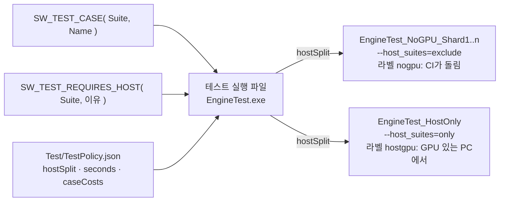

# Test — 자동화 테스트

## 이것은 무엇이고 왜 있나

엔진의 자동화 테스트입니다. 프레임워크는 gtest 가 아니라 직접 만든 `TestFramework` 이지만 `--gtest_filter` 같은 gtest 형식 플래그도 받습니다.
테스트는 CTest 로 등록되어 `ctest` 한 번으로 모두 돌고, CI 는 그중 GPU 없이 도는 것을 돌립니다.

실행 파일은 **링크하는 의존성**으로 나뉩니다. 새 테스트는 필요한 의존성을 이미 링크하는 실행 파일에 넣고, 없으면 작은 실행 파일을 하나 더 만듭니다.

| 폴더 | 무엇을 테스트하나 |
|---|---|
| `CoreTest` | `Source/Core` 만(Engine · GameFramework · Editor · Games · App 을 include 하지 않는다 — `CheckTestSuites`) |
| `EngineTest` | 엔진 객체와 GameFramework, 장르 키트(GameFramework 를 링크하는 유일한 실행 파일, 게임 서비스 바인딩 도우미 `EngineTest/GameTestUtil.h`). GPU가 필요한 스위트는 따로 갈립니다 |
| `ReflectionTest` | `ReflectionParser` 가 헤더에서 `*.gen.cpp` 를 올바르게 만드는지 |
| `SmokeTest` | 게임 DLL 핫 리로드와 RHI 모듈 동적 로드 같은 런타임 통합 |
| `EditorTest` | 에디터의 UI 없는 부분(ImGui 를 링크하지 않는다) |
| `EditorUITest` | ImGui 컨텍스트가 필요한 에디터 테스트. GPU와 창은 쓰지 않습니다 |
| `AppTest` | App의 정책 코드(App 소스를 파일 단위로 가져옴)와 실제 `App.exe` 를 띄우는 실행 테스트 |
| `ServerTest` | 실제 `Server` 실행 파일을 띄워 시작, 틱, 정상 종료를 확인 |
| `PythonTest` | 파이썬 도구의 단위 테스트와 QA 러너 등록(`Test*.py` 하나가 CTest 항목 `PythonTest_<이름>`, `nogpu`) |
| `FuzzTest` | 커버리지 안내 퍼저(Linux 전용, CTest 항목 아님) |
| `Qa` | QA 러너의 데이터. 게임별 자동 플레이 인자, 골든 이미지, 성능 기준 |
| `TestFramework` | 테스트 등록, 실행, 필터, 결과 수집. 스위트가 같이 쓰는 하네스는 `TestFramework/Harness/` |

## 머릿속 그림



**스위트와 케이스.** `SW_TEST_CASE( Suite, Name )` 하나가 케이스, 같은 `Suite` 이름의 묶음이 스위트입니다. 필터와 CI 분류는 모두 스위트 단위입니다.

**호스트 스위트.** GPU, 디스플레이, DXC가 필요해 CI가 돌릴 수 없는 스위트입니다. 스위트 파일 안에 `SW_TEST_REQUIRES_HOST( 스위트, "이유" )` 한 줄로 선언하고 CMake에는 적지 않습니다. 정책에서 `hostSplit` 인 실행 파일(`EngineTest`, `AppTest`)은 이 선언을 보고 CTest 항목을 둘로 나눕니다.

**등록 정책.** 라벨 · 샤드 · 제한 시간 · 호스트 분리는 `Test/TestPolicy.json` 한 곳이 정합니다. 폴더의 CMakeLists 는 무엇을 짓는지만 적고 `sw_addTestExecutable(<이름>)` 이 같은 이름의 정책 줄을 읽어 CTest 항목을 만듭니다.

**라벨.** 정본은 정책 파일의 `labels` 표이고 표에 없는 라벨은 configure 가 멈춥니다. `nogpu` 는 "CI 러너가 돌릴 수 있다", `hostgpu` 는 "CI가 돌릴 수 없다"이며 `load` 는 기본 집합에서 빠집니다.

**작업 폴더.** 테스트는 현재 폴더에서 위로 올라가며 `Resource/` 를 찾으므로 항상 `build/<프리셋>/Bin` 에서 돌립니다(CTest도 그렇게 합니다).

## 따라 해 보기 — 테스트 하나 쓰고 돌리기

`Core/String` 의 Base64 인코더에 케이스를 더한다고 해 봅시다.

**1단계 — 파일 위치.** 테스트 파일은 소스 폴더를 따릅니다(`Source/Core/String/Base64Util` → `Test/CoreTest/String/TestBase64Util.cpp`). CMake는 glob으로 찾으므로 새 파일은 configure를 한 번 다시 해야 잡힙니다.

**2단계 — 케이스.**

<!-- snippet: Test/CoreTest/String/TestBase64Util.cpp 의 URLAlphabetHasNoPaddingAndRoundTrips — 5b U7 에서 대조 -->
```cpp
SW_TEST_CASE( Base64UtilTest, URLAlphabetHasNoPaddingAndRoundTrips )
{
    const uint8 arrByte[] = { 0xFB, 0xFF, 0xBF, 0x00, 0x10 };
    SW_EXPECT_EQUAL( string( "-_-_ABA" ), Base64Util::encodeURL( arrByte, sizeof( arrByte ) ) );
    SW_EXPECT_EQUAL( string( "+/+/ABA=" ), Base64Util::encode( arrByte, sizeof( arrByte ) ) );
    vector<uint8> decoded;
    SW_ASSERT_TRUE( Base64Util::decodeURL( "-_-_ABA", decoded ) );
    SW_ASSERT_EQUAL( sizeof( arrByte ), decoded.size() );
    for ( size_t index = 0; index < decoded.size(); ++index )
        SW_EXPECT_EQUAL( arrByte[index], decoded[index] );
}
```

`SW_EXPECT_*` 는 실패를 기록하고 계속, `SW_ASSERT_*` 는 기록하고 그 케이스를 끝냅니다. 뒤 줄이 앞 줄의 결과에 기대는 곳에만 ASSERT를 씁니다.

**3단계 — 빌드하고 이름으로 돌립니다.**

```powershell
cmake --build --preset Ninja-Debug
py -3 -m Scripts test Base64UtilTest.*
```

**4단계 — CTest로 확인합니다.** 커밋 전에 CI와 같은 집합을 돌립니다. GPU가 필요한 코드를 고쳤다면 GPU가 있는 PC에서 Shipping의 `hostgpu` 도 돌립니다(CI가 대신 돌려 주지 않습니다).

```powershell
ctest --test-dir build/Ninja-Debug -L nogpu --output-on-failure
ctest --test-dir build/Ninja-Shipping -L hostgpu --output-on-failure
```

## 작동 원리

### 실행하는 법

```powershell
ctest --test-dir build/Ninja-Debug --output-on-failure      # 전부
ctest --test-dir build/Ninja-Debug -L nogpu                  # CI와 같은 집합
ctest --test-dir build/Ninja-Debug -L core                   # Core만
ctest --preset Ninja-Debug-lint                              # 린트만
```

Ninja는 구성이 하나뿐인 생성기라 `ctest -C Debug` 의 `-C` 는 아무 일도 하지 않습니다(구성은 프리셋이 정함). 다른 빌드가 함께 도는 PC 에서는 `ctest -j <N> --test-load <코어 수>` 로 시작을 늦춥니다.

**테스트 실행 파일은 모든 구성에서 `TestBin` 에 있지만 작업 폴더는 `Bin` 입니다.** `TestBin` 에서 그대로 돌리면 리소스 루트를 찾지 못하고 Dev 는 `Engine.dll` 도 찾지 못합니다. 모듈 DLL 은 `Bin/Modules` 에 있고 `FileUtil::getBinaryDirectory`(TestBin → Bin) 기준으로 찾습니다.

```powershell
cd build/Ninja-Debug/Bin
../TestBin/EngineTest.exe --test_filter=MaterialTest.*
```

`py -3 -m Scripts test` 는 이 차이를 처리합니다. 실행 파일마다 `--test_list` 로 물어 패턴에 맞는 케이스가 있는 것만 `Bin` 에서 돌립니다(`Scripts/dev/RunTests.py`).

```powershell
py -3 -m Scripts test "SceneTest.*,ResourceTest.Ensure*" --list   # 어느 실행 파일에 어떤 케이스가 있나
py -3 -m Scripts test ResourceTest.* --preset Ninja-Shipping
py -3 -m Scripts test ProcessTest.* --repeat 20 --shuffle
py -3 -m Scripts test --changed                                    # main 과 갈라진 뒤 바뀐 파일이 닿는 테스트만(모르면 전체)
```

모르는 인자(`--host_suites=all` 등)는 실행 파일에 그대로 넘어갑니다. 고른 케이스가 어디에도 없으면 종료 코드 1입니다.
**린트도 CTest 항목입니다.** `lint` 라벨은 `Scripts/lint/gate/` 와 `selftest/` 전부이고 configure 때 `LintCatalog.py` 가 훑어 항목을 만듭니다(목록은 `ctest --preset Ninja-Debug-lint -N`).

### 호스트 스위트 나누기

`hostSplit` 인 실행 파일은 `<타깃>_NoGPU`(`--host_suites=exclude`, `nogpu`)와 `<타깃>_HostOnly`(`--host_suites=only`, `hostgpu`)로 나뉩니다. 선언된 호스트 스위트는 `EngineTest --test_list` 끝에 이유와 함께 나옵니다.

- `--host_suites=only` 가 아무것도 고르지 않거나 선언한 스위트에 케이스가 없으면 실패합니다.
- **모든 스위트의 케이스는 처리하지 않은 `[Error]` · `[Warning]` 로그 하나로 실패합니다**(검증 레이어 · 드라이버 오류, 깨진 자료를 읽는 거절 경로는 로그로만 남기 때문). 일부러 거절 경로를 부르는 곳은 `SW_TEST_DEFENSIVE_SCOPE( "이유" )` 로 그 호출만 감쌉니다. 시나리오 실행기의 로그 게이트 자체를 시험하는 케이스는 표식을 붙일 수 없으므로 `SW_TEST_JUDGE_IGNORE_LINES( "글 조각", "이유" )` 로 케이스 판정에서만 뺍니다. App 시나리오(`AppScenarioTest`)는 같은 규칙을 로그 게이트(`Source/Engine/Automation/AutomationLogPolicy.h`)로 지키고 실패는 종료 코드 15 입니다.
- 원인이 엔진에 있고 못 고친 줄은 `Resource/engine/automation/allowedlogs.json` 에 `suite` 항목(로그 id · 스위트 · 사유 · 처리 계획 문서)으로 적습니다(시나리오와 같은 하나뿐인 목록). 로그 id(`SW_LOG_WARNING_ID` · `SW_LOG_ERROR_ID`)가 없는 줄은 가릴 수 없습니다.

**샤드와 제한 시간은 한 실행 시간(`seconds`)에서 계산합니다.** 샤드 수는 `ceil(seconds / targetShardSeconds)`(30 초), 제한 시간은 `max(60, 4 × max(조각 하나의 초, 가장 비싼 케이스의 초))` 입니다(멈춤을 잡는 그물이고 느려짐은 `SW_TEST_TIME_BUDGET` 이 판정). 샤드는 `<타깃>_Shard1..n` 으로 `--test_shard=<k>/<n>` 으로 돌고,
케이스는 정책의 `caseCosts`(`--test_costs=`)로 비싼 것부터 가장 가벼운 조각에 놓입니다(LPT). `hostShards` 는 `_HostOnly` 를 나누고(비용 `hostCaseCosts`), `_HostOnly` 는 GPU 칸(`gpuSlots`) 하나를 받고 잠금 없이 칸 수만큼 겹쳐 돕니다 — App 은 케이스마다의 작업 폴더(`build/<프리셋>/AppRuns/shard<i>of<n>/<스위트_케이스>`, `AppTestUtil::getRunFolder`)에서 뜨고 로그 · 보고 · 사진도 거기 남습니다. 공유 자리에 쓰는 실행이 생기면 정책의 `hostResourceLock`(이유 `_hostResourceLockReason`)으로 비켜 가게 합니다.
스위트가 크게 느려지면 `seconds` 와 `caseCosts` 를 다시 잽니다(요약의 `Slowest cases:` 가 재료). 비용표의 케이스 이름이 바뀌면 `CheckTestSuites.py` 가 잡습니다.

**`race` 는 Debug 전용 레이스 묶음입니다.** `DataRaceDetector` 가 `SW_DEBUG` 에서만 켜지므로 스레드 경로를 지나는 케이스만 골라(`raceCases`) Debug 에 `<타깃>_Race` 로 등록합니다. 단계별로 무엇을 도는지는 [작업 방식](../docs/11_Workflow.md) 3절 표에 있습니다. 묶음을 바꾸면 `ctest -L race` 직렬 합이 10 분 안쪽인지 다시 잽니다.

### 구성마다 도는 케이스 수가 다릅니다

`ctest` 는 어느 구성에서나 "Passed"라고만 하지만 실제 케이스 수는 다릅니다(`--test_list` 로 셉니다). SmokeTest 는 Shipping 에서 훨씬 적고(핫 리로드와 모듈 백그라운드 컴파일은 Dev 에만 있다), AppTest 도 줄며(에디터 실행 · 백엔드 교체 · 메모리 태그 보고), EngineTest · EditorTest 는 Dev 전용 경로(모듈 코드 해제, 셰이더 라이브 컴파일, 인스펙터 메타데이터)만큼, Shipping 은 `SW_LOG_*` 가 빠져 로그 확인 검사만큼 적습니다.
어느 구성에서나 스킵되는 **자식 역할 케이스**(`CrashReportTest.ChildProcessCrashesAsRequested`, `TestFrameworkTest.ChildRoleEchoesOrHangs`, `ModuleAPITest.SharedModuleChildKeepsItsRegistrations`)는 환경 변수가 없으면 빠지고 다른 케이스가 자식으로 띄울 때만 돕니다.

**의도한 축소와 사고를 가르는 기준은 하나입니다. 스위트가 통째로 비면 실패합니다.** 필터로 고른 스위트의 케이스가 전부 스킵되면 프레임워크가 실패로 처리합니다(정말 비어도 되면 `--allow_empty_suite`). 샤드로 나뉜 스위트는 이 검사를 받지 않으므로 전제 조건이 없으면 스킵하는 스위트는 전제를 단언하는 케이스를 하나 둡니다(`ReflectionParserTest.ParserExecutableIsBuilt`).

### 단언과 도우미

모든 단언은 같은 뼈대(`SW_TEST_CHECK_IMPL`, `SW_TEST_CHECK_EQUAL_IMPL`)를 지나고 실패 처리는 바깥 함수(`test::reportFailure` 등)에 있습니다.

| 도우미 | 쓰는 곳 |
|---|---|
| `SW_ASSERT_TRUE_MSG( 조건, 메시지 )` | 실패하면 메시지(보통 실제로 받은 값)를 남기고 케이스를 멈춥니다 |
| `test::ScopedLogCollector` | 스코프 동안의 Warning과 Error 로그를 모읍니다. `countWithID( "영역.사건" )` 로 소스의 `SW_LOG_*_ID` id 로 확인하고(문구를 고쳐도 지지 않는다), 줄이 없다는 확인은 `count()`, 실패 메시지에는 `joined()` |
| `test::ScopedDefensiveTestLog` | 일부러 내는 오류와 경고 앞에 `[Expected Defensive Test] ` 를 붙입니다(로그 문구는 포함 여부로 비교) |
| `test::ScopedAssertCapture` | 엔진 단언(`SW_ASSERT`, `SW_LOG_ASSERT`)을 멈추지 않고 셉니다(Debug 의 디버거 멈춤도 없어 방어 경로 테스트가 Debug 에서도 돈다) |
| `test::ScopedFailureCapture` | 테스트 단언의 실패를 가로챕니다(단언 자체를 테스트할 때) |
| `test::ScopedTrace( "backend=Vulkan" )` | gtest 의 `SCOPED_TRACE` 와 같습니다. 진 단언과 재현 요약에 맥락 한 줄이 붙습니다 |
| `test::runThisExecutableAsChild` | 자기 실행 파일을 자식 프로세스로 띄워 케이스 하나를 돌립니다(프로세스마다 한 번뿐인 상태나 프로세스를 죽이는 동작) |

도우미는 `Test/TestFramework/TestScopes.h` 에 있습니다. 테스트가 띄우는 프로세스(자식 테스트, 실제 App, 전용 서버)는 모두 `test::runProcessWithDeadline`(`Harness/TestProcessRun.h`)으로 돌립니다 — **제한 시간을 넘기면 죽이므로**(새니타이저 빌드는 열 배) 멈춘 프로세스 하나가 실행 파일 전체를 CTest 제한 시간까지 붙잡지 않습니다.
배포본의 `SW_LOG_ASSERT` 는 멈추지 않으므로 `ResourcePaths::initialize()` 를 쓰는 케이스는 결과를 `SW_ASSERT_TRUE` 로 감쌉니다.

그 밖의 도우미입니다.

- `test::makeTempPath` · `makeTempDirectory`, `test::RHITestDevice`(`kArrAllRHIBackend`) · `test::RHIBackendSweep` · `test::RHITestImage`(두 판 비교는 `RHITestImage::compare` 로 바뀐 화소 수를 센다), 병렬 기록을 nogpu 로 보는 `test::FakeRHIDevice`.
- GPU 렌더 도우미(`TestRenderPassGPU.cpp`): `makeSingleTargetPSODesc` · `beginOffscreenRenderPass` · `countPrimaryColorPixels` · `renderSceneFrame`, `LitCubeScene` · `renderPresentCaptureOf`. 에디터 지역 서비스는 `Test/EditorTest/EditorTestServices.h`.
- 네트워크 호스트 묶음 `test::LoopbackCluster`(`Harness/TestLoopbackCluster.h`, 손으로 진행하는 `step` 과 호스트 스레드 둘 다 가능, CoreTest 도 씀). 씬과 라우터까지 필요하면 `NetSimHarness`.
- 할당 실패 경로는 `Memory::injectAllocationFailures( count )`(Dev, 스레드 국소).
- 리소스 루트 아래 폴더로만 풀리는 것(도메인 · 검색 우선순위 · 낱개 파일과 팩 경쟁 · 셰이더 스탬프)은 `test::ScopedTempResourceRoot` 로 케이스 임시 폴더에 `Resource` 를 만들어 루트를 바꿉니다(`writeTextFile` · `makePath`, 루트 기준 상대 경로만).
- 바깥 서버가 필요한 테스트는 `SW_TEST_REQUIRES_ENVIRONMENT( 스위트, "변수", "까닭" );` 으로 변수가 비면 그 스위트만 `[ SKIP SUITE ]` 로 뺍니다. PostgreSQL 은 `SW_TEST_POSTGRES_URL`, 구현마다 같은 케이스는 계약 매크로(`SW_SERVICE_STORE_CONTRACT_SUITE` · `SW_SQL_DRIVER_CONTRACT_SUITE` · `SW_EPHEMERAL_STORE_CONTRACT_SUITE`)이며 실패 경로는 닿지 않는 주소(`host=127.0.0.1 port=1 connect_timeout=1`)로 봅니다.

### 테스트가 남긴 상태 정리

케이스가 끝나면 프레임워크가 비동기 씬 로드와 TaskManager를 정리합니다. 테스트가 직접 만든 것(코덱 등록, 전역 설정)은 `SW_TEST_DEFER_CLEANUP` 으로 되돌립니다(등록 역순 실행). AssetManager 전체 종료나 전역 씬 초기화처럼 다른 테스트에 영향을 주는 정리는 자동으로 하지 않습니다.

<!-- snippet: Test/CoreTest/Compression/TestCompression.cpp 의 코덱 등록과 되돌리기 — 5b U7 에서 대조 -->
```cpp
sw::CompressionCodecRegistry& registry  = *sw::CompressionCodecRegistry::getActive();
const bool                    bHadCodec = registry.isCodecRegistered( sw::CompressionCodecType::Custom );

registry.registerCodec( sw::make_unique<XorTestCodec>() );
SW_TEST_DEFER_CLEANUP( SW_DELEGATE_LAMBDA( sw::Delegate<void()>, [bHadCodec]()
{
    if ( bHadCodec == false )
        sw::CompressionCodecRegistry::getActive()->unregisterCodec( sw::CompressionCodecType::Custom );
} ) );
```

**임시 파일은 프레임워크가 정리합니다.** `test::makeTempPath( "x.xml" )` 는 `<임시 폴더>/sw_<pid>/<스위트_케이스>/x.xml` 을 돌려주고 케이스가 끝나면 그 폴더를 통째로 지웁니다. 파일 이름이 의미를 갖는 경우(팩 이름이 우선순위를 정함)는 `test::makeTempDirectory( "packs" )` 안에 원래 이름으로 둡니다. 파일을 연 채로 두어 지우지 못하면 그 케이스가 실패합니다.

### 반복과 섞기 — 간헐 실패와 순서 의존 찾기

| 플래그 | 하는 일 |
|---|---|
| `--test_repeat=N`(`--gtest_repeat=N`) | 고른 케이스를 N번 반복하고 진 케이스마다 재현율(`failed 3 / 20 (15.0%) - intermittent`)을 출력합니다 |
| `--test_seed=<씨앗>`(`--gtest_random_seed=<씨앗>`) | 섞기와 `test::getRandomSeed()` 의 씨앗. 주지 않으면 실행마다 고르고 씨앗을 읽은 케이스가 지면 재현 명령에 붙습니다 |
| `--test_shuffle`(`--gtest_shuffle`) | 스위트 순서와 스위트 안의 케이스 순서를 섞고(스위트끼리는 붙어 있음) 쓴 씨앗을 맨 앞에 출력합니다 |
| `--test_shuffle=<씨앗>` | 그 순서를 다시 만듭니다 |

받는 플래그 전체는 `--help`(`-h` · `--gtest_help`)로 봅니다. **진 실행은 다시 돌릴 명령을 출력합니다.** 요약 끝의 `Reproduce` 가 작업 폴더 · 실행 파일 · 진 케이스 필터 · 스위트 종류 · 씨앗 · 엔진 인자(`-gv_*`) · ctest 항목(`SW_TEST_CTEST_NAME`) · 구성 이름을 적고,
섞은 실행은 원래 고른 집합 · 샤드 · 씨앗을 그대로 적습니다. 비결정 실패는 그 명령에 `--test_repeat=20` 을 붙여 재현율을 잽니다.

```powershell
cd build/Ninja-Debug/Bin
./CoreTest.exe --test_filter=ProcessTest.* --test_repeat=50   # 간헐 실패
./EngineTest.exe --test_shuffle                               # 앞 케이스가 남긴 상태에 기대는 테스트
./EngineTest.exe --test_shuffle=81234                         # 실패한 순서 다시 만들기
```

### 실제 App을 띄우는 테스트

`AppTest_HostOnly` 는 실제 `App.exe` 를 띄우는 스위트를 직렬로 돌립니다(창과 GPU를 잡기 때문). `Engine` 전체를 돌리는 자동 테스트는 이것뿐입니다.

- **`AppSmokeTest`** — App을 네 백엔드와 에디터 유무 조합으로 띄워 종료 코드와 `[Error]` 로그를 봅니다(창 닫기, 백엔드 교체, 메모리 태그 보고, 골든 이미지 비교 포함).
- **`AppScenarioTest`** — 자동화 시나리오(`*.scenario.xml`)를 시나리오 × 백엔드마다 독립 케이스 `AppScenarioTest.<시나리오>.<백엔드>`(실행 시작에 폴더를 훑어 만든다)로 돌려 종료 코드 0을 확인합니다(처리하지 않은 Warning · Error 가 남으면 15 라 실패. 기동 · 종료 구간의 줄은 `[id:…]` 꼬리표로 같은 허용 목록에 건다). 엔진 시나리오와 활성 게임 팩의 시나리오를 모두 찾으므로 파일을 두기만 하면 돕니다. 형식은 `Source/Engine/Automation/`.
- **`AppUITest`** — `engine/automation/uidemo.scenario.xml` 을 백엔드마다 돌려 스크린샷과 레이아웃 덤프(`UILayoutDump`)를 받고 위젯 이름으로 찾은 영역의 색을 확인하며 평균 색과 가장자리 수를 첫 백엔드와 견줍니다(평균 차 0.02 이하, 가장자리 수 차 2% 이하).

세 스위트 모두 종료 코드 13(건너뜀)과 77(이 기계에 없는 백엔드)은 건너뜁니다. 게임은 프리셋마다 하나이므로 게임 시나리오는 그 게임의 프리셋에서 돕니다.

**벤치 장면 골든 이미지.** `AppSmokeTest.BenchFrameMatchesGoldenImage` 는 벤치 큐브 장면(`-W=256 -H=144 -gv_benchMeshes=8 -gv_benchAnimate=0`)을 불투명과 투명 두 장으로 백엔드마다 찍어 `Test/AppTest/Golden/<장면>_<백엔드>.ppm.z` 와 채널 차이 2까지 비교합니다(Linux 는 `.linux` 이름을 따로 두고 없으면 경고만, 실패한 이미지는 `build/<프리셋>/GoldenDiff`).

### QA 러너 — 게임 골든 이미지, soak, 성능, 퍼징

`PythonTest` 폴더의 CMake가 `QaGoldenImages`(`hostgpu`), `QaSoak`(`soak`), `QaPerfRegression`(`perf`, Release만)를 등록합니다. `soak` 와 `perf` 는 몇 분씩 걸려 `hostgpu` 에 넣지 않았고 `ctest -L soak` 처럼 직접 고릅니다.

```powershell
py -3 -m Scripts golden --app build/Ninja-Debug/Bin/App.exe --game NileCity                   # 네 백엔드로 그려 기준과 비교
py -3 -m Scripts golden --app build/Ninja-Debug/Bin/App.exe --game NileCity --record --runs 3 # 기준을 새로 만든다
py -3 -m Scripts soak --app build/Ninja-Debug/Bin/App.exe --game NileCity --minutes 10 --out soak.json
py -3 -m Scripts perf --app build/Ninja-Release/Bin/App.exe [--record]
```

**게임 골든 이미지는 픽셀이 아니라 지표로 비교합니다**(`Scripts/common/ImageMetrics.py`): 모서리에서 배경색을 추정해 빼고 전경 비율, 전경 평균색, (R−B), 경계 밀도, 8×4 격자 밝기를 견줍니다. 자동 플레이는 실제 시간을 따라가 장면이 조금씩 다르므로 허용 오차는 `--record` 가 같은 조건으로 여러 번 돌린 결과의 퍼짐으로 정합니다.

- 기준은 `Test/QA/Golden/<게임>/<백엔드>.png`(160×90)와 `.json`, 게임마다의 자동 플레이 인자와 캡처 프레임은 `Test/QA/Games.json` 입니다. 기준이 없는 게임과 돌지 못하는 백엔드는 건너뜁니다(77). 기준은 그린 장치(GPU 이름, 드라이버)를 `device` 로 적고 다른 기계에서 실패하면 두 장치를 함께 찍습니다(기계별 기준을 두지 않는 결정은 [결정 기록](../docs/09_Decisions.md) 5-2).
- 네 모서리가 두 색으로 갈리는 장면(1인칭의 하늘 · 땅)은 배경이 없다고 보고 화면 전체를 전경으로 측정합니다.
- 판정이 실패를 잡는지는 `--extra-arg=-gv_viewMode=Wireframe` 나 `--extra-arg=-gv_benchMeshes=0` 으로 일부러 망가뜨려 봅니다. 실패한 실행의 App 출력은 `%TEMP%/sw_golden_<백엔드>_<회차>_app.log` 입니다.

**soak** 는 `-gv_profileSeconds=<초>` 동안 App이 돌다 끝나게 하고 프라이빗 메모리, 작업 집합, 핸들, GDI와 USER 개체 수를 잽니다. 판정은 워밍업 뒤의 최소제곱 기울기(MB/분, 개/분)입니다(두 점만 보면 캐시 채우기 계단을 누수로 오해한다).
**성능 기준은 기계마다**(호스트, CPU, 백엔드) `Test/QA/Perf/<게임>.json` 에 저장되고 여러 번 돌린 중앙값이 `기준 × (1 + 허용 오차) + 바닥` 을 넘으면 실패입니다.

**로더 퍼징.** `EngineTest` 의 `LoaderFuzzTest`(nogpu)가 씨앗을 고정한 변이로 로더와 받은 바이트의 디코더(넷 패킷 · 스트림 프레임 · HTTP · HPACK · JWT · 고정 배치형 · 상태 코덱, `EngineTest/LoaderFuzzTargets.cpp`, 씨앗은 저장소의 실제 파일과 만든 바이트)를 퍼징하고 엔진 단언도 결함으로 셉니다. 키트의 디코더는 키트마다 `EngineTest/Fuzz/KitFuzzTargets<키트>.cpp` 가 표에 올립니다(키트가 꺼지면 그 파일이 빠진다). 찾은 결함은 그 스위트에 회귀 테스트로 둡니다. 오래 돌리려면:

```powershell
$env:SW_FUZZ_ITERATIONS=20000; $env:SW_FUZZ_TRACE=1; cd build/Ninja-Debug/Bin; ../TestBin/EngineTest.exe --test_filter=LoaderFuzzTest.*
```

커버리지 안내 퍼징(libFuzzer)은 `FuzzTest/` 의 `LoaderFuzzer` 가 같은 목록(키트 대상은 빼고 — 키트를 링크하지 않는다)으로 하며 Linux 전용(`SW_ENABLE_FUZZING`, 프리셋 `CI-Fuzz`, `.github/workflows/fuzz.yml` 이 밤마다)입니다 — Windows 의 `clang_rt.fuzzer` 는 정적 런타임(/MT)뿐이라 /MD 엔진과 링크되지 않습니다.

## 확장하는 법

**GPU가 필요한 테스트를 쓰려면** RHI 디바이스를 만드는 테스트는 `RenderPassGPUTest` 스위트에 넣고, 창과 디바이스는 `test::RHITestDevice`(`Test/EngineTest/RHITestDevice.h`, 스코프를 벗어나면 정리)로 만듭니다.
백엔드마다 도는 케이스는 `for ( test::RHITestDevice& device : sweep )`(`test::RHIBackendSweep`)이고 하나도 없으면 `sweep.getReadyCount() == 0` 으로 건너뜁니다. 새 호스트 스위트는 그 파일에 `SW_TEST_REQUIRES_HOST` 를 두고 다른 스위트를 두지 않습니다.

**렌더링이 의도해서 바뀌었다면 골든 기준을 다시 만듭니다.** 벤치 장면은 `SW_UPDATE_GOLDEN=1` 로 그 케이스를 돌려 바뀐 `.ppm.z` 를 같은 커밋에 넣고, 게임 골든은 `py -3 -m Scripts golden --record` 를 씁니다.

**새 테스트 실행 파일을 만들려면** `Test/<이름>/CMakeLists.txt` 에 `sw_addTestExecutable(<이름> LIBS …)` 를 두고 `Test/TestPolicy.json` 에 줄 하나(`area` · `seconds`, 호스트 스위트가 있으면 `hostSplit`)를 더합니다. 소스는 재귀로 훑고 `Dev/` 아래 파일은 개발 구성에서만 짓습니다(`sw_registerTestRun`).

**구성마다 없는 기능은 데이터로 선언합니다.** 케이스 첫 줄에 `SW_TEST_REQUIRES_FEATURE( DevelopmentBuild )`(`DebugAsserts` · `DebugLog` · `MemoryTagScopes` · `SourceResources`)를 둡니다. 그 기능이 없는 구성에서는 건너뛰고 요약이 기능별로 세며 "아무것도 검증하지 않은 스위트" 로 지지 않습니다(본문이 쓰는 심볼이 없는 구성이면 본문만 `#if`).
환경 탓(파일 · 장치 · 서버가 없음)의 건너뜀은 `SW_TEST_SKIP` 이고 이것만 빈 스위트 판정에 듭니다. 기능 표는 `TestCase.h` 의 `BuildFeature` 와 `TestCatalog.cpp` 의 표 한 줄입니다.

**부하 · 시간 예산 검증을 더하려면** 스위트 파일에 `SW_TEST_LOAD_SUITE( 스위트, "이유" )` 와 `SW_TEST_TIME_BUDGET( 스위트, 밀리초, "이유" )` 를 두고 정책 줄에 `loadSeconds` 를 더합니다. `<타깃>_Load`(라벨 `load`, 직렬)가 `--load_suites=only` 로 돌고 **Release 에서만** `--enforce_budgets` 로 예산을 넘은 케이스가 집니다(다른 실행은 요약에 찍기만).
hostgpu 항목은 `--required_backends=<이름,…>`(정책 `requiredBackends.<플랫폼>`)를 받아 그 백엔드가 서지 못하면 건너뛰지 않고 집니다(`test::reportUnusableBackend`). 벤치 스위트(`*BenchTest`)는 모두 부하 스위트이고 CI 에서 사라지면 안 되는 정확성은 짧은 nogpu 스위트로 남깁니다.
시나리오 × 하드웨어 프로필 단위의 부하 검증은 `py -3 -m Scripts load` 이고 [검증과 측정](../docs/08_Verification.md) "부하 검증" 절이 원본입니다.

**폴더를 훑어 만든 목록이 케이스가 되어야 하면**(시나리오 × 백엔드) `SW_TEST_CASE_GENERATOR( 스위트, 함수 )` 로 `void ( test::TestCatalog& )` 함수를 등록하고 `catalog.addCase( 스위트, 이름, 람다, 예상 초 )` 로 더합니다. 생성기는 엔진이 선 뒤 실행 시작(`--test_list` 포함)에 한 번 불려 리소스 폴더를 읽어도 되고 이름이 `--test_filter` · 샤드 비용표에 그대로 쓰입니다.
같은 파일에 `SW_TEST_CASE` 가 하나는 있어야 하고(`CheckTestSuites`) 동적 이름은 `TestPolicy.json` 비용표에 적지 못하므로 예상 초를 마지막 인자로 줍니다(안 주면 기본 0.05 초라 한 샤드에 몰린다). 예: `Test/AppTest/TestAppScenario.cpp`.
**백엔드 루프를 한 케이스 안에서 돌지 말고** `SW_TEST_CASE_PER_PARAMETER( 스위트, 이름, 목록 함수, 예상 초 )` 로 백엔드마다 케이스(`스위트.이름.dx12` …)를 둡니다. 본문은 `void ( const utf8* pParameter )` 이고 하나가 못 돌면(`SW_TEST_SKIP`) 그 백엔드만 건너뛰며 하나가 져도 나머지는 돕니다. 정책의 `raceCases` 는 `스위트.이름.*` 로 가리킵니다(백엔드끼리 견주는 케이스는 한 케이스로 둔다).

**판정이나 보고 형식을 더하려면** 실행기를 고치지 않고 `ITestCaseJudge`(`TestJudge.h`, `TestRegistry::registerJudge`)나 `ITestRunListener`(`TestReport.h`, `registerListener`)를 하나 더 붙입니다. 둘 다 구독(`sw::Subscription`)을 돌려주고, 구독이 사라지면 떨어집니다.

**케이스 단위 결과 보고(JSON).** `--test_report=<경로>`(gtest 별칭 `--gtest_output=json:<경로>`, 다른 형식은 실행을 실패로 끝낸다)를 주면 실행이 끝날 때 `JSONTestReporter`(`TestReportJSON.cpp`)가 파일 하나를 씁니다. ctest 항목은 `SW_TEST_REPORT_DIR`(`<빌드>/TestReports`)을 받아 경로를 안 주면 `<폴더>/<ctest 이름>.json` 에 씁니다(폴더만 있고 `SW_TEST_CTEST_NAME` 이 없으면 실패). 형식은 하나뿐이고(`format` 1, 별칭 · 옛 형식 리더 없음) 케이스마다 `name` · `parameter` · `result`(`passed`/`failed`/`skipped`) · `ms` · `iteration` · `shard` · `failures`(`file` · `line` · `condition` · `message` · `trace`) · `partSkips` · `missingFeature` · `unhandledLog`(처리하지 않은 Error · Warning 줄)를 적습니다. 틀 테스트 안의 `(nested)` 레지스트리는 쓰지 않습니다.

## 함정과 주의

게이트가 막는 규칙(스위트 이름 `XxxTest` · 한 파일 한 스위트, 호스트 스위트 파일 분리, 비활성 게임 팩 원본은 `SW_TEST_REQUIRES_FEATURE( SourceResources )`, CoreTest 의 엔진 include 금지, EditorTest 의 ImGui 금지, 실패 가능 bool 의 `[[nodiscard]]`)은 `CheckTestSuites` · `CheckFallibleNodiscard` 가 잡습니다.

- **실행 파일 폴더(`Bin`)나 소스 트리에 파일을 쓰지 마세요.** `ctest -j` 로 나란히 도는 다른 프로세스가 같은 트리를 읽어 넣었다 바로 지워도 그 사이에 훑은 프로세스가 집니다. `test::ScopedTempResourceRoot`, `makeTempPath` · `makeTempDirectory` 를 씁니다.
- **스킵은 "이 구성에 없다"(`SW_TEST_REQUIRES_FEATURE`) · "이 기계에 없다"(`SW_TEST_SKIP`) 일 때만 씁니다.** 있어야 할 것이 실패하면 단언합니다(SmokeTest 는 `isModuleBuilt` 로 모듈 파일이 있는지 보고 스킵하고 지어진 모듈의 `registerModule` 실패는 `SW_ASSERT_TRUE_MSG`).
- **`editor::getSubsystem<EditorContext>()` 로 컨텍스트를 받는 함수는 EditorTest 에서 테스트할 수 없습니다**(컨텍스트가 없으면 모든 구성에서 멈춘다). 컨텍스트 없이 도는 테스트가 부르는 함수는 `editor::findSubsystem<EditorContext>()` 로 받아 null 을 정상 경로로 둡니다. 새 EditorTest 소스 파일을 더한 뒤에는 `cmake --preset Ninja-Debug` 로 다시 구성합니다.
- **오브젝트는 지역 `GameObjectManager` 로 만듭니다.** 전역 활성 씬을 빌리면 테스트끼리 상태가 샙니다.
- **모듈 정적 캐시에 넣은 것은 케이스 끝에 비웁니다.** `makeTempPath` 는 반복 회차마다 같은 경로를 주므로 경로를 키로 쥐는 정적 상태(`GameDataCache`)가 남으면 다음 `--test_repeat` 회차가 앞 회차의 내용을 읽습니다(서비스를 풀 때 캐시를 비우는 RAII 가드, 예: `ScopedCatalogServiceBinding`).
- **`--test_filter` 는 gtest 형식입니다.** 패턴 사이는 `:` 도 쉼표도 되고 첫 `-` 뒤는 모두 빼는 패턴입니다(`A.*:B.*-A.X`). 패턴이 케이스 하나와도 맞지 않으면 실행이 실패합니다. PowerShell 에서 쉼표가 든 `--test_filter` 는 따옴표로 감쌉니다(안 감싸면 앞 토큰만 먹고 오류도 없다).
- **`RUN_SERIAL` 은 이유와 함께만 씁니다.**
- **App 의 종료 코드 77 은 "이 기계와 빌드가 그 RHI 백엔드를 못 돌린다" 입니다**(`RHIInitResult` 의 `BackendNotBuilt` · `DriverUnsupported`). 테스트와 `AppRun.py` 는 로그 문구가 아니라 이 코드로 건너뜁니다. 환경 탓으로 물러나는 새 경로는 백엔드가 `_initResult` 를 적어야 건너뜀이 되고 안 적으면 결함으로 실패합니다.
- **설정 파일 테스트는 둘입니다.** `ConfigFileSchemaTest`(EngineTest)와 `EditorConfigFileSchemaTest`(EditorTest, `Config/Editor`)가 테이블에 없는 파일을 실패로 보므로 새 설정 파일은 그 테이블과 `Scripts/common/ConfigCatalog.py` 에 한 줄씩 더합니다.
- **느린 시나리오는 조건마다 한 케이스로 쪼갭니다.** 샤드는 케이스 단위로 나뉘므로 한 케이스에 조건 둘을 넣으면 한 샤드가 둘 다 짊어집니다.
- **고정 틱 창 끝에서 "모두 같다" 를 보는 네트워크 테스트는 서버 물리가 그 창 안에 가라앉는다고 가정하지 않습니다**(구성마다 궤적이 달라 리눅스 Shipping 에서 수렴이 창 너머로 밀렸다). 창 뒤 상한 안에서 같아질 때까지 돌려 보고(`ScenarioOptions::_settleTickLimit`) 해시가 갈리면 사건마다 적용 전후 해시를 찍어 같은 (오브젝트, 번호) 끼리 맞춰 봅니다.
- **공개 API 는 단언 뒤에 진짜 if 가드를 둡니다**(Release 에서 단언이 사라진다). 그런 경로의 테스트는 Debug 에서 건너뜁니다. 작업 스레드 안의 `SW_ASSERT_*` 는 그 람다만 끝냅니다. future 테스트에서 `wait()` 를 부르지 말고 `isValid()` 와 짧은 `waitFor` 를 씁니다.
- **여러 스레드가 결과를 적는 칸은 고정 배열로 둡니다.** `sw::vector` 의 비 const 첨자는 레이스 탐지기에 컨테이너 쓰기로 잡혀 드물게 크래시합니다(`T arrResult[kThreadCount]{}` 나 atomic).
- **모듈 코드 정리 테스트에 이미지 전체를 범위로 주지 마세요.** Shipping 은 엔진까지 한 exe 입니다. 스텁이나 vtable 하나씩으로 좁힙니다.
- **할당 0 을 보는 테스트는 여러 번 재서 최솟값을 봅니다**(누계는 프로세스 전체 값). 누수 테스트는 `MemoryProfiler::getLiveAllocationCount` 로, 노드를 동시에 여럿 쥐고 봅니다. 큰 `reserve` 는 실패하지 않을 수 있으니 상한 테스트는 할당 바이트로 단언합니다.
- **공유 테스트 픽스처의 등록**(`makeMockComponentTypeInfo` 등)은 짝 `.cpp` 한 TU 에 둡니다(헤더에 두면 TU 마다 `TypeInfo` 가 중복 등록).
- **시간으로 움직이는 GPU 픽셀 단언은 `FrameRenderer::setDebugOverrides` 의 `_animationTime` 으로 시각을 고정합니다**(음수 = 벽시계). 단위 큐브는 t ≈ π/2 + kπ 에서 변위가 0 이 되어 벽시계로 찍으면 간헐 실패합니다.
- **`FrameRenderer::executePacket` 은 패킷의 스냅샷을 옮겨 갑니다.** 같은 패킷을 두 번 내면 두 번째는 빈 프레임입니다. App 실기동으로 좁혀지지 않는 백엔드 교체 결함은 `RenderPassGPUTest.RendererSurvivesDeviceRecreate` 로 재현합니다.
- **테스트 안에서 만든 `TestRegistry` 의 결과 줄은 `(nested) ` 로 시작합니다**(CI 실패 보고 `Scripts/dev/CiFailureReport.py` 가 줄 머리로 실패를 고르므로 머리가 같으면 안쪽 줄이 보고된다).

## 더 볼 곳

- 테스트 파일이 include 하는 한 헤더 `TestFramework/TestFramework.h`(단언 `TestAssert.h` · 등록 `TestCatalog.h` · 실행 `TestRegistry.h` · `TestRunOptions.h` · 결과 `TestReport.h` · `TestJudge.h` · 범위 `TestScopes.h` · `TestTempPath.h`, 프로세스 `Harness/TestProcessRun.h` · `TestChildProcess.h`), GPU 장치 `EngineTest/RHITestDevice.h`, App 실행 도우미 `AppTest/AppTestUtil.h`
- 실행 파일마다 라벨 · 샤드 · 제한 시간 · 호스트 분리 · 비용표: `Test/TestPolicy.json`, 등록 함수 `cmake/Engine/TestTargets.cmake`
- 검증 절차 전반: [docs/08_Verification.md](../docs/08_Verification.md), 자동화 시나리오: `Source/Engine/Automation/`, 상위: [문서 지도](../docs/02_DocumentMap.md)
