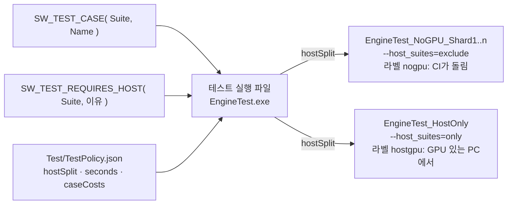

# Test — 자동화 테스트

## 이것은 무엇이고 왜 있나

이 폴더에는 엔진의 자동화 테스트가 있습니다. 테스트 프레임워크는 gtest가 아니라 직접 만든 것(`TestFramework`)이지만, `--gtest_filter` 같은 gtest 형식의 플래그도 받습니다.
테스트는 CTest로 등록되어 `ctest` 한 번으로 모두 돌고, CI는 그중 GPU 없이 도는 것을 돌립니다.

테스트 실행 파일은 **링크하는 의존성**으로 나뉩니다. 새 테스트는 필요한 의존성을 이미 링크하는 실행 파일에 넣고, 그런 것이 없으면 작은 실행 파일을 하나 더 만듭니다.
`EditorUITest` 와 `AppTest` 가 그렇게 생겼습니다.

| 폴더 | 무엇을 테스트하나 |
|---|---|
| `CoreTest` | `Source/Core` 만. 수학, 문자열, 컨테이너, 델리게이트, 이벤트, 전역 변수 |
| `EngineTest` | 엔진 객체와 GameFramework, 장르 키트. GPU가 필요한 스위트는 따로 갈립니다 |
| `ReflectionTest` | `ReflectionParser` 가 헤더에서 `*.gen.cpp` 를 올바르게 만드는지 |
| `SmokeTest` | 게임 DLL 핫 리로드와 RHI 모듈 동적 로드 같은 런타임 통합 |
| `EditorTest` | 에디터의 UI 없는 부분. 커맨드 스택, 선택, 뷰포트 수학, 문서 더티 상태 |
| `EditorUITest` | ImGui 컨텍스트가 필요한 에디터 테스트. GPU와 창은 쓰지 않습니다 |
| `AppTest` | App의 정책 코드와, 실제 `App.exe` 를 띄우는 실행 테스트 |
| `ServerTest` | 실제 `Server` 실행 파일을 띄워 시작, 틱, 정상 종료를 확인 |
| `PythonTest` | 파이썬 도구의 단위 테스트와 QA 러너 등록 |
| `FuzzTest` | 커버리지 안내 퍼저(Linux 전용, CTest 항목 아님) |
| `Qa` | QA 러너의 데이터. 게임별 자동 플레이 인자, 골든 이미지, 성능 기준 |
| `TestFramework` | 테스트 등록, 실행, 필터, 결과 수집. 스위트가 같이 쓰는 하네스는 `TestFramework/Harness/` |

- `CoreTest` 의 테스트 파일은 Engine, GameFramework, Editor, Games, App 헤더를 include하지 않고 `engine::` 서비스를 부르지 않습니다.
  공용 `TestFramework` 가 Engine을 링크하므로 include 경로로는 막을 수 없어서, `CheckTestSuites.py` 가 이 규칙을 검사합니다. 엔진 타입이 필요하면 `EngineTest` 에 둡니다.
- `EngineTest` 가 GameFramework와 장르 키트를 링크하는 유일한 실행 파일이라, 키트 테스트도 여기에 있습니다. 게임 서비스 바인딩 도우미는 `EngineTest/GameTestUtil.h` 입니다.
- `EditorTest` 는 일부러 ImGui를 링크하지 않습니다. 그래서 ImGui 컨텍스트만 있으면 되는 테스트는 `EditorUITest` 에 둡니다.
- `App` 은 실행 파일이라 링크할 라이브러리가 없습니다. 그래서 `AppTest` 는 App 소스를 파일 단위로 가져와 정책 코드를 테스트하고, 실제 App을 띄우는 테스트도 함께 둡니다.
- `PythonTest` 는 `Test*.py` 하나가 CTest 항목 하나(`PythonTest_<이름>`, `nogpu`)입니다.

## 머릿속 그림



**스위트와 케이스.** `SW_TEST_CASE( Suite, Name )` 하나가 케이스 하나이고, 같은 `Suite` 이름의 케이스를 스위트라고 부릅니다. 필터와 CI 분류는 모두 스위트 단위입니다.

**호스트 스위트.** GPU, 디스플레이, DXC가 필요해서 CI가 돌릴 수 없는 스위트입니다. 스위트 파일 안에 `SW_TEST_REQUIRES_HOST( 스위트, "이유" )` 한 줄로 선언합니다.
CMake에는 스위트 이름을 적지 않습니다. 정책 파일에서 `hostSplit` 인 실행 파일(`EngineTest`, `AppTest`)은 이 선언을 보고 CTest 항목을 둘로 나눕니다.

**등록 정책.** 라벨 · 샤드 · 제한 시간 · 호스트 분리는 `Test/TestPolicy.json` 한 곳이 정합니다. 폴더의 CMakeLists 는 무엇을 짓는지(소스 · 링크)만 적고,
`sw_addTestExecutable(<이름>)` 이 같은 이름의 줄을 읽어 CTest 항목을 만듭니다. 폴더 이름은 실행 파일 이름과 같습니다.

**라벨.** 쓸 수 있는 라벨은 정책 파일의 `labels` 표가 정본이고, 표에 없는 라벨은 configure 가 멈춥니다. 영역(`core` · `engine` · `editor` · `app` · `server` · `module` · `reflection`),
`unit` · `nogpu` · `hostgpu` · `load` · `lint` · `python` · `qa` · `soak` · `perf` · `build` 가 있습니다.
`nogpu` 는 "CI 러너가 돌릴 수 있다"는 약속이고, `hostgpu` 는 CI가 돌릴 수 없는 것입니다. `load` 는 부하 · 시간 예산 검증이라 기본 집합에서 빠집니다.

**작업 폴더.** 테스트는 현재 폴더에서 위로 올라가며 `Resource/` 를 찾습니다. 그 탐색이 성공하는 위치가 `build/<프리셋>/Bin` 이므로, 테스트는 항상 `Bin` 에서 돌립니다. CTest도 그렇게 합니다.

## 따라 해 보기 — 테스트 하나 쓰고 돌리기

`Core/String` 의 Base64 인코더에 테스트 케이스를 더한다고 해 봅시다.

**1단계 — 파일 위치를 정합니다.** 테스트 파일은 소스 폴더를 따릅니다. `Source/Core/String/Base64Util` 의 테스트는 `Test/CoreTest/String/TestBase64Util.cpp` 입니다.
CMake는 하위 폴더까지 glob으로 찾으므로 새 파일을 만들어도 CMake를 고칠 필요가 없습니다. 다만 새 파일은 configure를 한 번 다시 해야 잡힙니다.

**2단계 — 케이스를 씁니다.**

<!-- snippet: Test/CoreTest/String/TestBase64Util.cpp 의 URLAlphabetHasNoPaddingAndRoundTrips — 5b U7 에서 대조 -->
```cpp
SW_TEST_CASE( Base64UtilTest, URLAlphabetHasNoPaddingAndRoundTrips )
{
    const uint8 arrByte[] = { 0xFB, 0xFF, 0xBF, 0x00, 0x10 };
    SW_EXPECT_EQUAL( string( "-_-_ABA" ), Base64Util::encodeURL( arrByte, sizeof( arrByte ) ) );
    SW_EXPECT_EQUAL( string( "+/+/ABA=" ), Base64Util::encode( arrByte, sizeof( arrByte ) ) );
    vector<uint8> decoded;
    SW_ASSERT_TRUE( Base64Util::decodeURL( "-_-_ABA", decoded ) );
    SW_ASSERT_EQUAL( sizeof( arrByte ), decoded.size() );
    for ( size_t index = 0; index < decoded.size(); ++index )
        SW_EXPECT_EQUAL( arrByte[index], decoded[index] );
}
```

`SW_EXPECT_*` 는 실패를 기록하고 계속 진행합니다. `SW_ASSERT_*` 는 기록하고 그 케이스를 끝냅니다.
뒤 줄이 앞 줄의 결과에 기대는 곳(여기서는 `decoded` 의 크기를 확인한 뒤 원소를 읽는 곳)에만 ASSERT를 씁니다.

**3단계 — 빌드하고 이름으로 돌립니다.**

```powershell
cmake --build --preset Ninja-Debug
py -3 -m Scripts test Base64UtilTest.*
```

`py -3 -m Scripts test` 는 그 스위트가 어느 실행 파일에 있는지 찾아 `Bin` 에서 돌립니다(`Scripts/dev/RunTests.py`). 직접 돌리려면 이렇게 합니다.

```powershell
cd build/Ninja-Debug/Bin
./CoreTest.exe --test_filter=Base64UtilTest.*
```

**4단계 — CTest로 확인합니다.** 커밋 전에 CI와 같은 집합을 돌립니다.

```powershell
ctest --test-dir build/Ninja-Debug -L nogpu --output-on-failure
```

GPU가 필요한 코드를 고쳤다면 GPU가 있는 PC에서 Shipping의 `hostgpu` 도 돌립니다. CI가 이것을 대신 돌려 주지 않습니다.

```powershell
ctest --test-dir build/Ninja-Shipping -L hostgpu --output-on-failure
```

## 작동 원리

### 실행하는 법

```powershell
ctest --test-dir build/Ninja-Debug --output-on-failure      # 전부
ctest --test-dir build/Ninja-Debug -L nogpu                  # CI와 같은 집합
ctest --test-dir build/Ninja-Debug -L core                   # Core만
ctest --preset Ninja-Debug-lint                              # 린트만
```

Ninja는 구성이 하나뿐인 생성기라서 `ctest -C Debug` 의 `-C` 는 아무 일도 하지 않습니다. 구성은 프리셋, 곧 빌드 폴더가 정합니다.

다른 빌드나 실행이 함께 도는 PC 에서는 `ctest -j <N> --test-load <코어 수>` 로 시작을 늦춥니다. Windows 에서도 적용됩니다(2026-10-16, 1 초짜리 테스트 셋을 `-j3` 로 돌려 `--test-load 1` 은 3.4 s, 없으면 1.3 s).
프리셋에 고정하지 않는 것은 코어 수가 PC 마다 달라서입니다.

**테스트 실행 파일은 모든 구성에서 `TestBin` 에 있지만, 작업 폴더는 여전히 `Bin` 입니다.** `Bin` 에 테스트 바이너리와 DXC가 섞이지 않게 출력 폴더만 나눈 것입니다.
`TestBin` 에서 그대로 돌리면 리소스 루트를 찾지 못하고, Dev 는 `Engine.dll` 도 찾지 못합니다(Windows 로더가 작업 폴더 `Bin` 에서 찾는다).
모듈 DLL 은 `Bin/Modules` 에 있고, 테스트는 그것을 `FileUtil::getBinaryDirectory`(TestBin → Bin) 기준으로 찾습니다.

```powershell
cd build/Ninja-Debug/Bin
../TestBin/EngineTest.exe --test_filter=MaterialTest.*
```

`py -3 -m Scripts test` 는 이 차이를 알아서 처리합니다. 실행 파일마다 `--test_list` 로 물어 패턴에 맞는 케이스가 있는 것만 `Bin` 에서 돌립니다.

```powershell
py -3 -m Scripts test "SceneTest.*,ResourceTest.Ensure*" --list   # 어느 실행 파일에 어떤 케이스가 있나
py -3 -m Scripts test ResourceTest.* --preset Ninja-Shipping
py -3 -m Scripts test ProcessTest.* --repeat 20 --shuffle
py -3 -m Scripts test --changed                                    # main 과 갈라진 뒤 바뀐 파일이 닿는 테스트만(모르면 전체)
```

이 스크립트가 모르는 인자(`--host_suites=all` 등)는 실행 파일에 그대로 넘어갑니다. 고른 케이스가 어디에도 없으면 종료 코드 1로 끝납니다. 오타 난 패턴이 "통과"로 보이지 않게 하기 위해서입니다.

**린트도 CTest 항목입니다.** `lint` 라벨은 `Scripts/lint/gate/` 의 게이트와 `Scripts/lint/selftest/` 의 자기 검사 전부입니다.
목록을 손으로 적지 않고, configure 시점에 `Scripts/lint/LintCatalog.py` 가 두 폴더를 훑고 `Scripts/generate/GenerateLintTargets.py` 가 CTest 항목을 만듭니다.
지금 무엇이 도는지는 `ctest --preset Ninja-Debug-lint -N` 으로 봅니다.

### 호스트 스위트 나누기

정책에서 `hostSplit` 인 실행 파일은 CTest 항목이 두 갈래입니다. `<타깃>_NoGPU` 는 `--host_suites=exclude` 로 호스트 스위트를 빼고 돌며 `nogpu` 라벨을 받습니다.
`<타깃>_HostOnly` 는 `--host_suites=only` 로 호스트 스위트만 돌고 `hostgpu` 라벨을 받습니다. 지금 선언된 호스트 스위트는 `EngineTest --test_list` 끝에 이유와 함께 출력됩니다.

- `--host_suites=only` 실행이 아무것도 고르지 않으면 실패합니다. 선언한 스위트에 케이스가 없어도 실패합니다.
- **호스트 스위트의 케이스는 처리하지 않은 `[Error]` · `[Warning]` 로그 하나로 실패합니다.** 검증 레이어와 드라이버 오류는 로그로만 남고 단언은 통과할 수 있기 때문입니다.
  일부러 거절 경로를 부르는 곳은 `SW_TEST_DEFENSIVE_SCOPE( "이유" )` 로 감쌉니다. 그 안의 줄은 표시가 붙어 세지 않습니다.
  App 을 띄우는 시나리오(`AppScenarioTest`)는 같은 규칙을 시나리오 실행기의 로그 게이트(`Source/Engine/Automation/AutomationLogPolicy.h`)로 지킵니다. 실패는 종료 코드 15(`UnhandledLog`)입니다.
- 원인이 엔진에 있고 아직 고치지 못한 줄은 허용 목록 `Resource/engine/automation/allowedlogs.json` 에 `suite` 항목(로그 id · 스위트 이름 · 사유 · 처리 계획 문서)으로 적습니다. 시나리오 실행기와 같은 하나뿐인 목록입니다.
  그 스위트의 그 로그 id 만 허용하고, 로그 id(`SW_LOG_WARNING_ID` · `SW_LOG_ERROR_ID`)가 없는 줄은 어떤 항목으로도 가릴 수 없습니다. 실행 요약이 허용한 케이스 수를 출력합니다. 칸이 비었거나 `TODO` 이면 목록을 읽지 못해 실패 메시지에 이유가 듭니다.
  예전 `SW_TEST_KNOWN_LOG`(문구 부분 문자열)는 없앴습니다.

**샤드와 제한 시간은 한 실행 시간(`seconds`)에서 계산합니다.** 샤드 수는 `ceil(seconds / targetShardSeconds)`(30 초), 제한 시간은
`max(60, 4 × max(조각 하나의 초, 가장 비싼 케이스의 초))` 입니다. 샤드는 `<타깃>_Shard1..n` 으로 등록되고 각각 `--test_shard=<k>/<n>` 으로 돕니다.
케이스는 비용으로 고르게 나뉩니다. 정책의 `caseCosts`(느린 케이스의 초)가 `--test_costs=` 로 넘어가고, 비싼 케이스부터 가장 가벼운 조각에 놓입니다(LPT).
비용이 없는 케이스는 차례로 돌며 놓여 한 스위트가 한 조각에 몰리지 않습니다. `hostShards` 는 `_HostOnly` 를 나눕니다(호스트 케이스의 비용은 `hostCaseCosts` — 분 단위 케이스가 nogpu 조각의 제한 시간을 늘리지 않게 따로 둡니다).
`_HostOnly` 는 직렬이 아니라 GPU 칸(`gpuSlots`) 하나를 받아 둘까지 겹쳐 돌고, 같은 `Bin` 에 산출물을 쓰는 실행끼리는 `hostResourceLock` 으로 비켜 갑니다.

**`race` 는 Debug 전용 레이스 묶음입니다.** `DataRaceDetector` 가 `SW_DEBUG` 에서만 켜지므로, 스레드 경로를 지나는 케이스만 골라(`raceCases`) Debug 에 `<타깃>_Race` 로 등록합니다.
기능 확인(`hostgpu`)은 Shipping 이 기본이고, 단계마다 무엇을 도는지는 [작업 방식](../docs/11_Workflow.md) 3절 표에 있습니다. 묶음을 바꾸면 `ctest -L race` 의 직렬 합이 10 분 안쪽인지 다시 잽니다.

- **제한 시간은 멈춤을 잡는 그물입니다.** 이 PC 는 빌드가 겹치면 같은 케이스가 두세 배 느려지므로, 제한 시간은 부하 없는 시간의 네 배로 잡습니다.
  느려짐은 시간 예산(`SW_TEST_TIME_BUDGET`)이 따로 판정합니다.
- 스위트가 크게 느려지면 `seconds` 와 `caseCosts` 를 다시 잽니다. 실행 파일을 직접 돌린 요약의 `Slowest cases:` 와 `[       OK ]` 줄의 시간이 재료입니다.
- 비용표가 가리키는 케이스 이름이 바뀌면 `CheckTestSuites.py` 가 잡습니다.

### 구성마다 도는 케이스 수가 다릅니다

`ctest` 는 어느 구성에서나 똑같이 "Passed"라고만 말하지만, 실제로 도는 케이스 수는 구성마다 다릅니다. 각 실행 파일에서 `--test_list` 로 셉니다.

- **SmokeTest** 는 Debug보다 Shipping에서 훨씬 적습니다(예: 52개와 3개). 핫 리로드와 모듈 백그라운드 컴파일은 Dev에만 있고, Shipping 스모크는 정적 `exportGameAPI` 경로만 보기 때문입니다(`Test/SmokeTest/CMakeLists.txt`).
- **AppTest** 도 Shipping에서 줄어듭니다. 에디터 실행, 백엔드 교체, 메모리 태그 보고 케이스는 배포본에 그 기능이 없어 컴파일되지 않습니다.
- EngineTest와 EditorTest의 차이는 Dev 전용 경로(모듈 코드 해제, 셰이더 라이브 컴파일, 인스펙터 메타데이터) 케이스입니다.
- Shipping은 `SW_LOG_*` 가 컴파일에서 빠지므로 로그를 확인하는 검사가 빠집니다.

어느 구성에서나 스킵되는 것은 **자식 역할 케이스**입니다. 환경 변수가 없으면 스스로 빠지고, 다른 케이스가 자기 실행 파일을 자식 프로세스로 띄울 때만 돕니다.
`CrashReportTest.ChildProcessCrashesAsRequested`, `TestFrameworkTest.ChildRoleEchoesOrHangs`, `ModuleAPITest.SharedModuleChildKeepsItsRegistrations` 가 그 예입니다.

**의도한 축소와 사고를 가르는 기준은 하나입니다. 스위트가 통째로 비면 실패합니다.** 필터로 고른 스위트의 케이스가 전부 스킵되면 아무것도 검증하지 않은 것이므로 프레임워크가 실패로 처리합니다.
DXC가 사라지거나 쿠킹된 셰이더가 없어져도 초록으로 끝나지 않게 하기 위해서입니다. 정말 비어도 되는 실행이면 `--allow_empty_suite` 를 줍니다.
샤드로 나뉜 스위트는 이 검사를 받지 않으므로, 전제 조건이 없으면 스킵하는 스위트는 그 전제를 단언하는 케이스를 하나 둡니다(`ReflectionParserTest.ParserExecutableIsBuilt`).

### 단언과 도우미

모든 단언은 같은 뼈대(`SW_TEST_CHECK_IMPL`, `SW_TEST_CHECK_EQUAL_IMPL`)를 지나고, 실패 처리는 바깥 함수(`test::reportFailure`, `reportNotEqual` 등)에 있습니다.
그래서 단언한 곳에는 비교와 호출 하나만 남고, 새 단언도 뼈대로 한 줄이면 됩니다.

| 도우미 | 쓰는 곳 |
|---|---|
| `SW_ASSERT_TRUE_MSG( 조건, 메시지 )` | 실패하면 메시지를 남기고 케이스를 멈춥니다. 메시지에는 보통 실제로 받은 값을 넣습니다 |
| `test::ScopedLogCollector` | 스코프 동안의 Warning과 Error 로그를 모읍니다 |
| `test::ScopedDefensiveTestLog` | 일부러 내는 오류와 경고 앞에 `[Expected Defensive Test]` 를 붙입니다 |
| `test::ScopedAssertCapture` | 엔진 단언(`SW_ASSERT`, `SW_LOG_ASSERT`)을 멈추지 않고 셉니다 |
| `test::ScopedFailureCapture` | 테스트 단언의 실패를 가로챕니다. 단언 자체를 테스트할 때 씁니다 |
| `test::runThisExecutableAsChild` | 자기 실행 파일을 자식 프로세스로 띄워 케이스 하나를 돌립니다 |

- `ScopedLogCollector` 로 모은 로그는 `countWithID( "영역.사건" )` 로 그 경고가 나왔는지 확인하고(문장이 아니라 소스의 `SW_LOG_*_ID` id 로 찾는다 — 문구를 고쳐도 지지 않는다. 문자열 부분 일치 API 는 없다. 아무 줄도 없다는 확인은 `count()`), 실패 메시지에는 `joined()` 로 붙입니다. 이 도우미들은 `Test/TestFramework/TestScopes.h` 에 있습니다.
- `test::ScopedTrace( "backend=Vulkan" )` 는 gtest 의 `SCOPED_TRACE` 와 같습니다. 그 범위에서 진 단언과 재현 요약에 맥락 한 줄이 붙습니다. `RHIBackendSweep` 은 백엔드마다 겁니다.
- `ScopedDefensiveTestLog` 의 표시는 로그를 읽는 사람이 의도한 오류를 실패로 오해하지 않게 하려는 것입니다.
- Debug의 엔진 단언은 디버거를 멈추지만(`SW_DEBUG_BREAK`), `ScopedAssertCapture` 를 건 동안은 멈추지 않고 셉니다. 그래서 방어 경로 테스트가 Debug에서도 돕니다. 유니티의 `LogAssert.Expect` 와 같습니다.
- `ScopedFailureCapture` 는 gtest의 `EXPECT_FATAL_FAILURE` 와 같은 일을 합니다. `Test/CoreTest/TestTestFramework.cpp` 가 매크로마다 실패를 하나 남기는지, 무엇을 출력하는지, ASSERT가 멈추는지 확인합니다.
- `runThisExecutableAsChild`(`TestFramework/Harness/TestChildProcess.h`)는 프로세스마다 한 번뿐인 상태나 프로세스를 죽이는 동작을 테스트할 때 씁니다. 환경 변수는 띄우는 동안만 겁니다.
- 테스트가 띄우는 프로세스(자식 테스트 실행 파일, 실제 App, 전용 서버)는 모두 `test::runProcessWithDeadline`(`Harness/TestProcessRun.h`)으로 돌립니다. 출력을 모으고, 줄마다 콜백을 부르고,
  **제한 시간을 넘기면 죽입니다**(새니타이저 빌드는 열 배). 제한 없이 기다리면 멈춘 프로세스 하나가 실행 파일 전체를 CTest 제한 시간까지 붙잡습니다.
- 배포본의 `SW_LOG_ASSERT` 는 멈추지 않고 로그만 남긴 뒤 진행합니다. 그래서 `ResourcePaths::initialize()` 를 쓰는 케이스는 그 결과를 `SW_ASSERT_TRUE` 로 감싸 그 자리에서 실패하게 합니다.
- `ScopedDefensiveTestLog` 범위 안의 로그는 메시지 앞에 `"[Expected Defensive Test] "` 가 붙습니다. 그래서 로그 문구는 startsWith 가 아니라 포함 여부로 비교합니다.

그 밖의 도우미는 다음과 같습니다.

- `test::makeTempPath` · `makeTempDirectory`(아래 "테스트가 남긴 상태 정리"), `test::RHITestDevice`(`kArrAllRHIBackend`) · `test::RHIBackendSweep` · `test::RHITestImage`, 병렬 기록을 nogpu 로 보는 `test::FakeRHIDevice`.
- GPU 렌더 테스트 도우미: `makeSingleTargetPSODesc` · `beginOffscreenRenderPass` · `countPrimaryColorPixels` · `renderSceneFrame`, `LitCubeScene` · `renderPresentCaptureOf`(`TestRenderPassGPU.cpp`). 새 GPU 케이스는 이것부터 봅니다.
  두 판(켬 · 끔, 경로 A · B)은 `test::RHITestImage` 로 읽어 `RHITestImage::compare` 로 견줍니다 — 바뀐 화소 수를 세고, 평균 색 · 평균 밝기로 판정하지 않습니다.
- 에디터 지역 서비스는 `Test/EditorTest/EditorTestServices.h` 에 있습니다.
- 네트워크 호스트 묶음은 `test::LoopbackCluster`(`TestFramework/Harness/TestLoopbackCluster.h`)입니다. 루프백에 엔드포인트마다 회선 흉내를 붙이고, 손으로 진행하는 시각(`step`)과 호스트 스레드를 둘 다 쓸 수 있으며 CoreTest 도 씁니다. 씬과 라우터까지 필요하면 `NetSimHarness` 를 씁니다.
- 할당 실패 경로는 `Memory::injectAllocationFailures( count )`(Dev, 스레드 국소)로 테스트합니다. 이 스레드의 다음 count 번 `allocate` · `allocateAligned` 가 nullptr 를 돌려줍니다.
- 리소스 루트 아래 폴더로만 풀리는 것(도메인 · 검색 우선순위 · 낱개 파일과 팩의 경쟁 · 셰이더 스탬프와 디스크 캐시)을 테스트하려면 `test::ScopedTempResourceRoot` 를 둡니다. 케이스 임시 폴더에 `Resource` 를 만들어 루트를 그리로 바꾸고 범위가 끝나면 되돌립니다.
  파일은 그 객체의 `writeTextFile` 로 넣고 경로는 `makePath` 로 얻습니다. 루트 기준 상대 경로만 받고, 절대 경로나 `..` 는 그 자리에서 케이스를 떨어뜨립니다.
- 바깥 서버가 있어야 하는 테스트는 `SW_TEST_REQUIRES_ENVIRONMENT( 스위트, "변수", "까닭" );` 을 둡니다. 변수가 비면 그 스위트만 빠지고 `[ SKIP SUITE ]` 한 줄이 남습니다(실패도 "모두 건너뜀" 도 아니고, 호스트 스위트와 섞이지 않는다).
  PostgreSQL 은 `SW_TEST_POSTGRES_URL` 입니다. 구현마다 같은 케이스는 계약 매크로(`SW_SERVICE_STORE_CONTRACT_SUITE` · `SW_SQL_DRIVER_CONTRACT_SUITE` · `SW_EPHEMERAL_STORE_CONTRACT_SUITE`)로 씁니다.
  서버 없이 실패 경로만 보려면 닿지 않는 주소(`host=127.0.0.1 port=1 connect_timeout=1`)를 줍니다. 깨끗이 실패하고 멈추지 않아야 합니다.

### 테스트가 남긴 상태 정리

케이스가 끝나면 프레임워크가 비동기 씬 로드와 TaskManager를 정리합니다. 그 밖에 테스트가 직접 만든 것(코덱 등록, 전역 설정)은 `SW_TEST_DEFER_CLEANUP` 으로 되돌립니다. 등록한 역순으로 실행됩니다.

<!-- snippet: Test/CoreTest/Compression/TestCompression.cpp 의 코덱 등록과 되돌리기 — 5b U7 에서 대조 -->
```cpp
sw::CompressionCodecRegistry& registry  = *sw::CompressionCodecRegistry::getActive();
const bool                    bHadCodec = registry.isCodecRegistered( sw::CompressionCodecType::Custom );

registry.registerCodec( sw::make_unique<XorTestCodec>() );
SW_TEST_DEFER_CLEANUP( SW_DELEGATE_LAMBDA( sw::Delegate<void()>, [bHadCodec]()
{
    if ( bHadCodec == false )
        sw::CompressionCodecRegistry::getActive()->unregisterCodec( sw::CompressionCodecType::Custom );
} ) );
```

AssetManager 전체 종료나 전역 씬 초기화처럼 다른 테스트와 엔진 서비스에 영향을 주는 정리는 자동으로 하지 않습니다.

**임시 파일은 프레임워크가 정리합니다.** `test::makeTempPath( "x.xml" )` 는 `<임시 폴더>/sw_<pid>/<스위트_케이스>/x.xml` 을 돌려주고, 케이스가 끝나면 정리 함수가 돈 뒤 그 케이스 폴더를 통째로 지웁니다.
엔진이 옆에 쿠킹한 `.bin` 과 `.meta` 도 같이 지워집니다. 파일 이름 자체가 의미를 갖는 경우(팩 이름이 우선순위를 정하는 경우)는 `test::makeTempDirectory( "packs" )` 안에 원래 이름으로 둡니다.
파일을 연 채로 두어 지우지 못하면 그 케이스가 실패합니다.

### 반복과 섞기 — 간헐 실패와 순서 의존 찾기

| 플래그 | 하는 일 |
|---|---|
| `--test_repeat=N`(`--gtest_repeat=N`) | 고른 케이스를 N번 반복합니다. 실패하면 몇 번째 반복이었는지와 진 케이스마다 재현율(`failed 3 / 20 (15.0%) - intermittent`)을 출력합니다 |
| `--test_seed=<씨앗>`(`--gtest_random_seed=<씨앗>`) | 섞기와 `test::getRandomSeed()` 가 쓰는 씨앗입니다. 주지 않으면 실행마다 고르고, 씨앗을 읽은 케이스가 지면 재현 명령에 붙습니다 |
| `--test_shuffle`(`--gtest_shuffle`) | 스위트 순서와 스위트 안의 케이스 순서를 섞고, 쓴 씨앗을 맨 앞에 출력합니다 |
| `--test_shuffle=<씨앗>`(`--gtest_random_seed=<씨앗>`) | 그 순서를 다시 만듭니다 |

섞을 때 스위트끼리는 붙어 있습니다(gtest와 같음). 섞어서 실패한 실행은 끝에 다시 돌릴 플래그를 출력합니다.
실행 요약에는 가장 오래 걸린 케이스 다섯 개가 `Slowest cases:` 로 나옵니다. 테스트가 느려지는 것은 조용히 일어나기 때문입니다.
받는 플래그 전체는 `--help`(`-h` · `--gtest_help`)로 봅니다. 엔진을 세우지 않고 도움말만 찍은 뒤 종료 코드 0 으로 끝납니다.

**진 실행은 다시 돌릴 명령을 출력합니다.** 요약 끝의 `Reproduce` 가 작업 폴더 · 실행 파일 · 진 케이스만 고른 필터 · 스위트 종류 · 씨앗 · 엔진 인자(`-gv_*`)와
ctest 항목(`ctest -R "^EngineTest_NoGPU_Shard3$"`, `SW_TEST_CTEST_NAME`), 구성 이름을 한 번에 적습니다. 섞은 실행은 순서가 실패의 일부일 수 있어 원래 고른 집합 · 샤드 · 씨앗을 그대로 적습니다.
`ScopedTrace` 가 걸린 실패는 `... failed under: backend=Vulkan` 줄이 붙습니다. 비결정 실패는 그 명령에 `--test_repeat=20` 을 붙여 재현율을 잽니다.

```powershell
cd build/Ninja-Debug/Bin
./CoreTest.exe --test_filter=ProcessTest.* --test_repeat=50   # 간헐 실패
./EngineTest.exe --test_shuffle                               # 앞 케이스가 남긴 상태에 기대는 테스트
./EngineTest.exe --test_shuffle=81234                         # 실패한 순서 다시 만들기
```

### 실제 App을 띄우는 테스트

`AppTest_HostOnly` 는 실제 `App.exe` 를 띄우는 스위트 셋을 직렬로 돌립니다. 창을 띄우고 GPU를 잡기 때문입니다.
`Engine` 전체를 돌리는 자동 테스트는 이것뿐입니다.

- **`AppSmokeTest`** 는 App을 네 백엔드와 에디터 유무 조합으로 띄워 종료 코드와 `[Error]` 로그를 봅니다. 창 닫기, 백엔드 교체, 메모리 태그 보고, 골든 이미지 비교도 여기에 있습니다.
- **`AppScenarioTest`** 는 자동화 시나리오(`*.scenario.xml`)를 백엔드마다 돌리고 종료 코드 0을 확인합니다(처리하지 않은 Warning · Error 가 남으면 15 라 실패입니다. 기동 · 종료 구간의 줄은 출력의 `[id:…]` 꼬리표로 같은 허용 목록에 건다). 엔진 시나리오와 활성 게임 팩의 시나리오를 모두 찾으므로, 파일을 두기만 하면 돕니다.
  시나리오 형식과 실행기는 `Source/Engine/Automation/` 의 소스와 헤더 주석에 있습니다.
- **`AppUITest`** 는 엔진 시나리오 `engine/automation/uidemo.scenario.xml` 을 백엔드마다 돌려 UI 견본 화면의 스크린샷과 레이아웃 덤프(`UILayoutDump`)를 받습니다.
  덤프에서 위젯 이름으로 사각형을 찾아, 알려진 영역의 색을 확인하고(주 버튼 가운데는 강조색), 영역마다 평균 색과 가장자리 수를 첫 백엔드와 비교합니다(평균 차 0.02 이하, 가장자리 수 차 2% 이하).

세 스위트 모두 종료 코드 13(건너뜀)과 77(이 기계에 없는 백엔드)은 건너뜁니다. 게임은 프리셋마다 하나이므로, 게임 시나리오는 그 게임의 프리셋에서 돕니다.

```powershell
ctest --test-dir build/Ninja-Debug -L hostgpu -R AppTest_HostOnly --output-on-failure   # 게임 팩마다 -game= 으로 돈다
```

**벤치 장면 골든 이미지.** `AppSmokeTest.BenchFrameMatchesGoldenImage` 는 벤치 큐브 장면(`-W=256 -H=144 -gv_benchMeshes=8 -gv_benchAnimate=0`)을 불투명과 투명 두 장으로 백엔드마다 찍습니다.
그리고 `Test/AppTest/Golden/<장면>_<백엔드>.ppm.z`(Zlib으로 감싼 PPM)와 채널 차이 2까지 비교합니다.
기준은 백엔드마다 하나이고 Windows 드라이버가 그린 것입니다. Linux는 `.linux` 를 붙인 이름을 따로 두고, 없으면 경고만 남깁니다. 배포본은 링크한 백엔드 하나의 기준과 비교합니다.
실패한 이미지는 `build/<프리셋>/GoldenDiff` 에 남습니다.

### QA 러너 — 게임 골든 이미지, soak, 성능, 퍼징

`PythonTest` 폴더의 CMake가 QA 러너를 CTest에 등록합니다. `QaGoldenImages`(`hostgpu`), `QaSoak`(`soak`), `QaPerfRegression`(`perf`, Release만)입니다.
`soak` 와 `perf` 는 몇 분씩 걸려서 `hostgpu` 에 넣지 않았고, `ctest -L soak` 처럼 직접 고릅니다.

```powershell
py -3 -m Scripts golden --app build/Ninja-Debug/Bin/App.exe --game NileCity                   # 네 백엔드로 그려 기준과 비교
py -3 -m Scripts golden --app build/Ninja-Debug/Bin/App.exe --game NileCity --record --runs 3 # 기준을 새로 만든다
py -3 -m Scripts soak --app build/Ninja-Debug/Bin/App.exe --game NileCity --minutes 10 --out soak.json
py -3 -m Scripts perf --app build/Ninja-Release/Bin/App.exe [--record]
```

**게임 골든 이미지는 픽셀이 아니라 지표로 비교합니다**(`Scripts/common/ImageMetrics.py`). 모서리에서 배경색을 추정해 빼고, 전경 비율, 전경 평균색, (R−B), 경계 밀도, 8×4 격자 밝기를 비교합니다.
자동 플레이는 실제 시간을 따라가서 같은 프레임 번호에서도 장면이 조금씩 다르므로, 허용 오차는 `--record` 가 같은 조건으로 여러 번 돌린 결과의 퍼짐으로 정합니다.

- 기준은 `Test/QA/Golden/<게임>/<백엔드>.png` 와 `.json` 입니다. 160×90 PNG라 작고 사람이 열어 볼 수 있습니다. 지금 Empty, NileCity, StarSkirmish, Shooter3D에 네 백엔드씩 있습니다.
- 게임마다의 자동 플레이 인자와 캡처 프레임은 `Test/QA/Games.json` 에 있습니다. 기준이 없는 게임과 돌지 못하는 백엔드는 건너뜁니다(77, CTest Skipped).
- 네 모서리가 두 색으로 갈리는 장면(1인칭에서 위는 하늘, 아래는 땅)은 배경이 없다고 보고 화면 전체를 전경으로 측정합니다.
- 판정이 실제로 실패를 잡는지는 `--extra-arg=-gv_viewMode=2`(와이어프레임)나 `--extra-arg=-gv_benchMeshes=0` 으로 일부러 망가진 이미지를 만들어 봅니다. 이 실행은 기준에 남지 않습니다.
- 실패한 실행의 App 출력은 `%TEMP%/sw_golden_<백엔드>_<회차>_app.log` 에 있습니다.

**soak** 는 `-gv_profileSeconds=<초>` 로 App이 그 시간 동안 돌고 스스로 끝나게 하고, 바깥에서 프라이빗 메모리, 작업 집합, 핸들, GDI와 USER 개체 수를 측정합니다.
판정은 워밍업 뒤의 최소제곱 기울기(MB/분, 개/분)입니다. 처음과 끝 두 점만 보면 캐시 채우기 같은 계단을 누수로 오해하기 때문입니다.

**성능 기준은 기계마다**(호스트, CPU, 백엔드) 따로 있고 `Test/QA/Perf/<게임>.json` 에 저장됩니다. 여러 번 돌린 결과의 중앙값을 쓰고, `값 > 기준 × (1 + 허용 오차) + 바닥` 이면 실패입니다.

**로더 퍼징.** `EngineTest` 의 `LoaderFuzzTest`(nogpu)는 씨앗을 고정한 변이로 로더를 퍼징합니다. 오래 돌리려면 반복 수를 늘립니다.

```powershell
$env:SW_FUZZ_ITERATIONS=20000; $env:SW_FUZZ_TRACE=1; cd build/Ninja-Debug/Bin; ../TestBin/EngineTest.exe --test_filter=LoaderFuzzTest.*
```

퍼징 대상 목록은 `EngineTest/LoaderFuzzTargets.cpp` 에 있습니다. XML, JSON, DDS, `.mesh`, 팩, 씬 같은 로더 스물몇 개가 들어 있고, 씨앗은 저장소의 실제 파일입니다.
엔진 단언도 결함으로 셉니다. 바깥 데이터로 단언이 걸린다면 입력 검증이 먼저 막아야 하기 때문입니다. 찾은 결함은 그 로더의 스위트에 회귀 테스트로 둡니다.
커버리지 안내 퍼징(libFuzzer)은 `FuzzTest/` 의 `LoaderFuzzer` 가 같은 대상 목록으로 합니다. Linux 전용이고(`SW_ENABLE_FUZZING`, 프리셋 `CI-Fuzz`) `.github/workflows/fuzz.yml` 이 밤마다 돌립니다.
퍼저와 테스트 실행 파일은 같은 초기화 코드(`Test/TestFramework/Harness/TestHostRuntime`)를 씁니다.

## 확장하는 법

**GPU가 필요한 테스트를 쓰려면**

1. RHI 디바이스를 만드는 테스트는 `RenderPassGPUTest` 스위트에 넣습니다.
2. 창과 디바이스는 `test::RHITestDevice`(`Test/EngineTest/RHITestDevice.h`)로 만듭니다. 스코프를 벗어나면 정리되므로, 단언으로 일찍 빠져도 다음 케이스에 남지 않습니다.
3. 백엔드마다 도는 케이스는 `test::RHIBackendSweep` 범위로 돕니다. `for ( test::RHITestDevice& device : sweep )` 로 만들어진 백엔드마다 본문을 한 번씩 돌리고, 하나도 없으면 `sweep.getReadyCount() == 0` 으로 건너뜁니다.
4. 새 호스트 스위트를 만들 때는 그 스위트 파일에 `SW_TEST_REQUIRES_HOST` 를 두고, 파일에 다른 스위트를 두지 않습니다.

**렌더링이 의도해서 바뀌었다면 골든 기준을 다시 만듭니다.** 벤치 장면은 `SW_UPDATE_GOLDEN=1` 로 그 케이스를 돌리고, 바뀐 `.ppm.z` 를 같은 커밋에 넣습니다. 게임 골든은 `py -3 -m Scripts golden --record` 를 씁니다.

**새 테스트 실행 파일을 만들려면** `Test/<이름>/CMakeLists.txt` 에 `sw_addTestExecutable(<이름> LIBS …)` 를 두고 `Test/TestPolicy.json` 에 줄 하나(`area` · `seconds`, 호스트 스위트가 있으면 `hostSplit`)를 더합니다.
소스는 폴더를 재귀로 훑으므로 목록을 적지 않습니다. `Dev/` 아래 파일은 개발 구성에서만 짓습니다(Shipping 에 없는 기능의 테스트). 등록하면 작업 폴더가 `Bin` 인 CTest 항목이 생깁니다(`sw_registerTestRun`).

**구성마다 없는 기능은 데이터로 선언합니다.** 케이스 첫 줄에 `SW_TEST_REQUIRES_FEATURE( DevelopmentBuild )`(`DebugAsserts` · `DebugLog` · `MemoryTagScopes`)를 둡니다.
그 기능이 없는 구성에서는 건너뛰고 요약이 기능별로 셉니다. 스위트가 전부 이것으로 건너뛰어도 "아무것도 검증하지 않은 스위트" 로 지지 않습니다. 본문이 쓰는 심볼이 없는 구성이면 본문만 `#if` 로 감싸고 등록은 남깁니다.
환경 탓(파일 · 장치 · 서버가 없음)의 건너뜀은 `SW_TEST_SKIP` 이고, 이것만 빈 스위트 판정에 듭니다. 기능 표는 `TestCase.h` 의 `BuildFeature` 와 `TestCatalog.cpp` 의 표 한 줄입니다.

**부하 · 시간 예산 검증을 더하려면** 스위트 파일에 `SW_TEST_LOAD_SUITE( 스위트, "이유" )` 와 `SW_TEST_TIME_BUDGET( 스위트, 밀리초, "이유" )` 를 두고, 정책 줄에 `loadSeconds` 를 더합니다.
`<타깃>_Load`(라벨 `load`, 직렬)가 `--load_suites=only` 로 돌고, **Release 구성에서만** `--enforce_budgets` 를 받아 예산을 넘은 케이스가 집니다(Debug 는 정확성만 본다). 다른 실행은 부하 스위트를 빼고, 예산을 넘은 케이스를 요약에 찍기만 합니다.

hostgpu 항목(호스트 조각 · 레이스 묶음)은 `--required_backends=<이름,…>`(정책 `requiredBackends.<플랫폼>`, 쿠킹 표의 명령줄 이름)를 받습니다. 그 백엔드가 서지 못하면(`RHITestDevice` · App 의 "이 기계에서 못 돌린다" 종료 코드) 케이스가 건너뛰지 않고 집니다(`test::reportUnusableBackend`). 빌드에 없는 백엔드(배포본의 고르지 않은 것)는 요구에서 빠집니다.
벤치 스위트(`*BenchTest`)는 모두 부하 스위트이고, CI 에서 사라지면 안 되는 정확성은 짧은 nogpu 스위트로 남깁니다(`OnlineLoadBotTest` 봇 12 · `OnlineLoadBotLoadTest` 봇 200).
시나리오 × 하드웨어 프로필 단위의 부하 검증(App · 온라인 봇 · 루프백 클러스터, 예산 · 기준선 · 병목 보고)은 `py -3 -m Scripts load` 이고 [검증과 측정](../docs/08_Verification.md) "부하 검증" 절이 원본입니다.
클러스터 드라이버는 부하 스위트(`NetSimLoadTest`)를 환경 변수(`SW_LOAD_CLIENTS` · `SW_LOAD_RAMP_UP_SECONDS` · `SW_LOAD_DURATION_SECONDS` · `SW_LOAD_NETWORK`)로 돌리고 `[LoadMetric] 이름=값` 줄을 읽습니다.

**판정이나 보고 형식을 더하려면** 실행기를 고치지 않습니다. 케이스를 지게 하는 규칙은 `ITestCaseJudge`(`TestJudge.h`, `TestRegistry::registerJudge`), 출력 형식은 `ITestRunListener`(`TestReport.h`, `registerListener`)를 하나 더 붙입니다.

## 함정과 주의

- **스위트 이름은 `XxxTest` 형식으로 하고, 한 스위트는 한 파일에만 둡니다.** 대문자로 시작하고 `Test` 로 끝나며 밑줄이 없어야 합니다. `Core_` 나 `Engine_` 같은 계층 접두어는 붙이지 않습니다. 실행 파일 이름이 이미 그 정보를 줍니다.
  CI 분류와 `--test_filter` 가 모두 스위트 단위라서 이름이 흔들리면 둘이 흔들립니다. `CheckTestSuites.py` 가 강제합니다.
- **호스트 스위트 파일에 다른 스위트를 두지 마세요.** 섞여 있으면 새 케이스를 옆 스위트에 붙이기 쉽고, 그 순간 GPU가 필요한 케이스가 CI로 들어갑니다.
  `SW_TEST_REQUIRES_HOST` 는 정책에서 `hostSplit` 인 실행 파일의 폴더에 있어야 효력이 있습니다. 그렇지 않으면 아무도 읽지 않아 CI가 그 스위트를 돌립니다. 이것도 `CheckTestSuites.py` 가 확인합니다.
- **실행 파일 폴더(`Bin`)나 소스 트리에 파일을 쓰지 마세요.** `ctest -j` 로 나란히 도는 다른 프로세스가 같은 트리를 읽습니다. 넣었다 바로 지워도 그 사이에 폴더를 훑은 프로세스가 집니다
  (셰이더 쿠킹 스탬프가 임시 헤더를 보고 "낡음" 으로 판정했다). 루트 아래 구조가 필요하면 `test::ScopedTempResourceRoot`, 그 밖에는 `makeTempPath` · `makeTempDirectory` 를 씁니다.
- **테스트 도우미의 실패 가능 bool 도 `[[nodiscard]]` 입니다.** `parsePpm` · `readCounters` · `createPackFile` 의 false 를 버리면 테스트가 통과한 척 이어집니다.
  부르는 쪽은 `SW_ASSERT_TRUE( … )` 로 받습니다. `CheckFallibleNodiscard.py` 가 `Test` 까지 봅니다.
- **스킵은 "이 구성에 없다"(`SW_TEST_REQUIRES_FEATURE`) · "이 기계에 없다"(`SW_TEST_SKIP`) 일 때만 씁니다.** 있어야 할 것이 실패하면 단언합니다. SmokeTest 는 모듈 파일이 있는지를 `isModuleBuilt` 로 보고 스킵하고,
  지어진 모듈의 `registerModule` 실패(로드 · 바인딩)는 `SW_ASSERT_TRUE_MSG` 로 실패시킵니다. 등록 실패를 스킵으로 바꾸면 회귀가 스킵 줄 하나로 지나갑니다.
- **오브젝트는 지역 `GameObjectManager` 로 만듭니다.** 전역 활성 씬을 빌려 쓰면 테스트끼리 상태가 샙니다.
- **모듈 정적 캐시에 넣은 것은 케이스 끝에 비웁니다.** `makeTempPath` 는 반복 회차마다 같은 경로를 주므로, 표 캐시(`GameDataCache`)처럼 경로를 키로 쥐는 정적 상태가
  남으면 `--test_repeat` 다음 회차가 앞 회차가 고친 내용을 읽습니다. 서비스를 풀 때 캐시를 비우는 RAII 가드로 묶습니다(`InteractionTest.EditedCatalog…` 의 `ScopedCatalogServiceBinding`).
- **`TestBin` 에서 테스트를 직접 돌리지 마세요.** 리소스 루트를 찾지 못합니다. 작업 폴더는 언제나 `Bin` 입니다.
- **커버리지 안내 퍼징은 Linux에서만 합니다.** Windows의 `clang_rt.fuzzer` 는 정적 런타임(/MT)뿐이라 동적 런타임(/MD)인 엔진과 링크되지 않습니다. 디코더만 /MT로 떼어 돌리지 않고, 같은 코드를 Linux가 퍼징합니다.
- **틀을 테스트하려고 테스트 안에서 만든 `TestRegistry` 의 결과 줄은 `(nested) ` 로 시작합니다.** `TestFrameworkTest` 는 안쪽 케이스(`GpuProbeTest.LogsError`)를 일부러 지게 만듭니다.
  CI 실패 보고(`Scripts/dev/CiFailureReport.py`)는 줄 머리(`[  FAILED  ]` · `  [FAILED]`)로 실패를 고르므로, 머리가 같으면 그 조각의 진짜 실패(새니타이저 보고처럼 표시 줄이 없는 것) 대신 안쪽 줄이 보고됩니다.
- `EditorTest` 는 Editor 소스를 손으로 나열합니다. 나열한 파일이 실제로 있는지, ImGui를 include하지 않는지는 `CheckTestSuites.py` 가 확인합니다.
  ImGui 를 링크하지 않고 정해 둔 Editor 파일만 링크하므로(`EditorAssetCommands.cpp` 는 빠져 있다) 테스트할 로직은 ImGui 없는 함수로 꺼냅니다.
  `alignObjects( listObject, … )`, `EditorPlaySession::captureSnapshot( PlaySessionData& )`, `EditorSessionPolicy` 가 그 예입니다. `EditorContext::get()` 을 읽는 함수는 테스트할 수 없습니다.
  새 소스 파일을 더한 뒤에는 `cmake --preset Ninja-Debug` 로 다시 구성합니다.
- **CoreTest 는 엔진을 쓰지 않습니다.** include 경로로는 막을 수 없습니다(`TestFramework` 가 Engine 을 PUBLIC 링크하고 `TestFramework.h` 가 `EngineMinimal.h` 를 include 한다).
  `CheckTestSuites` 규칙 6 이 CoreTest 파일의 직접 Engine · GameFramework · Editor include 와 `engine::` 호출을 막습니다. 엔진 타입이 필요하면 지역 대역을 쓰거나 EngineTest 에 둡니다.
- **`--test_filter` 는 gtest 형식입니다.** 패턴 사이는 `:` 도 쉼표도 되고, 첫 `-` 뒤는 모두 빼는 패턴입니다(`A.*:B.*-A.X`; `-A.*,B.*` 는 둘 다 뺀다).
  고르는 패턴이 등록된 케이스 하나와도 맞지 않으면 실행이 실패합니다(`TestFrameworkTest.FilterThatSelectsNothingFails`) — 0/0 통과를 확인한 것으로 착각하지 않게 하기 위해서입니다.
  PowerShell 에서 쉼표가 든 `--test_filter` 는 따옴표로 감쌉니다(안 감싸면 앞 토큰만 먹고 오류도 없다).
- **`RUN_SERIAL` 은 이유와 함께만 씁니다.**
- **App 의 종료 코드 77 은 "이 기계와 빌드가 그 RHI 백엔드를 못 돌린다" 입니다**(`RHIInitResult` 의 `BackendNotBuilt` · `DriverUnsupported`). 테스트와 `AppRun.py` 는 로그 문구가 아니라 이 코드로 건너뜁니다.
  환경 탓으로 물러나는 새 경로는 백엔드가 `_initResult` 를 적어야 건너뜀이 됩니다. 안 적으면 결함으로 실패합니다.
- **설정 파일 테스트는 둘입니다.** `ConfigFileSchemaTest`(EngineTest, `Config/` 의 엔진 · 게임 · 서버)와 `EditorConfigFileSchemaTest`(EditorTest, `Config/Editor`)입니다.
  둘 다 테이블에 없는 파일을 실패로 보므로, 새 설정 파일은 그 테이블과 `Scripts/common/ConfigCatalog.py` 에 한 줄씩 더합니다.
- **느린 시나리오는 조건마다 한 케이스로 쪼갭니다.** 샤드는 케이스 단위로 나뉘므로, 한 케이스에 조건 둘을 넣으면 한 샤드가 둘 다 짊어집니다
  (`NetSimDestructionMatrixTest` 는 회선 둘을 두 케이스로 나눠 호스트 스위트에서 nogpu 로 옮겼다 — WSL Debug 에서 케이스마다 17 초).
- **고정 틱 창 끝에서 "모두 같다" 를 보는 네트워크 테스트는 서버 물리가 그 창 안에 가라앉는다고 가정합니다.** 물리 궤적은 구성마다 달라, 리눅스 Shipping 에서는
  파괴 벽의 사건이 480 틱 창 너머까지 와서 수렴 단언이 실패했습니다(Debug 는 269 틱에 멈춤). 수렴은 창 뒤 상한 안에서 같아질 때까지 돌려 봅니다(`ScenarioOptions::_settleTickLimit`).
  해시가 갈리면 사건마다 적용 전후 해시를 서버와 클라이언트에 찍어 같은 (오브젝트, 번호) 끼리 맞춰 봅니다. 결정성 결함인지 테스트 가정인지 한 번에 갈립니다.
- **공개 API 는 단언 뒤에 진짜 if 가드를 둡니다**(Release 에서 단언이 사라진다). 그런 경로의 테스트는 Debug 에서 건너뛰고 Release · Shipping 에서 봅니다.
  작업 스레드 안의 `SW_ASSERT_*` 는 그 람다만 끝냅니다. future 테스트에서 `wait()` 를 부르지 마세요(회귀가 정지가 된다). `isValid()` 와 짧은 `waitFor` 를 씁니다.
- **여러 스레드가 결과를 적는 칸은 고정 배열로 둡니다.** `sw::vector` 의 비 const 첨자는 레이스 탐지기에 컨테이너 쓰기로 잡혀, 스레드마다 다른 칸에 써도 드물게(30 번에 한 번꼴) 동시 쓰기로 크래시합니다.
  `T arrResult[kThreadCount]{}` 나 atomic 을 씁니다(`RenderPassGPUTest.ConcurrentTextureAcquireCreatesOnce`).
- **모듈 코드 정리 테스트에 이미지 전체를 범위로 주지 마세요.** Shipping 은 엔진까지 한 exe 입니다. 스텁이나 vtable 하나씩으로 좁힙니다.
- **큰 `reserve` 는 실패하지 않을 수 있습니다.** 상한 테스트는 할당 바이트로 단언합니다.
- **할당 0 을 보는 테스트는 여러 번 재서 최솟값을 봅니다**(누계는 프로세스 전체 값). 누수 테스트는 `MemoryProfiler::getLiveAllocationCount` 로, 노드를 동시에 여럿 쥐고 봅니다.
- **공유 테스트 픽스처의 등록**(`makeMockComponentTypeInfo` 등)은 짝 `.cpp` 한 TU 에 둡니다. 헤더에 두면 TU 마다 `TypeInfo` 가 중복 등록됩니다. 테스트 본문(전역 스코프)에서는 `sw::` 로 한정합니다.
- **시간으로 움직이는 GPU 픽셀 단언은 `FrameRenderer::setDebugOverrides` 의 `_animationTime` 으로 시각을 고정합니다**(음수 = 벽시계). 단위 큐브는 모프 위상이 π 근처에 몰려
  t ≈ π/2 + kπ 에서 변위가 다 함께 0 이 됩니다. 벽시계로 찍으면 부하에 따라 간헐적으로 실패합니다.
- **`FrameRenderer::executePacket` 은 패킷의 스냅샷을 옮겨 갑니다.** 테스트에서 같은 패킷을 두 번 내면 두 번째는 빈 프레임입니다.
  App 실기동으로 좁혀지지 않는 백엔드 교체 결함은 `RenderPassGPUTest.RendererSurvivesDeviceRecreate` 쪽으로 옮겨 재현합니다.
- **골든 기준은 그린 장치(GPU 이름, 드라이버)를 적습니다**(`device`, 다음 `--record` 부터). 다른 기계에서 실패하면 비교 메시지가 두 장치를 함께 찍습니다. 기계별 기준을 두지 않는 결정은 [결정 기록](../docs/09_Decisions.md) 5-2 에 있습니다.

## 더 볼 곳

| 파일 | 내용 |
|---|---|
| `TestFramework/TestFramework.h` | 테스트 파일이 include 하는 한 헤더(아래 책임별 헤더를 모은다) |
| `TestFramework/TestAssert.h` · `TestCatalog.h` | 단언 매크로 · 케이스 등록과 스위트 선언 |
| `TestFramework/TestRegistry.h` · `TestRunOptions.h` | 실행 · 선택 · 건너뜀 · 명령줄과 재현 인자 |
| `TestFramework/TestReport.h` · `TestJudge.h` | 결과 줄 · 요약(리스너) · 단언 밖의 판정(판정기) |
| `TestFramework/TestScopes.h` · `TestTempPath.h` | 가로채기 범위 · 추적 · 케이스마다의 임시 경로 |
| `TestFramework/Harness/TestProcessRun.h` · `TestChildProcess.h` | 프로세스 한 판(시한 · 출력) · 자식 프로세스로 케이스 돌리기 |
| `EngineTest/RHITestDevice.h` | GPU 테스트 장치 |
| `AppTest/AppTestUtil.h` | App 실행 도우미, 건너뛸 종료 코드 |
| `Test/TestPolicy.json` | 실행 파일마다 라벨 · 샤드 · 제한 시간 · 호스트 분리 · 비용표, 라벨 표 |
| `cmake/Engine/TestTargets.cmake` | `sw_addTestExecutable`, `sw_registerTestPolicy`, `sw_registerTestRun` |

- 검증 절차 전반: [docs/08_Verification.md](../docs/08_Verification.md)
- 자동화 시나리오: `Source/Engine/Automation/` 의 소스와 헤더 주석
- 상위 문서: [문서 지도](../docs/02_DocumentMap.md)
