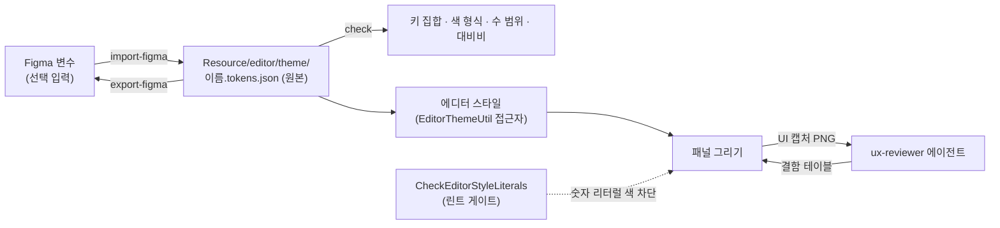

# 에디터 UX 기반

에디터의 색, 간격, 모서리는 테마 토큰 파일 하나에서 나오고, 화면은 캡처로 확인하고, 캡처는 읽기 전용 에이전트가 체크리스트로 점검합니다.
Figma는 이 흐름에 값을 넣어 줄 수 있는 선택 입력입니다. 이 문서는 그 기반이 무엇이고, 어떻게 쓰고, 어디서 틀리기 쉬운지 적습니다.

왜 이렇게 하는가는 세 가지입니다. 첫째, 색을 코드에 숫자로 박으면 라이트 테마나 고대비 테마로 바꿔도 그 색만 남아 글자가 안 보입니다.
둘째, UI 결함은 로그가 초록이어도 화면에서만 보이므로 캡처를 보고 판정할 기준이 글로 있어야 합니다.
셋째, 디자이너가 Figma에서 값을 바꿨을 때 사람이 손으로 옮기면 틀리므로, 옮기는 일은 검사가 붙은 스크립트가 맡습니다.

## 1. 이 기반의 그림



- **토큰 파일이 원본입니다.** `Resource/editor/theme/<이름>.tokens.json` 이 다섯 개(dark, charcoal, midnight, light, highcontrast) 있습니다. 색, 모서리, 간격, 선 두께, 글자 크기, 밀도 배율이 들어 있습니다.
- **Figma는 선택입니다.** Figma에 로그인하지 않아도 토큰 수정, 검사, 캡처, 점검이 모두 동작합니다.
- **코드는 토큰만 읽습니다.** 에디터 코드는 `EditorThemeUtil` 접근자로 값을 얻고, 숫자 리터럴로 색을 만들면 린트가 막습니다.
- **점검은 읽기 전용입니다.** `ux-reviewer` 는 캡처를 보고 결함 테이블만 냅니다. 고치는 일은 사람이나 작업자가 합니다.

## 2. 토큰 도구 따라 하기

모든 명령은 저장소 루트에서 `py -3 -m Scripts editor-theme` 로 시작합니다. 구현은 `Scripts/dev/MakeEditorTheme.py` 입니다.

**검사.** 토큰 파일을 고친 뒤에는 항상 돌립니다.

```
py -3 -m Scripts editor-theme check Resource/editor/theme/*.tokens.json
```

키 집합이 기준(다크 세트와 같은 키)과 다르거나, 색이 대문자 `#RRGGBB` 또는 `#RRGGBBAA` 가 아니거나, 수가 범위를 벗어나면 오류이고 종료 코드가 1입니다.
대비비가 기준 미만이면 경고입니다. 경고도 실패로 세려면 `--fail-on-warning` 을 줍니다.

**Figma에서 가져오기.** 입력은 두 형식 중 하나입니다.

```
py -3 -m Scripts editor-theme import-figma figma.json --set Editor --mode Dark --name dark
py -3 -m Scripts editor-theme import-figma tokens.dtcg.json --set light --name light --display-name "Light"
```

- Figma REST 응답(`GET /v1/files/:key/variables/local`)이면 `--set` 이 컬렉션 이름이고 `--mode` 가 모드 이름입니다. 컬렉션이 하나뿐이면 `--set` 을 생략할 수 있고, 모드를 생략하면 기본 모드를 씁니다.
- DTCG JSON이면 최상위 키가 세트이고 `--set`(또는 `--mode`)로 고릅니다. 최상위가 바로 `color`, `radius` 같은 그룹이면 세트가 하나인 파일로 봅니다.
- 변수 이름은 `color/accent` 나 `color.accent` 형식이고, `_color._accent` 로 대응합니다. `radius/window`, `spacing/windowPaddingX`, `stroke/frame`, `typography/fontSize`, `density` 도 같습니다. 대소문자는 가리지 않습니다.
- 별칭은 따라가서 값을 얻습니다. Figma는 같은 이름의 모드를 먼저 찾고 없으면 대상의 기본 모드를 씁니다. DTCG는 `{color.accent}` 경로를 따릅니다.
- 이름 표에 없는 변수와 값 형식이 틀린 변수는 경고로 출력하고 버립니다. 조용히 넣지 않습니다.
- 출력 파일이 이미 있으면 그 위에 덮어쓰고, 입력에 없는 키는 기존 값을 유지합니다. 없는 파일이면 다크 세트를 바탕으로 만들고, 어떤 키를 다크에서 채웠는지 경고로 알려 줍니다.
- 결과의 키 집합이 다크 세트와 다르면 파일을 쓰지 않고 종료 코드 1로 끝납니다.

**Figma로 내보내기.**

```
py -3 -m Scripts editor-theme export-figma Resource/editor/theme/dark.tokens.json Resource/editor/theme/light.tokens.json --out Saved/figma.dtcg.json
```

세트가 모드가 되도록 최상위 키를 테마 이름으로 둔 DTCG JSON을 씁니다. 색은 `$type: color`, 나머지는 `$type: number` 입니다. 테마의 `_name` 과 `_displayName` 은 세트의 `$extensions.sw.editor` 에 들어가서,
다시 `import-figma` 로 읽으면 같은 파일이 바이트까지 똑같이 나옵니다(테스트 `TestEditorTheme.testCommandsRoundTripThroughFiles`).

**출력 서식.** CRLF 줄 끝, 들여쓰기 4칸, 색은 대문자 16진입니다. 기존 테마 파일과 diff가 생기지 않게 맞춘 것입니다.

## 3. UX 체크리스트

`ux-reviewer` 에이전트와 사람 리뷰어가 같은 기준을 씁니다. 판정은 캡처 1장 기준이고, 숫자는 캡처의 실제 픽셀 크기(밀도 1.0, 글자 16px)에서 잰 값입니다.

| 항목 | 결함으로 보는 기준 |
|---|---|
| 정렬 | 같은 열의 라벨과 입력 위젯의 왼쪽 경계가 1px 넘게 어긋남. 같은 줄 위젯의 세로 중심이 1px 넘게 어긋남. 라벨 열 폭이 같은 패널 안에서 다름 |
| 간격 | 인접 위젯 사이 간격이 토큰 값(`itemSpacing`, `framePadding`, `windowPadding`, 모두 밀도 배율 적용)의 정수배에서 1px 넘게 벗어남. 한 패널 안에서 같은 관계의 간격이 두 가지 이상 |
| 대비 | 본문 글자와 배경 4.5:1 미만. 보조 글자(`textMuted`)도 4.5:1. 큰 글자(18px 이상), 아이콘, 포커스 링은 3:1 미만. 고대비 테마는 글자 7:1 미만 |
| 잘림과 클리핑 | 글자나 아이콘이 컨테이너 경계 밖으로 나가 한쪽이 잘림. 말줄임 표시(`…`)나 툴팁 없이 글자가 사라짐 |
| 겹침 | 서로 다른 위젯의 사각형이 1px 이상 겹침. 글자 위에 다른 위젯이 올라탐 |
| 일관성 | 같은 역할의 버튼 높이가 다름(기준은 글자 크기 + 2 × `framePaddingY`). 같은 목적의 아이콘 크기가 다름. 같은 동작을 패널마다 다른 용어로 부름 |
| 키보드 접근성 | 포커스된 위젯에 3:1 이상, 2px 이상의 포커스 표시가 없음. Tab 순서가 화면 순서(왼쪽에서 오른쪽, 위에서 아래)와 다름. 단축키가 있는 메뉴 항목에 단축키 표기가 없음. 클릭 대상이 24×24px 미만 |
| 빈 상태 | 목록이나 뷰포트가 비었을 때 빈 영역만 보이고, 왜 비었는지와 다음에 할 일이 없음 |
| 오류 상태 | 오류를 색으로만 구분함(아이콘이나 글이 없음). 메시지에 원인이나 해결 방법이 없음. 오류 색이 `error` 토큰이 아님 |
| 하드코딩 색 | 캡처의 색이 어느 테마의 팔레트에도 없고, 코드에서 숫자로 만든 색이 출처임 |

우선순위는 P0(쓸 수 없음: 글자가 안 보이거나 조작이 불가), P1(읽기 어렵거나 오해를 부름), P2(일관성과 정돈), P3(다듬기) 입니다.

수치의 근거는 다음과 같습니다. 대비비 4.5:1과 3:1, 고대비 7:1은 WCAG 2.x의 AA와 AAA 기준이고 `check` 가 같은 식(상대 휘도)으로 계산합니다.
24×24px 클릭 대상은 WCAG 2.2의 2.5.8입니다. 1px 허용 오차는 안티앨리어싱과 정수 좌표 반올림을 감안한 값이고, 토큰이 정수 픽셀이라서 더 느슨하게 잡을 이유가 없습니다.

## 4. Figma 연동

### 사용자가 직접 할 일

인증은 사용자만 할 수 있습니다. 에이전트는 로그인할 수 없습니다.

1. 저장소의 `.mcp.json` 에 `figma` 서버가 이미 있습니다(원격 공식 서버 `https://mcp.figma.com/mcp`, HTTP 전송). 토큰이나 비밀 값은 저장소에 없습니다.
2. Claude Code를 새로 시작하고 `/mcp` 를 입력해 `figma` 를 고른 뒤 Authenticate를 선택합니다. 브라우저가 열리면 Figma 계정으로 로그인하고 Allow Access를 누릅니다(OAuth).
3. 연결되면 `/mcp` 목록에서 `figma` 가 connected로 보입니다.

데스크톱 앱의 Dev Mode MCP 서버는 대안입니다. 조직이나 엔터프라이즈 요건이 있을 때를 위한 것이고, 데스크톱 앱이 켜져 있어야 합니다. 로컬 주소는 `http://127.0.0.1:3845/mcp` 이고
`claude mcp add --transport http figma-desktop http://127.0.0.1:3845/mcp` 로 개인 설정에 추가합니다. 저장소 `.mcp.json` 에는 넣지 않았습니다.

### 인증 없이도 모두 동작합니다

토큰 파일이 원본이므로 Figma 연결은 없어도 됩니다. 인증하지 않으면 `figma` 서버가 연결되지 않을 뿐이고, `editor-theme` 명령, 린트, 캡처, `ux-reviewer` 에는 영향이 없습니다.
Figma 값이 필요하면 사용자가 변수 JSON을 내려받아 `import-figma` 에 주면 됩니다(REST 응답이나 플러그인으로 내보낸 DTCG).

### 확인한 것과 추정한 것

확인한 것(Figma 개발자 문서에서 읽음):

- 원격 서버 주소는 `https://mcp.figma.com/mcp` 이고, Claude Code에서는 `claude mcp add --transport http figma https://mcp.figma.com/mcp` 로 추가하며 `/mcp` 에서 Authenticate를 합니다.
- 데스크톱 서버 주소는 `http://127.0.0.1:3845/mcp` 입니다.
- 읽기 도구 이름: `get_design_context`(레이어나 선택의 스타일과 구조), `get_variable_defs`(선택에서 쓰인 변수와 스타일), `get_screenshot`, `get_metadata`(ID, 이름, 타입, 크기 개요), `search_design_system`, `get_libraries`.
  이 문서의 절차는 `get_variable_defs` 와 `get_design_context` 를 씁니다. `get_code` 라는 도구는 없습니다.
- Figma 도움말은 변수의 JSON 가져오기와 내보내기를 기본 기능으로 소개하지 않고, 플러그인으로 만들 수 있다고만 적습니다. REST API에는 변수 조회, 생성, 수정, 삭제 엔드포인트가 있습니다.

추정한 것(직접 시험하지 못함):

- Figma 변수의 REST 응답 모양(`meta.variables`, `meta.variableCollections`, `valuesByMode`, `VARIABLE_ALIAS`, 색 `{r,g,b,a}` 0에서 1)은 REST 문서에 대한 지식에 따랐고, 실제 계정의 응답으로 확인하지 않았습니다.
  테스트는 같은 모양으로 직접 만든 응답을 씁니다.
- `export-figma` 가 쓰는 DTCG JSON을 Figma에 가져오는 방법은 확인하지 못했습니다. Figma가 직접 읽지는 않을 가능성이 높고, DTCG를 읽는 변수 가져오기 플러그인(예: Tokens Studio 계열)을 거칠 것으로 추정합니다.
  그래서 수 값은 단위 문자열 대신 `number` 로 썼습니다. 가져오기가 안 되면 형식을 플러그인에 맞춰 바꿉니다.
- 변수 REST 엔드포인트가 모든 요금제에서 열려 있는지는 확인하지 못했습니다. 막혀 있으면 MCP의 `get_variable_defs` 결과를 DTCG 모양으로 옮겨 `import-figma` 에 주는 방법이 남습니다.
- 원격 서버가 Figma 링크의 노드 ID로 프레임을 고르는지, 데스크톱 선택에 의존하는지는 확인하지 못했습니다. 첫 사용 때 프레임 링크를 붙여 넣어 시험합니다.

## 5. 에이전트 절차

디자인 프레임을 보고 패널을 고칠 때의 순서입니다. 1과 2는 Figma 인증이 있을 때만 합니다.

1. **프레임을 읽습니다.** MCP의 `get_design_context` 로 구조와 스타일을, `get_variable_defs` 로 쓰인 변수를, `get_screenshot` 으로 기준 이미지를 얻습니다.
2. **토큰으로 옮깁니다.** 변수가 토큰 이름(`color/accent` 등)과 맞으면 변수 JSON으로 `import-figma` 를 돌립니다. 경고로 나온 모르는 변수는 토큰을 새로 더할지 사람에게 묻습니다. 임의로 키를 만들지 않습니다.
3. **패널을 고칩니다.** 색, 간격, 모서리는 `EditorThemeUtil` 접근자로만 읽습니다. 필요한 값이 토큰에 없으면 토큰 파일 다섯 개와 접근자에 같은 커밋에서 키를 더합니다.
4. **캡처로 확인합니다.** `App --EnableEditor -gv_screenshotEditor=<경로>.png` 로 에디터 UI를 PNG로 저장합니다. 자동 시나리오에서는 단계 `<CaptureEditorUI file="..."/>` 를 씁니다.
   두 이름은 통합 담당이 만드는 기능의 이름이며 이 문서를 쓴 시점에는 구현되어 있지 않습니다. GPU와 창을 쓰므로 GPU 잠금을 잡고 실행합니다(`gpu-verifier` 에이전트가 맡을 수 있습니다).
5. **점검을 시킵니다.** `ux-reviewer` 에이전트에 캡처 경로와 패널 이름을 줍니다. 보고는 `우선순위 | 패널 | 캡처 파일 | 결함 | 근거(좌표/영역) | 제안` 테이블입니다.
   P0과 P1은 고치고 다시 4로 돌아갑니다.
6. **마무리합니다.** `editor-theme check` 와 `CheckEditorStyleLiterals` 가 통과하는지 봅니다.

## 6. 린트: 숫자 리터럴 색 차단

`Scripts/lint/gate/CheckEditorStyleLiterals.py` 가 `Source/Editor/**` 와 `Source/GameFramework/PlugIn/Editor/**` 의 `.cpp`, `.h` 를 봅니다.

- 막는 것: `IM_COL32(`, 첫 인자가 숫자인 `ImVec4(` 와 `Color{`, `Color(`, `Color::fromBytes(`, 값에 숫자 리터럴이 들어간 `ImGui::PushStyleColor(` 와 `ImGui::PushStyleVar(`(`ImVec2(4, 4)` 포함). 주석과 문자열은 보지 않습니다.
- 제외하는 것: 테마를 구현하는 파일(`EditorThemeUtil`, `EditorColorUtil`, `EditorThemeTokens`). 값을 만드는 곳이기 때문입니다.
- 커밋 훅은 그 커밋이 추가한 줄만 검사하고 병합 커밋은 건너뜁니다. 전체 훑기(`ctest -L lint`, `lint-suite`)는 건수가 기준선보다 늘면 실패합니다.
- 기준선은 `Scripts/lint/rules/CheckEditorStyleLiterals.toml` 의 `total` 이고 현재 174건입니다. 기존 위반을 토큰으로 옮겨 건수가 줄면 기준선도 같이 낮춥니다.

## 7. 함정과 주의

- **새 테마를 가져올 때 입력에 없는 키는 다크 값으로 채워집니다.** 그 사실은 경고 한 줄로만 나오므로 경고를 읽습니다. 라이트 테마에 다크 색이 섞이면 `check` 의 대비 경고로 드러납니다.
- **Figma의 알파는 `#RRGGBBAA` 로 들어옵니다.** 흰색 5% 같은 오버레이 색(`tableRowBgAlt`)은 알파가 있어야 의미가 있으니 알파를 버리는 도구를 거치지 않습니다.
- **대비비 검사는 불투명 색 기준입니다.** 알파가 있는 전경은 창 배경 위에 올려 계산하지만, 알파가 있는 배경 위의 글자는 계산하지 않습니다. 그런 조합은 캡처로 확인합니다.
- **`check` 의 대비 경고는 세 쌍만 봅니다.** `text` 대 `windowBg`, `panelBg`, `frameBg` 와 `textMuted` 대 `windowBg` 입니다. 강조색 위의 글자나 `headerBg` 위의 글자는 사람이 봅니다.
- **캡처는 해상도와 DPI를 적습니다.** 밀도 배율이나 DPI가 다르면 간격 기준(토큰의 정수배)이 달라지므로, 점검 보고에 캡처 조건이 없으면 판정을 믿지 않습니다.
- **`ux-reviewer` 는 눈으로 보는 점검입니다.** 1px 단위 판정은 축소된 이미지에서 틀립니다. 원본 크기의 PNG를 주고, 판정 불가 항목은 판정 불가로 적게 합니다.
- **토큰 키를 더하면 다섯 곳이 같이 바뀝니다.** 토큰 파일 다섯 개, C++ 로더의 구조체, `Scripts/dev/MakeEditorTheme.py` 의 `kSchema`, 접근자입니다. 하나만 바꾸면 `check` 가 키 집합 오류로 알려 줍니다.

## 8. 감사 결과

작성 예정.

## 9. 더 볼 곳

| 무엇 | 어디 |
|---|---|
| 토큰 원본 | `Resource/editor/theme/` |
| 토큰 도구 | `Scripts/dev/MakeEditorTheme.py`, 테스트 `Test/PythonTest/TestEditorTheme.py` |
| 린트 게이트 | `Scripts/lint/gate/CheckEditorStyleLiterals.py` |
| 점검 에이전트 | `.claude/agents/ux-reviewer.md` |
| Figma MCP 설정 | `.mcp.json` |
| 결정의 이유 | [결정 기록](../09_Decisions.md) 5-11절 |
| 작업 방식과 에이전트 | [작업 방식](../11_Workflow.md) 9절 |
