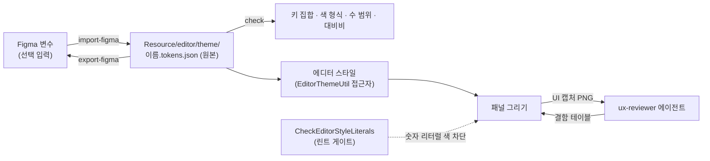

# 에디터 UX 기반

> 상태: 참고 · 선행: 없음 · 영역: editor · 옛번호: D3-12 · 진행: 해당없음

에디터의 색, 간격, 모서리는 테마 토큰 파일 하나에서 나오고, 화면은 캡처로 확인하고, 캡처는 읽기 전용 에이전트가 체크리스트로 점검합니다. Figma는 이 흐름에 값을 넣어 주는 선택 입력입니다.
이유: 색을 코드에 숫자로 박으면 테마를 바꿔도 그 색만 남아 글자가 안 보이고, UI 결함은 로그가 초록이어도 화면에서만 보이므로 캡처 판정 기준이 글로 있어야 하며, Figma 값을 손으로 옮기면 틀리므로 검사가 붙은 스크립트가 맡습니다.

## 1. 이 기반의 그림



- **토큰 파일이 원본입니다.** `Resource/editor/theme/<이름>.tokens.json` 다섯 개(dark, charcoal, midnight, light, highcontrast)에 색, 모서리, 간격, 선 두께, 글자 크기, 밀도 배율이 있습니다.
- **Figma는 선택입니다.** 로그인하지 않아도 토큰 수정, 검사, 캡처, 점검이 동작합니다.
- **코드는 토큰만 읽습니다.** `EditorThemeUtil` 접근자로 값을 얻고, 숫자 리터럴로 색을 만들면 린트가 막습니다.
- **점검은 읽기 전용입니다.** `ux-reviewer` 는 결함 테이블만 냅니다.

## 2. 토큰 도구 따라 하기

저장소 루트에서 `py -3 -m Scripts editor-theme ...` (구현 `Scripts/dev/MakeEditorTheme.py`).

**검사.** 토큰 파일을 고친 뒤 항상 돌립니다.

```
py -3 -m Scripts editor-theme check Resource/editor/theme/*.tokens.json
```

키 집합이 다크 세트와 다르거나, 색이 대문자 `#RRGGBB` · `#RRGGBBAA` 가 아니거나, 수가 범위를 벗어나면 오류(종료 1). 대비비 미달은 경고(`--fail-on-warning` 으로 실패로 센다).

**Figma에서 가져오기.**

```
py -3 -m Scripts editor-theme import-figma figma.json --set Editor --mode Dark --name dark
py -3 -m Scripts editor-theme import-figma tokens.dtcg.json --set light --name light --display-name "Light"
```

- Figma REST 응답(`GET /v1/files/:key/variables/local`)이면 `--set` 이 컬렉션, `--mode` 가 모드 이름(컬렉션이 하나면 생략 가능). DTCG JSON이면 최상위 키가 세트다.
- 변수 이름은 `color/accent` 나 `color.accent` 형식이고 `_color._accent` 로 대응합니다(`radius/window`, `spacing/windowPaddingX`, `stroke/frame`, `typography/fontSize`, `density` 도 같다, 대소문자 무시). 별칭은 따라갑니다.
- 이름 표에 없거나 값 형식이 틀린 변수는 경고로 출력하고 버립니다. 출력 파일이 있으면 입력에 없는 키는 기존 값을 유지하고, 없으면 다크 세트를 바탕으로 만들며 다크에서 채운 키를 경고로 알립니다. 결과의 키 집합이 다크와 다르면 파일을 쓰지 않고 종료 1.

**Figma로 내보내기.**

```
py -3 -m Scripts editor-theme export-figma Resource/editor/theme/dark.tokens.json Resource/editor/theme/light.tokens.json --out Saved/figma.dtcg.json
```

테마 이름을 최상위 키로 둔 DTCG JSON(색은 `$type: color`, 나머지 `number`)을 씁니다. 다시 `import-figma` 로 읽으면 바이트까지 같습니다(`TestEditorTheme.testCommandsRoundTripThroughFiles`). 출력 서식은 CRLF, 들여쓰기 4칸, 대문자 16진입니다.

## 3. UX 체크리스트

`ux-reviewer` 와 사람 리뷰어가 같은 기준을 씁니다. 판정은 캡처 1장 기준이고 숫자는 실제 픽셀(밀도 1.0, 글자 16px)입니다.

| 항목 | 결함으로 보는 기준 |
|---|---|
| 정렬 | 같은 열의 라벨과 입력 위젯의 왼쪽 경계가 1px 넘게 어긋남. 같은 줄 위젯의 세로 중심이 1px 넘게 어긋남. 라벨 열 폭이 같은 패널 안에서 다름 |
| 간격 | 인접 위젯 사이 간격이 토큰 값(`itemSpacing`, `framePadding`, `windowPadding`, 밀도 배율 적용)의 정수배에서 1px 넘게 벗어남. 한 패널 안에서 같은 관계의 간격이 두 가지 이상 |
| 대비 | 본문 글자와 배경 4.5:1 미만. 보조 글자(`textMuted`)도 4.5:1. 큰 글자(18px 이상), 아이콘, 포커스 링은 3:1 미만. 고대비 테마는 글자 7:1 미만 |
| 잘림과 클리핑 | 글자나 아이콘이 컨테이너 밖으로 나가 잘림. 말줄임 표시나 툴팁 없이 글자가 사라짐 |
| 겹침 | 서로 다른 위젯의 사각형이 1px 이상 겹침 |
| 일관성 | 같은 역할의 버튼 높이가 다름(기준은 글자 크기 + 2 × `framePaddingY`). 같은 목적의 아이콘 크기가 다름. 같은 동작을 패널마다 다른 용어로 부름 |
| 키보드 접근성 | 포커스 표시(3:1 이상, 2px 이상)가 없음. Tab 순서가 화면 순서와 다름. 단축키 메뉴 항목에 표기가 없음. 클릭 대상이 24×24px 미만 |
| 빈 상태 | 비었을 때 이유와 다음 할 일이 없음 |
| 오류 상태 | 색으로만 구분함. 메시지에 원인이나 해결 방법이 없음. 오류 색이 `error` 토큰이 아님 |
| 하드코딩 색 | 캡처의 색이 어느 테마 팔레트에도 없고 코드의 숫자 색이 출처임 |

우선순위: P0(쓸 수 없음), P1(읽기 어렵거나 오해를 부름), P2(일관성과 정돈), P3(다듬기).
근거: 4.5:1 · 3:1 · 7:1 은 WCAG 2.x AA · AAA(`check` 가 같은 상대 휘도 식), 24×24px 는 WCAG 2.2 의 2.5.8, 1px 허용은 안티앨리어싱과 정수 좌표 반올림 때문입니다.

## 4. Figma 연동

인증은 사용자만 할 수 있습니다. `.mcp.json` 에 `figma` 서버(원격 `https://mcp.figma.com/mcp`, HTTP)가 이미 있고 비밀 값은 없습니다. Claude Code 를 새로 시작해 `/mcp` 에서 `figma` 를 고르고 Authenticate(OAuth)합니다. 데스크톱 Dev Mode MCP(`http://127.0.0.1:3845/mcp`, `claude mcp add --transport http figma-desktop …`)는 조직 요건이 있을 때의 대안이고 저장소에는 넣지 않았습니다.
인증하지 않으면 `figma` 서버가 연결되지 않을 뿐 `editor-theme` 명령, 린트, 캡처, `ux-reviewer` 에는 영향이 없습니다. Figma 값이 필요하면 변수 JSON을 내려받아 `import-figma` 에 줍니다.

- 읽기 도구(문서에서 확인): `get_design_context`, `get_variable_defs`, `get_screenshot`, `get_metadata`, `search_design_system`, `get_libraries`. 이 문서의 절차는 앞의 둘을 쓴다(`get_code` 도구는 없다). Figma 도움말은 변수 JSON 가져오기 · 내보내기를 기본 기능으로 소개하지 않는다.
- 추정(직접 테스트하지 못함): REST 응답 모양(`meta.variables`, `valuesByMode`, `VARIABLE_ALIAS`, 색 `{r,g,b,a}` 0 ~ 1)은 REST 문서 지식에 따랐고 테스트는 같은 모양의 직접 만든 응답을 쓴다. `export-figma` 의 DTCG 를 Figma 에 가져오는 길은 DTCG 를 읽는 플러그인(Tokens Studio 계열)을 거칠 것으로 추정한다(안 되면 형식을 플러그인에 맞춘다). 변수 REST 가 모든 요금제에서 열려 있는지와, 원격 서버가 링크의 노드 ID 로 프레임을 고르는지는 첫 사용 때 확인한다(막혀 있으면 `get_variable_defs` 결과를 DTCG 모양으로 옮겨 `import-figma`).

## 5. 에이전트 절차

디자인 프레임을 보고 패널을 고칠 때의 순서입니다. 1과 2는 Figma 인증이 있을 때만 합니다.

1. **프레임을 읽습니다.** `get_design_context` · `get_variable_defs` · `get_screenshot`.
2. **토큰으로 옮깁니다.** 변수가 토큰 이름과 맞으면 `import-figma`. 경고로 나온 모르는 변수는 토큰을 새로 더할지 사람에게 묻고, 임의로 키를 만들지 않습니다.
3. **패널을 고칩니다.** 색, 간격, 모서리는 `EditorThemeUtil` 접근자로만 읽습니다. 값이 토큰에 없으면 토큰 파일 다섯 개와 접근자에 같은 커밋에서 키를 더합니다.
4. **캡처로 확인합니다.** `App -EnableEditor -gv_screenshotEditor=<경로>.png`(`-gv_screenshotEditorFrame=N`, 기본 60). 자동 시나리오는 `<CaptureEditorUI file="..." maxMagentaFraction="0" maxClippedWindows="N"/>`(6절). 패널 전체는 `engine/automation/editor/uiaudit.scenario.xml`(GPU 잠금 공유, `gpu-verifier` 가 맡을 수 있다).
5. **점검을 시킵니다.** `ux-reviewer` 에 캡처 경로와 패널 이름을 줍니다. 보고는 `우선순위 | 패널 | 캡처 파일 | 결함 | 근거(좌표/영역) | 제안` 테이블이고 P0 · P1 은 고치고 4로 돌아갑니다.
6. **마무리합니다.** `editor-theme check` 와 `CheckEditorStyleLiterals` 통과.

## 6. 에디터 UI 캡처의 원리

`-gv_screenshot` 과 `<Screenshot>` 은 주 출력만 담고 ImGui 는 담지 못합니다. 창을 전경으로 올려 화면을 복사하는 방식은 사용자 화면을 훔치고 다른 창이 섞이므로 쓰지 않습니다. 렌더 스레드가 그 프레임의 **최종 ImGui 그리기 목록**을 오프스크린 타깃에 한 번 더 그려 읽습니다(`EditorUICapture`).

- **플로팅 창까지 담습니다.** 멀티 뷰포트의 정점이 OS 화면 좌표라 메인과 플로팅 뷰포트의 목록을 한 그리기 데이터로 이어 붙이고 표시 영역을 모두를 감싸는 사각형으로 둡니다(창 사이 바탕은 검정).
- **네 백엔드가 같습니다.** 같은 ImGui 렌더러 백엔드 · 백버퍼 포맷이고 OpenGL 은 읽은 뒤 뒤집습니다. 창 위치 · 가림 · 포커스와 무관합니다.
- **지표 둘.** `maxMagentaFraction`(마젠타 R≥230 · B≥230 · G≤40 비율 상한 — 빠진 텍스처), `maxClippedWindows`(내용이 창보다 큰데 그 방향 스크롤바가 없는 창의 상한, 실패 줄과 로그 `Editor UI capture` 에 이름).
- **골든(그림 비교)은 하지 않습니다.** 글꼴 래스터와 DPI 가 기계마다 다르기 때문입니다. 같은 기계 전후 비교는 PNG 를 사람이나 `ux-reviewer` 가 봅니다.

## 6-1. 린트: 숫자 리터럴 색 차단

`Scripts/lint/gate/CheckEditorStyleLiterals.py` 가 `Source/Editor/**` 와 `Source/GameFramework/PlugIn/Editor/**` 의 `.cpp`, `.h` 를 봅니다.

- 막는 것: `IM_COL32(`, 첫 인자가 숫자인 `ImVec4(` 와 `Color{`, `Color(`, `Color::fromBytes(`, 값에 숫자 리터럴이 든 `ImGui::PushStyleColor(` · `PushStyleVar(`. 주석과 문자열은 보지 않는다. 테마 구현 파일(`EditorThemeUtil`, `EditorColorUtil`, `EditorThemeTokens`)은 제외.
- 커밋 훅은 추가한 줄만 검사하고 병합 커밋은 건너뜁니다. 전체 훑기(`ctest -L lint`, `lint-suite`)는 건수가 기준선(`Scripts/lint/rules/CheckEditorStyleLiterals.toml` 의 `total`, 현재 171)보다 늘면 실패합니다. 위반을 토큰으로 옮기면 기준선도 낮춥니다.

## 7. 함정과 주의

- **새 테마를 가져올 때 입력에 없는 키는 다크 값으로 채워집니다**(경고 한 줄뿐). 라이트에 다크 색이 섞이면 `check` 의 대비 경고로 드러납니다.
- **Figma의 알파는 `#RRGGBBAA` 로 들어옵니다.** `tableRowBgAlt` 같은 오버레이는 알파가 있어야 의미가 있으니 알파를 버리는 도구를 거치지 않습니다.
- **대비비 검사는 불투명 색 기준이고 세 쌍만 봅니다.** `text` 대 `windowBg` · `panelBg` · `frameBg` 와 `textMuted` 대 `windowBg`. 알파 배경 위 글자, 강조색 · `headerBg` 위 글자는 캡처로 봅니다.
- **캡처는 해상도와 DPI를 적습니다.** 조건이 없으면 점검 판정을 믿지 않습니다.
- **`ux-reviewer` 는 눈으로 보는 점검입니다.** 1px 판정은 축소 이미지에서 틀리므로 원본 크기 PNG 를 주고 판정 불가 항목은 판정 불가로 적게 합니다.
- **토큰 키를 더하면 다섯 곳이 같이 바뀝니다.** 토큰 파일 다섯 개, C++ 로더 구조체, `MakeEditorTheme.py` 의 `kSchema`, 접근자(하나만 바꾸면 `check` 가 키 집합 오류로 알린다).

## 8. 감사 결과

### 8-1. 첫 감사(2026-10-15)

`uiaudit.scenario.xml`(DX12, 1600x900, 밀도 1.0)로 패널 39 개 + 기본 배치 테마 셋 × 백엔드 넷, 52 장을 점검했다. 마젠타는 모든 장 0, 네 백엔드 기본 배치는 FPS · RHI 이름 · 로그 줄 수 말고 같다. 잘린 창(측정)은 Hierarchy(+319px) · Inspector · Output Log · Profiler · UI Preview 처럼 가로로 넘쳐 스크롤바 없이 잘리는 것이 많다. 같은 묶음에서 P0 지역화 키 노출 · 빈 상태 줄바꿈 · Prefab Editor 버튼 폭 · Output Log 오류 칩 색 · 라이트 `_headerBg` 를 고쳤다.

남은 결함(옛 `D3-12`). `maxClippedWindows` 는 메뉴 바 · 플레이 툴바의 작은 넘침(세로 +24, 가로 +8)을 아직 센다 — 넘친 양의 문턱을 정해 단언에 쓸 수 있게 한다. 라이트 · 고대비 대비는 `editor-theme check` 의 대비 쌍을 늘려 잡는다. 큰 것부터:

| 우선순위 | 패널 | 결함 |
|---|---|---|
| P0 고침 | Output Log · Content Browser(아래 도크) | 아래 도크 높이를 비율(0.28)이 아니라 글자 높이의 16 배(`kBottomDockTextLines`)로 정했다. `defaultlayout` 시나리오가 `Editor.PanelContentLines` 8 줄 이상을 지킨다(통합에서 측정 확인 필요) |
| P0 고침 | Scene(뷰포트) | HUD 상자 기본값을 껐다(`EditorPreferences::_bShowHUD`). 켜는 것은 툴바 HUD 단추다. `debughudcontrols` 가 직접 켠다 |
| P1 | 도킹 탭 줄 · Profiler 하위 탭 | 탭이 많으면 제목이 말줄임으로 뭉개진다. Profiler 표 헤더의 단위가 사라진다 |
| P1 | Hierarchy | 이름이 말줄임 · 툴팁 · 가로 스크롤 없이 잘린다 |
| P1 | Keyboard Shortcuts · Global Variables · Data Table · Project Settings · Modules | 열 폭 · 콤보 폭이 좁아 말줄임 없이 잘린다. Global Variables 는 Reset 열이 창 밖이다 |
| P1 | Preferences · User Settings | 필드 이름이 내부 변수명이고 `_uiScale = 0.00` 의 뜻 설명이 없다 |
| P1 | Input Map Editor | 경로 상자가 잘리고 라벨과 상자의 세로 중심이 어긋난다 |
| P1 | Audio Mixer | 이벤트 콤보가 잘리고, 채널 슬라이더 높이가 채널마다 다르며, 재생 전 `-inf dB` 에 설명이 없다 |
| P1 | 라이트 테마 | 프리팹 인스턴스 이름(연한 파랑)과 로그의 파란 태그가 흰 바탕에서 대비가 낮다 |
| P1 | 고대비 테마 | 꺼진 토글과 `Error` 칩의 대비가 낮다 |
| P2 | Scene 툴바 | `Rot Snap 15 (` 콤보 값이 잘리고 `5.0` 슬라이더 값이 막대에 가린다. 아래 아이콘 툴바는 켜짐 · 꺼짐 구분이 약하다 |
| P2 | 용어 | 되돌리기가 `Reset` · `Revert` · `Revert All to Default` 로 패널마다 다르다 |
| P3 | History · Catalog Editor · Multiplayer | 빈 영역에 이유와 다음 행동이 없다 |

판정 불가: Tab 순서와 포커스 표시, 메뉴의 단축키 표기, 클릭 대상 24px 실측, 오류 상태(해당 캡처 없음).

## 9. 더 볼 곳

| 무엇 | 어디 |
|---|---|
| 토큰 원본 | `Resource/editor/theme/` |
| 토큰 도구 | `Scripts/dev/MakeEditorTheme.py`, 테스트 `Test/PythonTest/TestEditorTheme.py` |
| 린트 게이트 | `Scripts/lint/gate/CheckEditorStyleLiterals.py` |
| 점검 에이전트 | `.claude/agents/ux-reviewer.md` |
| Figma MCP 설정 | `.mcp.json` |
| 결정의 이유 | [결정 기록](../09_Decisions.md) 5-11절 |
| 작업 방식과 에이전트 | [에이전트와 토큰](../12_Agents.md) |
